# VB-AUDIO CABLE REFERENCE MANUAL

Virtual Audio Device working as Virtual Audio Cable

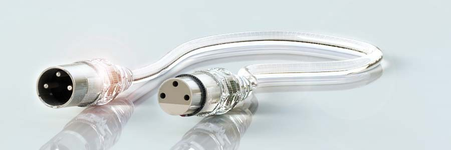

# Introduction

VB-CABLE is a Windows Audio Driver (without hardware) so called Virtual Audio Driver working as a simple Virtual Audio Cable transporting audio signal from its input to its output. Then it allows connecting two applications together, a player application to a recorder application.

The VB-CABLE is present in the system like any other audio devices. It is presenting all audio interfaces: MME / WASAPI / KS / Direct X as a playback and recording point.

  

  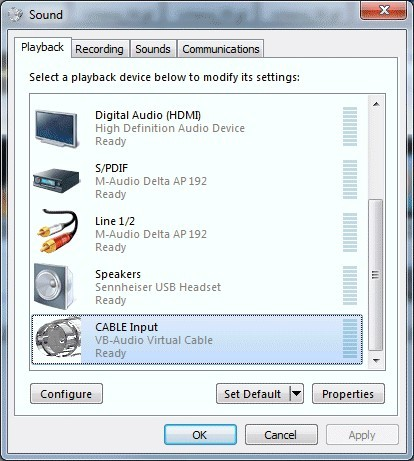
    
Playback device (the CABLE Input) can be configured like speaker in different mode (from mono to 7:1 home cinema setup) and supports 44.1 kHz to 96 or 192 kHz sample rate (16bits or 24bits resolution). 
    

    
Like a regular audio device, the CABLE input can be set as system preferred / default device and can be used by several client applications in the same time. 
    

  

  

  

  

  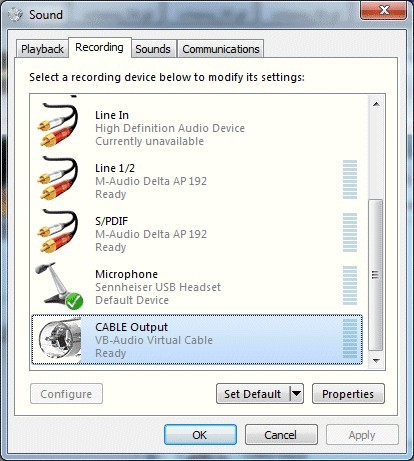
    
Recording Device (the CABLE output) can also be configured by properties dialog box and supports 44.1 kHz to 96 or 192 kHz samplerate (16bits or 24bits resolution). 
    

    
This CABLE output is simply providing signal coming in the other side (the CABLE input). 
    

  

## The simplest Virtual Audio Cable

The VB-CABLE is the simplest Virtual Audio Cable, because it takes all audio formats as input and does the conversion for output if needed, automatically. In other words, the VB- CABLE is expected to work in any scenario, without having to configure it. Player application can send audio to the CABLE input in any audio format (16 or 24 bits, 44.1 to 192 kHz, 1 to 8 channels) and the Recorder application can capture audio from the Cable output in any other audio format as well.

# Install VB-Cable 

VB-CABLE can be installed on all Windows from XP SP2 to latest Win11 32 or 64 bits. And for Win10/11 Arm64. The setup program will install the right driver for your current O/S automatically.

**STEP 1**: Extract all files from the zip to a temporary local folder (on system disc). The setup program cannot be launched directly from de zip package, because require access to all uncompressed files.

**STEP 2**: Run setup program in Administrator mode (Right click on exe file to get the menu):

- VBCABLE_Setup_x64.exe for 64bits O/S .
- VBCABLE_Setup.exe for 32bits O/S .

**STEP 3**: Follow instruction and wait for the end of the process. Restart your computer after installation (Restart after uninstallation too).

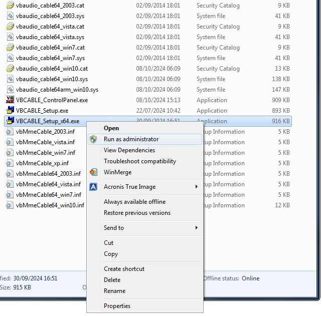

# Uninstall VB-Cable

If the VB-CABLE is already installed, the setup program will propose you to remove the driver (instead of installing it).

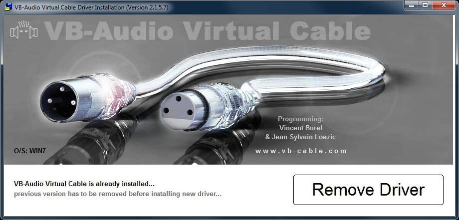

Don't forget to restart your computer after to let Windows finalize the uninstallation. If the driver is not removed after that, you will have to remove it manually by the Windows Device Manager:

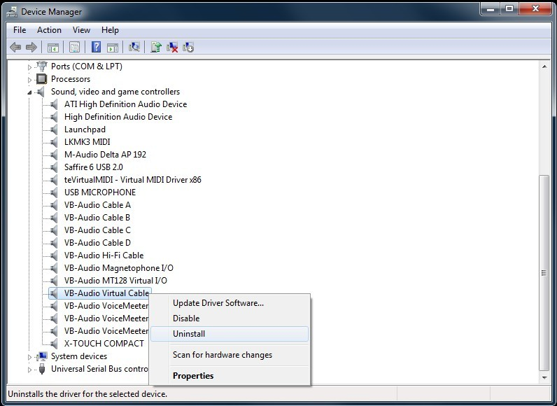

# Set VB-Cable as default device

After installation, you can set or check your default audio device. With Windows 10 and higher, the last installed audio driver can be automatically set as default device and it's maybe not what you want.

  

    
All PC Sound will come in VB-CABLE input (so you will not hear any sound anymore).

  

  

  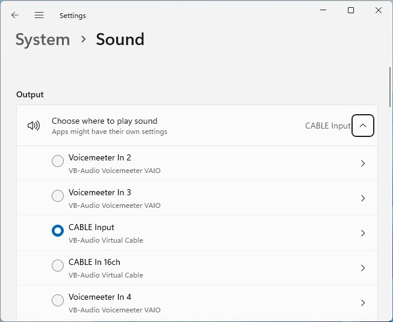
  

  

    
Default playback device can also be set in Windows Sound Dialog box (playback tab).

  

  

  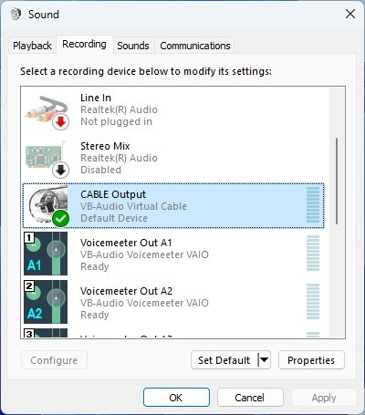
  

  

  

  

    
Your default microphone will be the VB-CABLE output (so all audio sent to VB-CABLE input).

  

  

  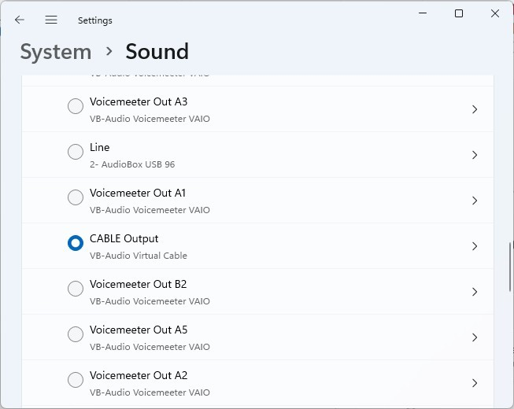
  

  

    
Default recording device can be selected in Windows Sound Dialog box (recording tab)

  

  

  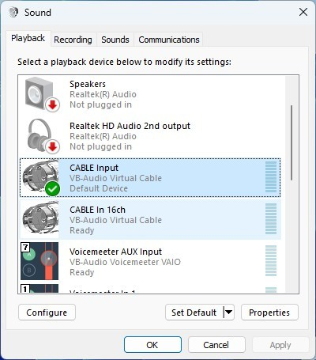
  

VB-CABLE for Win10/11 x64/Arm64 installs 2x different inputs. The first is a speaker playback device (that can be setup with configure button) limited to 8 channel (7.1 speaker config). The Second CABLE input is a Line Out pin able to manage up to 16 channels. Both are setup in stereo 48 kHz by default.

# Set VB-Cable Audio format

The VB-CABLE default format is stereo 48 kHz (for Win10/11) and stereo 44.1 kHz for previous version. The VB-CABLE input or output format can be changed by application connected to it, but most of applications are using the current defined format. So it can be useful to change the audio format, especially the number of channels and the sample rate if needed.

For "Speaker" pin, the channel number can be configured by the **configure** button.

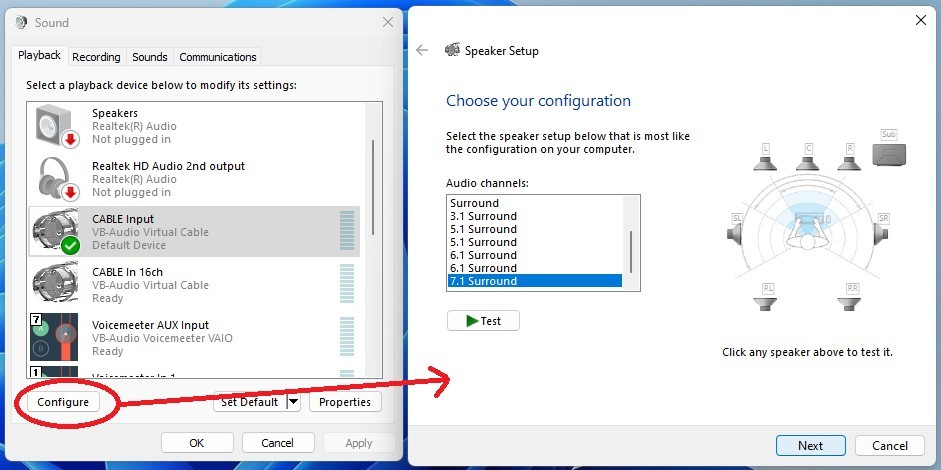

For a "Line Out" pin, the channel number must be defined with the default audio format in advanced properties (both cable inputs cannot be used in the same time):

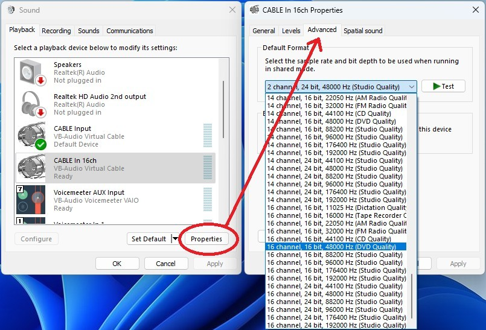

VB-CABLE recording devise is a "Line In" pin so the channel number must also be defined with the default audio format in advanced properties:

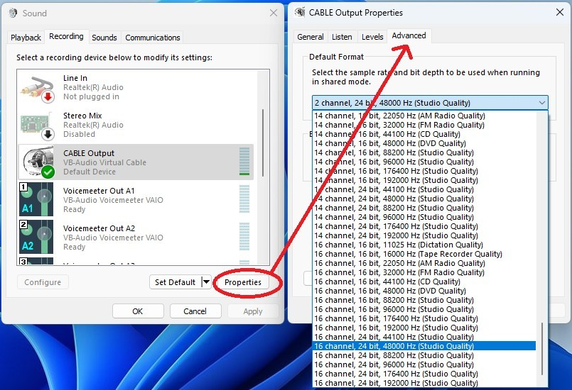

VB-CABLE previous version (XP to Win7) is limited to 8 channels. The 8 channels are also present on VB-CABLE output (recording device) but can be used with MME under XP only. MME is limited to stereo from Vista. But the 8 channels are available though KS interface. WIN10/11 version provides 8 channels (or up to 16) for all interface (MME, WASAPI, KS).

REM: VB-Audio Matrix coconut is able to manage Windows Audio device offering more than 8 channels (up to 64 channels).

# VB-Cable Control Panel

The VB-Cable Control Panel application can be found in the ZIP package or in the installation folder:

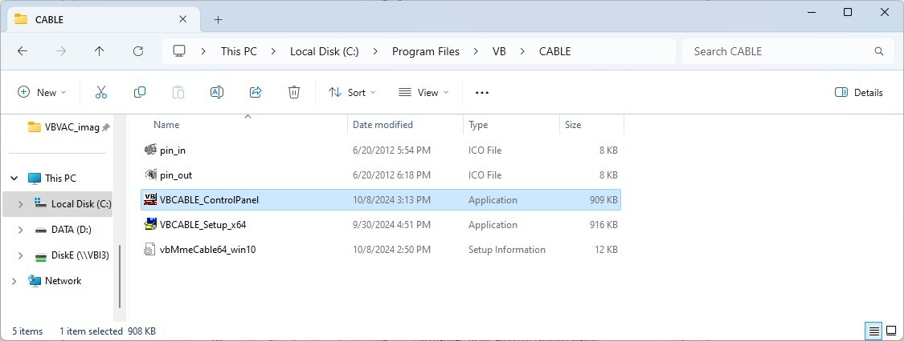

The VB-CABLE control panel is basically made to help in some particular cases, or in order to improve audio quality or real time streaming aspects, VB-CABLE control panel allows setting two important system parameters: the **Max Latency** (pipe size) and **internal sample rate** (called 'Internal SR').

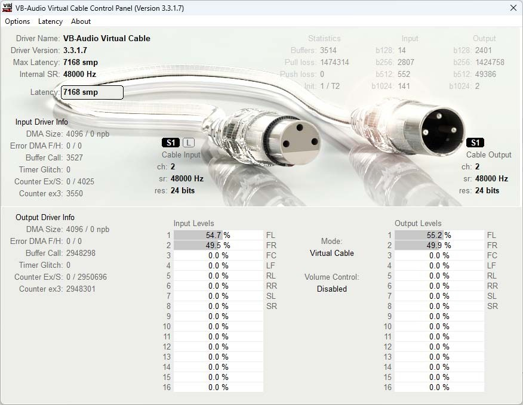

VB-CABLE Control Panel shows current system parameters (top-Left):

- **Driver Name:** VB-Audio Virtual Cable
- **Driver Version:** 3.3.1.7
- **Max Latency:** 7168 (is the max allocated memory on driver init).
- **Internal SR:** 48000 Hz (the working samplerate of the cable).
- **Latency:** 7168 (can be changed on the fly to improve latency).

Input / Output current settings show the current windows audio format configuration or the audio format used by connected client applications (applications might set/change i/o format, pending on O/S version and audio interface type used by them).

- **S0, S1**... number or system stream connected
- **L** : Loopback in use.

VB-CABLE Control Panel also shows statistics related to buffering, helpful to optimize latency. These statistics are simple counters for different buffer size:

b128 = number of buffer above or equal to 128 samples = nb buffers < 256 samples.  
b256 = number of buffer above or equal to 256 samples = nb buffers < 512 samples.  
b512 = number of buffer above or equal to 512 samples = nb buffers < 1024 samples.

Operating System can use different buffer size for streaming audio. In the picture above we can see that the cable input (which is a playback audio device) has been fed with 128 samples buffers as well as 256, 512 or 1024 samples buffers. To be precise, this statistics mean that VB-CABLE has received buffer with a size between 128 and more than 1024 samples.

Input driver info and Output driver info are for debugging purpose. Error DMA F/H must be 0 / 0\.

## Configuring Internal Sample rate

VB-CABLE works internally with a fixed Samplerate (given by Internal SR). It allows managing any audio sample rate format on input and output (independently). Then a DVD Player can send 48 kHz sound on VB-Cable input while another audio application can record at 44.1 kHz on VB-Cable Output. Conversion is automatically made by VB-CABLE.

  

  
  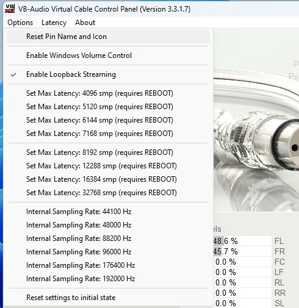
  

  

  

    
The main menu allows to set different options.

    
7168 as default buffer size is usually enough for any usual workflow because it guarantees a stable stream if connected applications are using buffer size below 2048 samples. However this can be not enough for high samplerate use cases (e.g. 192 kHz).
    

    
The menu allows to allocate more memory on driver init to be able to use a bigger internal latency.
    

    
Internal sampling rate can be changed on the fly, but to be persistent (stored in registry) the Control Panel must by run in administrator mode.
    

  

VB-CABLE for Win10/11 supports 8 kHz to 192 kHz sample rate on i/o, though standard Internal sample: 44.1, 48, 88.2, 96, 176.4 and 192 kHz.

If both i/o have the same sample rate than the Internal SR, the sound pass through the CABLE without conversion, so with the best audio quality ! That's why it can be useful to set the right Internal sample rate for given use cases.

But according Windows Version and Audio Interface used by client applications (e.g. MME, WASAPI, DX) system components (like kMixer for example) can make required conversion and decrease sound quality (independently from the VB-CABLE).

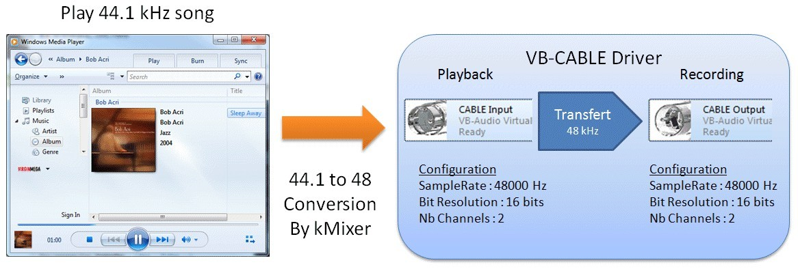

For example under Win7, conversion is made while under XP VB-Cable Input Samplerate is changed by windows media player.

## Configuring Internal Latency 

VB-CABLE can now let you change the latency on the fly or by editing the value on main view, or by using the latency menu.

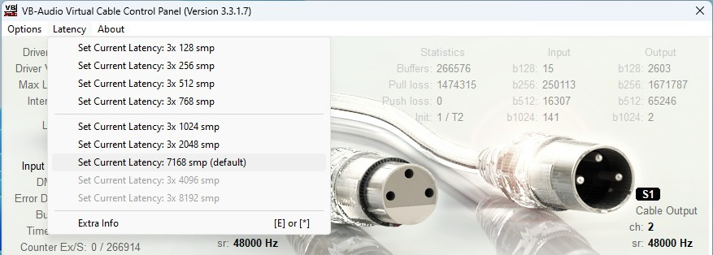

If the latency is considered too small according statistics (buffer used by applications connected to the cable) the counter becomes red and the sound can become discontinued or simply silence.

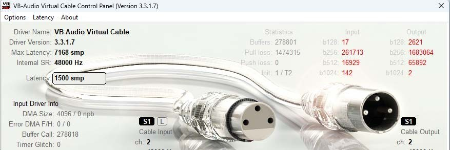

Simply enter a bigger value until removing the red display

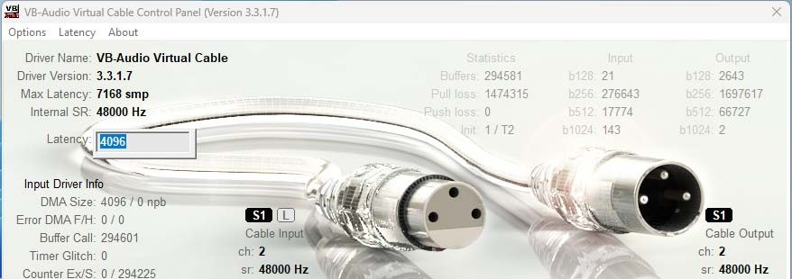

## Loopback streaming

Microsoft windows provides WASAPI interface to capture the stream of the playback device too (not only the recording device). This has been made to let remoting program to capture the sound playing back for example. This streaming was previously taken in charge by the system but is a special feature in new Win10 Driver Architecture and must be managed at driver level. Activated by default the Loopback option will allow you to capture the VB-CABLE Input.

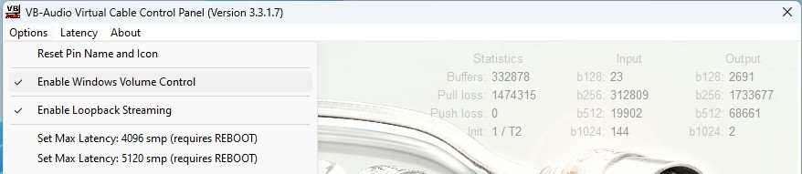

## Windows Volume Control

New VB-CABLE version implements the Windows Volume Control by option to let you change the volume of the VB-CABLE input (Playback device) with the regular Windows Controller. Otherwise the Volume Control has no effect (Mute control can have effect, pending on Windows version).

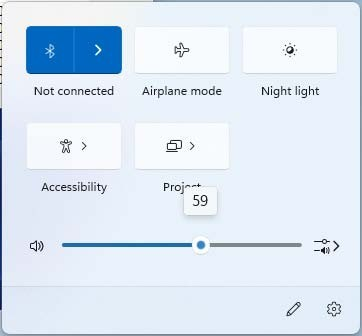

## Reset Pin Name and Icon

Will let you reset the icon and pin name of VB-CABLE device (run VB-CABLE Control Panel in administrator mode).

## Understanding Latency

Basically the VB-CABLE needs 3 buffers to make a continuous audio stream (one for input, one for internal, one for output), the difficulty to set the Max Latency is given by the operating system which is using various buffer size to stream audio.

  <h1>Max Latency = 3 x Max Buffer Size</h1>

**Statistics** are there to let you define rationally the best Max Latency of the cable and first to find the biggest buffer size used by current audio stream. It means you need to play the stream through the cable (with the player application and recorder application if any) to analyze statistics before setting VB-Cable Max Latency.

It's important to understand that audio stream buffering is pending on client applications and audio interface used by these applications (MME, KS, WASAPI behave different). If you set optimal latency for your DVD player and Audacity using KS audio interface, it could not work anymore with other player and recorder application.

  

  
  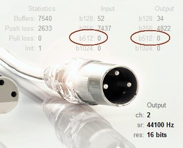
  

  

  

    
Finding Max Buffer Size:

    
According statistics left there, audio stream is never using buffer size above or equal 512 samples.
    

    
Consequently this stream should work with 512 samples buffer. 512 can be considered as the max buffer size used by current audio stream.
    

    
So MAX Latency = 3 x 512 = 1536

    
This result is true only if sample rate configuration is the same for i/o and internal SR.
    

  

This basic formula is working also for Hi-Fi Cable. However, for VB-CABLE where internal sample rate can be different from input sample rate and output sample rate, best Max Latency will need to be scaled by the ratio: InternalSR / (i/o SR).

$$
Max \ Latency = 3 \times (Max \ Buffer \ Size) \times \frac{InternalSR}{OutputSR}
$$

In the example above, if internal sample rate is 96 kHz and i/o SR is 44.1kHz, then our Max Latency must be scaled by 96/44.1.

$$
Max \ Latency = 3 \times 512 \times \frac{96000}{44100} = 1536 \times 2.177 = 3343
$$

So, the real MAX Latency in this case must be set to 3343 samples min (4096 recommended).

## Finding Optimal Latency in particular cases

General formula to compute Optimal Max Latency is much more complicated and would need to be implemented in the Control Panel as a Suggestion for users ... However we can study different possible cases according statistics results.

**Always take the Maximum Buffer given by statistics:**

  

  
  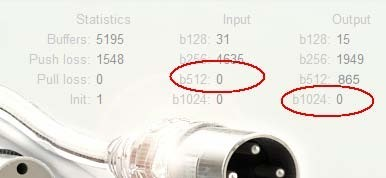
  

  

  

    
Here, according statistics, the stream of the Audio Source Application is using 512 sample max buffer while the stream of the Audio Recorder application uses 1024 samples Max Buffer.
    

    
Use biggest value and compute Max Latency with it = 3 x 1024 (x SR scale)
    

  

**Important remark:** VB-CABLE will work correct if its current Latency is equal or above the computed MAX Latency with Statistics (that's why default value is 7x1024 or 8x1024 samples. This value should work correct for most of the cases, up to 96 kHz stream). However, if the current MAX latency is lower than the computed MAX Latency according statistics, you might get cut in the sound (stream continuity problem).

**Use Max Latency if Statistics are overloaded:**

  

  
  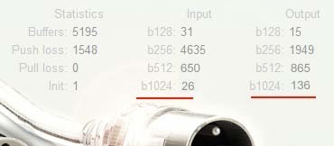
  

  

  

    
If Streaming is using 1024 samples buffer and more, you are obliged to consider using max Latency without being sure it will work correct (streaming might use 2048 or 8192 buffer as well, we cannot see it here because statistics are limited to 1024 buffer size).
    

  

Note: for VB-CABLE, you can decrease the Internal SR to increase effective pipe size.

**Statistics on Hi-Fi Cable:**

  

  
  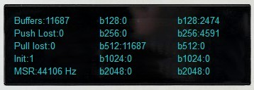
  

  

  

    
Hi-Fi Cable Statistics go up to 2048 buffering because can support bigger sample rate, and audio streaming is usually increasing buffering with samplerate.
    

  

REM : When client audio application are using KS or WASAPI audio interface, VB-CABLE usually receive the same buffer size. This is the case here above where only b512 counter is increased on input (because audio sound is sent through KS interface with 512 sample buffer) while MME buffering can use various buffer size to manage audio stream (as we can see it on output statistics – the right column). Consequently, If you are sure about how your audio application are buffering audio stream, you might use it to configure Max Latency (without needing to use statistics – or just to check the consistency of your settings).

# Hi-Fi Cable and ASIO Bridge

HiFi Cable is a bit different (compared to original VB-CABLE) since it does not include an SRC (Sample Rate Converter). Consequently, it works correctly only if i/o are configured with the same sample rate.

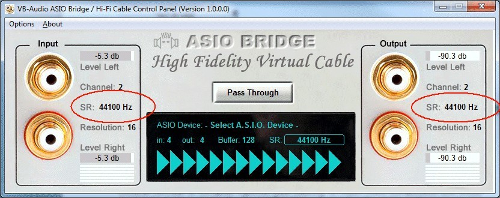

HiFi Cable Control Panel is called **ASIO Bridge** because it also allows routing virtual i/o to an ASIO Device. Per default HiFi Cable is in **Pass Through** mode: The regular mode where all incoming audio on input is going to audio output of the Hi-Fi Cable. In **ASIO Direct** Mode the HiFi Cable Input is routed to ASIO output and the ASIO input is routed to HiFi Cable Output. In a way, ASIO Bridge is an Audio Interface Converter allowing audio application to use ASIO device through its regular audio management (MME, KS, Direct-X or WASAPI).

NOTE : If the ASIO Bridge Application is not launched then the Hi-Fi Cable is PASS Through anyway.

## HiFi Cable Max Latency

Since it support up to 384 kHz audio stream, Hi-Fi Cable includes more options to set maximum latency time (up to 32k samples).

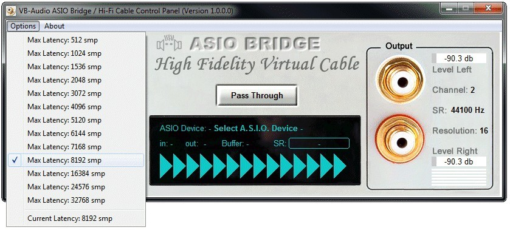

## Alert when Max Latency is not big enough

HiFi Cable Control Panel is analyzing statistics every second to check if the pipe size is big enough to support buffering used by the different i/o streams. And if current MAX Latency is too weak, we got a blinking text below LCD proposing a new MAX Latency.

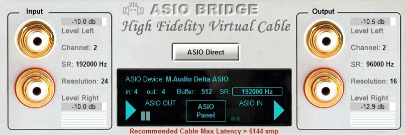

The red text below the LCD is displayed when current Cable Latency is too small to support current audio stream.

## Alert when ASIO Buffer is too big

ASIO Buffer size is displayed in a red blinking rectangle if it is too big compared to the cable MAX Latency. Again we must respect the main rule where buffer used must have size below 1/3 of the Cable MAX Latency.

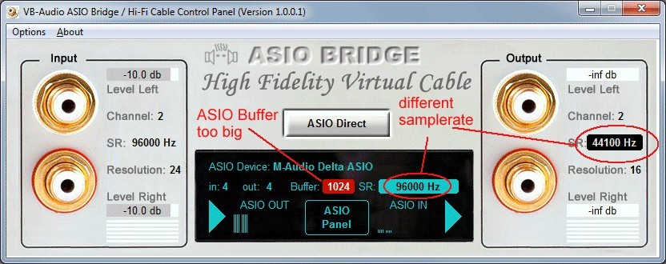

## Alert when Sample rate are different

Since the Hi-Fi Cable do not include a sample rate converter, all sample rate must be the same to make the different stream work correctly. These displayed sample rate are blinking on ASIO Bridge Dialog box only if used: it means only if there is an application connected to the virtual audio input out output.

REM: Of course if its blinking you can expect to have a corrupted audio stream, because not working in the right sample rate.

## Alert when ASIO Driver is not started

If ASIO Driver is not started, the device name is followed by the mention (STOPPED). To restart it, reselect ASIO Device in popup menu, or change twice the ASIO Bridge mode (PASS Through and ASIO Direct).

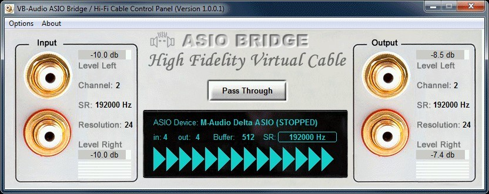

## Alert on bad ASIO Clock 

ASIO Bridge includes a sample rate measurement to check the real sample rate delivered by ASIO driver. This is done to detect wrong hardware configuration: bad sync mode, wrong word clock and whatever clock default if any.

Typical problem comes from hardware input that can use a different sample rate than the one required by the software. If you play a DVD asking for 48 kHz, ASIO Driver can start with this setting but work finally in 44.1 kHz because converter or audio physical connection is driven by another clock.

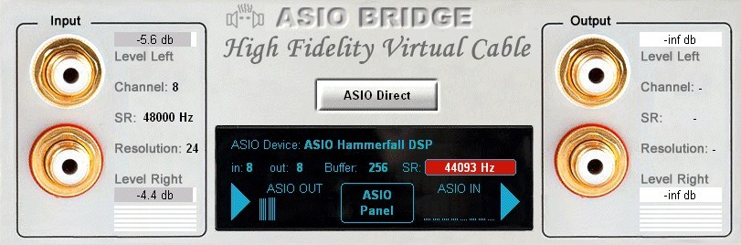

If there is an ASIO Clock problem, the measured sample rate (here 44100 Hz) is shown in a blinking red rectangle.

# VB-CABLE Under WINDOWS XP

# VB-CABLE Installation under Windows XP

The VB CABLE is a regular MME / KS / Direct X Audio Driver presenting a playback and recording point (exactly like other regular audio devices). To install it, just unzip the package in a folder on your local disk and launch the program **VBCABLE_Setup.exe** (for 32bit O/S).

  

  
  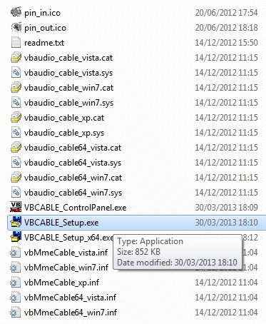
  

  

  

    
Installation program:

  
    
Continue Anyway to install driver:

  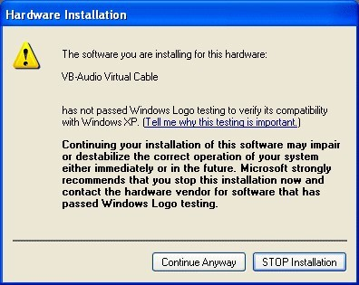
  

After installation you can go on Control Panel / Sound and Audio Properties Dialog Box to check that you have a new Audio Device installed on your system, called **VB-Audio Point**.

REM: (under other O/S above VISTA, the driver name is VB-CABLE input/output).

## Select VB-CABLE as default device

The VB-CABLE works like a regular audio device and can be selected as a playback device by any audio application handling MME, KS or Direct-X audio interfaces.

  

    
To record any sound played on your computer, select the VB-AUDIO CABLE as Default Playback Device. Then every sound playing on your computer will be sent to the VB-CABLE input.
    

    
WARNING, you will hear nothing anymore in your speaker while the VB-CABLE output is not routed to physical output (with another audio application).
    

    
REM: Don't forget to push the APPLY button to confirm your selection.
    

  

  

  

  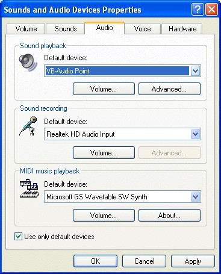
  

Then you can launch a player application (using default playback device). For example VLC, Windows Media Player, Winamp...

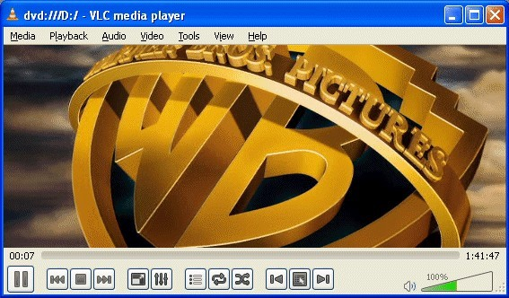

Check the sound is coming into VB-Cable input

The VB-CABLE package includes a small Control Panel program that can be useful to check if it works.

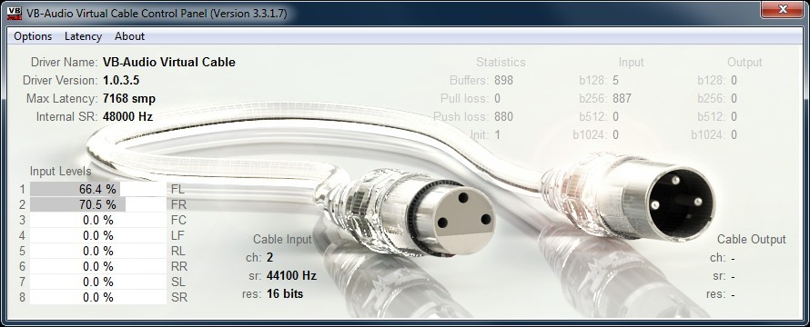

Here you can see in the input levels section if the audio signal is coming in the cable input (playback device). You can click on it to change the level unit (db or % level).

The Input and Output section show the Audio Point Configuration (Playback and Recording device audio point). Under XP this is set by client applications. In the picture above, the Output configuration is not shown because no client application is connected to this point (Recording Device). Note that the VB-CABLE can handle any format change on both points in real time (user has nothing to configure).

Statistics are there for analyzing purpose (expert user).

## Use Audacity to monitor VB-CABLE output

Audacity® is free, open source, cross-platform software for recording and editing sounds. (http://audacity.sourceforge.net/).

First of all you may configure AUDACITY device to record the signal coming from VB-CABLE output and play it back in a real audio output (in this example: the Realtek HD Audio output).

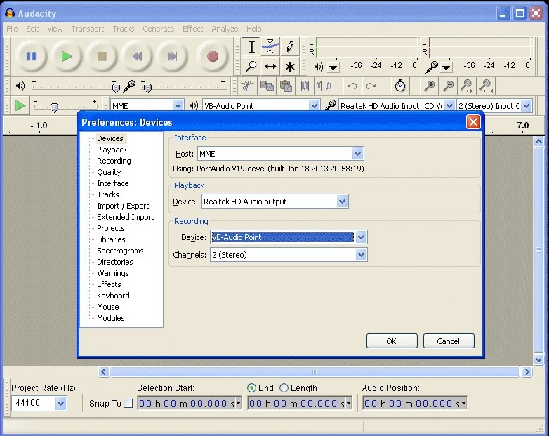

You can check that the signal is coming from the VB-CABLE by using START MONITOR function. Then you will see the Level Meters move.

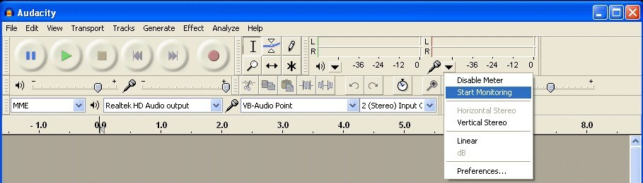

## Use Audacity to record VB-CABLE output

Simply push the RECORD Button.

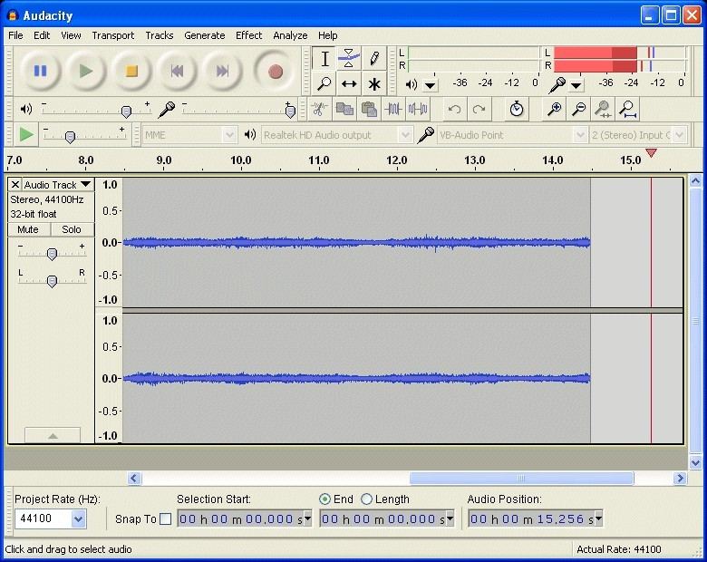

The Sound coming in VB-CABLE is recorded and after could be played back through a real output audio device (Just Push PLAY).

Routing Diagram :

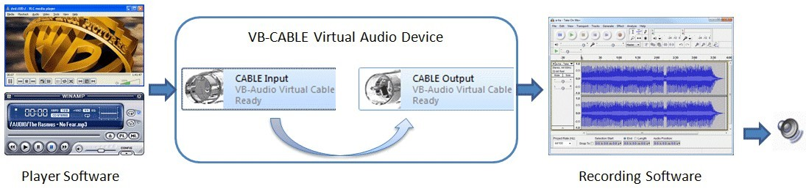

Every player are sending sound in the VB-CABLE input since it's set as Default Playback Audio Device. Then a recorder application can get back the signal from the CABLE-Output, which is a Virtual Recording Audio Device.

## VB-CABLE Control Panel

This application, delivered in the Driver Package, allows checking status of the driver: version, configuration, and specific data for diagnostic / debugging purpose. The VB-CABLE control panel for older version is more limited in term of options / functions (than the latest 2024 version for example).

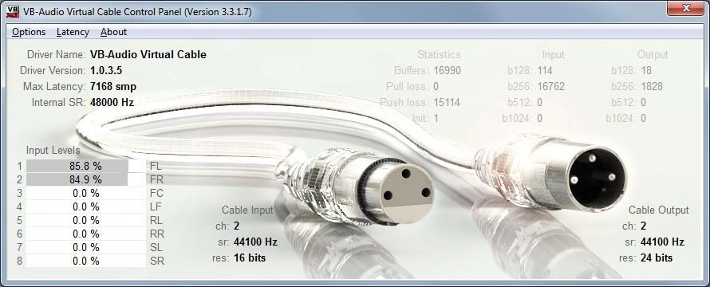

The VB-CABLE works internally with a fixed sample rate and a fixed pipe size (7168 samples per default) and support I/O sample rate range from 8 kHz to 96 kHz.

**Input Levels** give the incoming Signal Level for every possible input channel.

**Input and output** configuration (ch, sr, res) shows the present driver pin configuration. It is pending on O/S and applications using the driver.

**Statistics** give different data related to internal pipe: Buffers counter, Lost buffer in input (push loss) or in output (pull loss). The bxxx value gives the buffering type: how the client applications are feeding the input device and getting output signal (on this example the signal is sent by buffer smaller than 512 samples).

**Latency:** The Max Latency between VB-Cable Input and Output is given by the pipe size: per default 7168 samples. This value has been chosen to let the virtual cable works with most of Client Applications and allows until 2048 samples buffering.

# VB-CABLE customization

VB-CABLE audio device can let you redefine pin name and icon (by the properties dialog box).

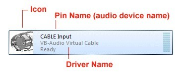

But only the latest Win10/11 version will allow you to change it and stay persistent. Previous VB-CABLE version (XP to Win7) could reset icon and pin name on Windows startup.

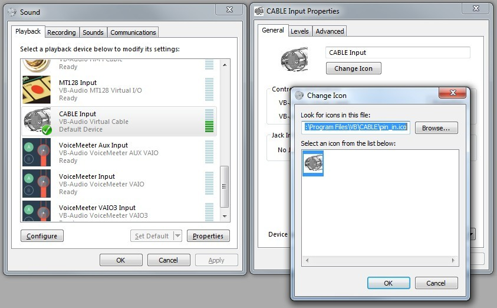

REM: the driver name cannot be changed.
