# VB-Audio Matrix & Coconut USER MANUAL

> Universal Audio Router for Windows


> OFFICIAL WEBSITE [www.vbaudiomatrix.com](https://www.vbaudiomatrix.com)

This Document explains all functions present in VB-Audio Matrix (VBMatrix) and further version (Coconut).

## INSTALLATION

- Run setup program and follow instructions.

- Reboot after installation or uninstallation

### FIRST INSTALLATION

> As prerequisite, you might have administrator rights otherwise you may run the setup program in administrator mode.

1. Run the Setup program and push the button INSTALL.

2. If already installed, push the button REMOVE.

3. REBOOT AFTER EACH OPERATION (IMPORTANT).  
**(Virtual Audio Device Driver needs this reboot to finalize uninstallation or installation)**

### HOW TO UPDATE

Update requires you uninstall VBMatrix first. You can save your current settings in a file before, but it should normally stay as it is (current settings are not deleted by the setup process):

As prerequisite, you might have administrator rights otherwise you may run the setup program in administrator mode. Close applications that could use VBMatrix.

1. Run the Setup program and push the button REMOVE.

2. REBOOT AFTER (IMPORTANT)

#### Before re-installing you may check different points

- In Windows Device Manager you may check that all VBMatrix VAIOs virtual audio drivers are removed (from the game controller section and from the audio I/O section) - if still present you will have to uninstall them manually from there (right click to get menu option).

#### THEN RE-INSTALL

3. Run the Setup program and push the button INSTALL.

4. REBOOT AFTER (IMPORTANT)

#### Then you may

5. Check Windows audio parameters (default playback device, default recording device...)

6. Check soft phone parameters (for example Skype / Zoom / Discord audio device selection).

7. Run the wanted VBMartrix version and reply to firewall authorization (if VBAN service is running).

8. Possibly re-check some option in menu (System Tray, Run at Startup, Show App on Startup...).

## ONLINE SUPPORT 

[https://vb-audio.com/Services/support.htm](https://vb-audio.com/Services/support.htm)

## Fair Trade, Affordable For Everyone

VB-Audio Matrix is distributed as Donationware with an activation code! After 30 days period, it will periodically invite you to activate your license.

For any professional use, you may pay the recommended license price on the webshop. For volume licensing / commercial distribution, you may contact us to get quotation / agreement.

More Licensing info: [https://vb-audio.com/Services/licensing.htm](https://vb-audio.com/Services/licensing.htm)

Thanks for your participation and support!  
[https://shop.vb-audio.com](https://shop.vb-audio.com)

Windows XP (SP2), VISTA, WIN7, WIN8, WIN8.1, WIN10/11 32/64 bits ARM64 compatible (MME, DX, WDM/WASAPI, KS, ASIO).

## INTRODUCTION

VB-Audio Matrix is a universal audio router for Windows, able to manage several ASIO devices, several Window devices, several Audio Applications, several ASIO applications or VBAN Streams together through different audio interfaces, with the capability to route any input to any output (any source to any target), channel by channel.

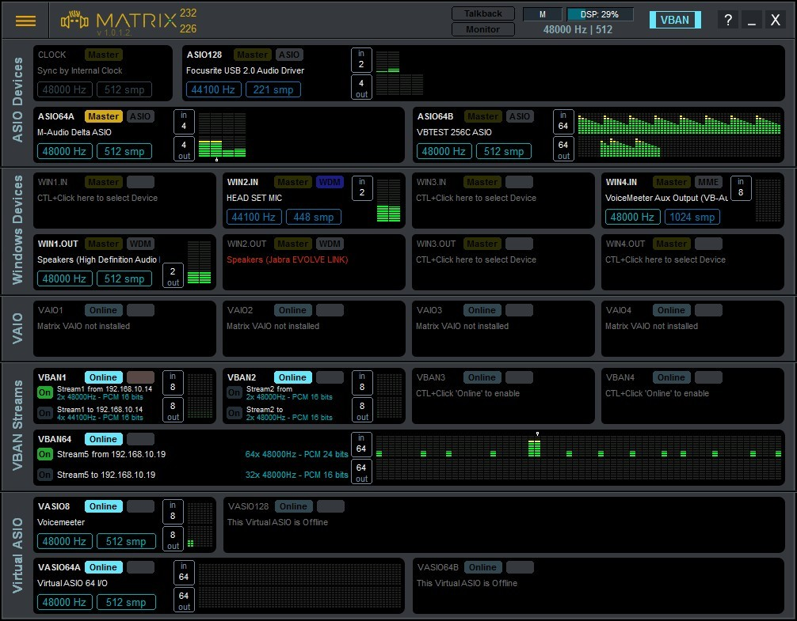

VB-Audio Matrix can manage up to 128 channels ASIO device and 64 channels VBAN Stream and is also providing a full routing grid view, preset management, MIDI functions and VBAN- TEXT request.

VB-Audio Matrix Coconut Is simply providing more slot and can manage up to 512 channels ASIO device, 128 channels VBAN stream and 64 channels Windows device.

The main sample rate and buffering is displayed below VDSP/ CPU load meter bars,.

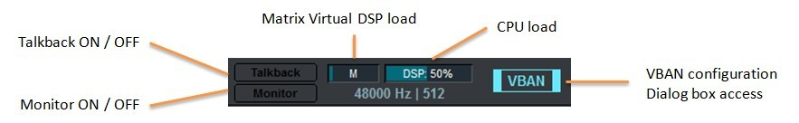

## Matrix Slots

VB-Audio Matrix is providing 5 types of slots:

**ASIO Devices:** To select ASIO drivers (up to 128 channels max according slot limitation).

**Windows Devices:** To select Windows device (8 channels max)

**VAIO:** To use Virtual Audio I/O installed with Matrix (on Windows 10/11 64bit/ARM64)

**VBAN Streams:** To use VBAN protocol to send / receive audio stream from other computers

**Virtual ASIO:** To use Virutal ASIO driver installed with VB-Audio Matrix.

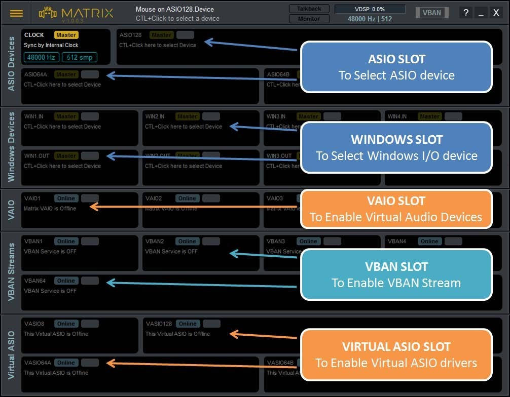

Use CTRL+CLICK to select a device in the slot, or to enable the slot.

**Once a Slot is enabled, it appears in the Routing Grid.**

## Routing Grid

If you click on MATRIX logo or use the menu -> Routing Grid, you get access to the Matrix Routing Grid:

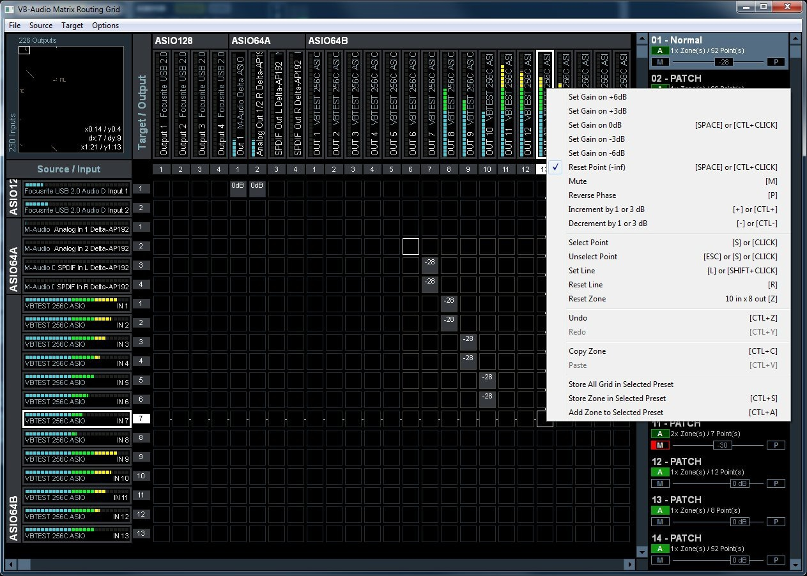

This is allowing to route any inputs to any outputs, possibly with a gain. In other words it allows sending any sources to any targets.

A Zone can be define to perform different action (reset points or store the zone in the selected preset for example), or act on all points of the zone at once (Set Gain on 0dB for example).

A Preset is composed of any number of points in 64 Zones maximum. Once it is defined the preset is providing a Slider Gain (giving the max level of all points) an Apply button (green when the preset is fully applied) a Mute button and a Phase button (to reverse phase).

Options menu offers different display options: 3 different view and axes option to change I/O on vertical or horizontal according your convenience.

Mouse wheel can be used to move vertically in the grid (use SHIFT key to move horizontally).  
Arrow key can be used to also browse the grid:  
Use CTRL + Arrow keys to move by page.  
Use SHIFT + Arrow keys to move from a slot to another.  
Use CTRL + Arrow keys to move from a point to another.

### Preset Patch

Matrix offers a set of 64 permanent presets, automatically stored on disk (in My Documents \\ VBAudioMatrix \\ PresetPatch directory).

To modify a preset can be done first by selecting the preset, and secondly by defining a zone on matrix (or a selected point) and right click to get the contextual menu to Store or Add current point(s)/zone in the selected preset (a preset can contains 64 zones max). Points of the selected preset appear in light blue.

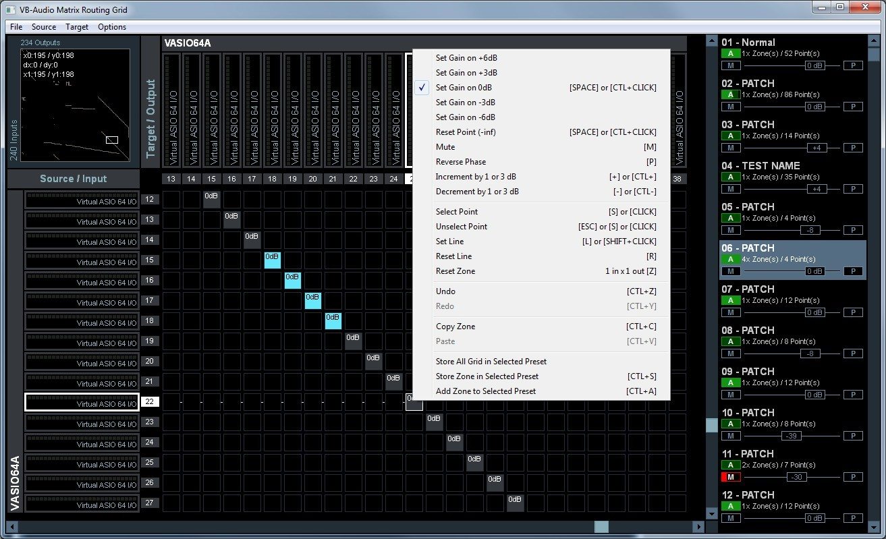

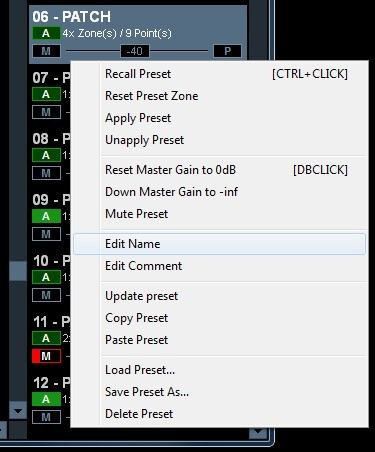

Right Click on Preset to retrieve the functions list.

Recall preset: apply the preset with zone(s) (it removes all points not part of the preset in zone). Other functions like Apply, Gain Mute, Phase, are applied to preset points only (other points of the zone are not affected if not part of the preset).

A Name and Comment can be defined for each preset.

Update Preset: restore the current preset with current point value and states, automatically set it in Applied status. "A" button is full green when all points of the preset are set like the preset definition.

 9 本页有 2 张图

## System settings

By the menu (or CTL + ',') you can get the system settings dialog box to check different options:

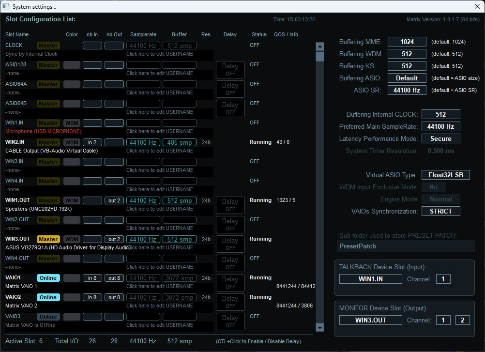

Buffering can be set for different audio interface: MME, WDM (WASAPI), KS, ASIO and for the internal clock.

Preferred mains sample rate and buffer size are negotiated with every devices. But the device can propose another format or buffer size at the end.

Virtual ASIO drivers are strictly synchronized to master device, so will take automatically the sample rate and buffer size of the master device. VAIOs will get the master sample rate as internal sample rate automatically, the VAIO buffer size can be set by the main view.

VAIOs Synchronization mode can force the VAIO windows driver to be strictly synchronized to the master clock (so expected to improve VAIO stream stability and sync to master device).

### TALKBACK Device Slot

Gives the device used to talk on a particular I/O (recording device) and channel of this device. By default the talkback can be done with a recording device connected in WIN1.IN slot

### MONITOR Device Slot

Gives the device used to listen to a particular I/O (playback device) and channel of this device. By default the Monitor can be done with the playback device connected in WIN1.OUT slot

## LOG / CLI:

VB-Audio Matrix also provides a LOG / CLI window to let you see what happened, what even or command has been used. The CLI (Command Line Instruction) can be enter in the bottom edit field and send by the send button:

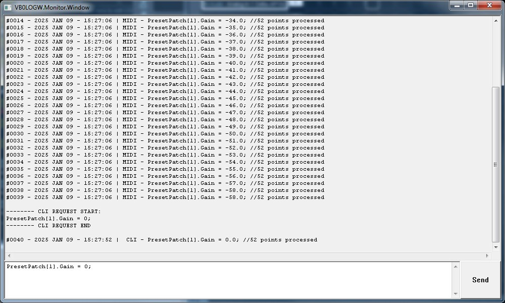

This is also practical to get request syntax. Most of instructions can also be used as VBAN- TEXT request.

### Command Line Instruction Set

SUID = Slot unique identifier (e.g. ASIO128, VBAN1 etc…).

```
Point(SUID.IN[i], SUID.OUT[j]).dBGain = -6.0; 
Point(SUID.IN[i1..i2], SUID.OUT[j1..j2]).dBGain = -6.0;

Point(SUID.IN[i], SUID.OUT[j]).Remove;  //Remove point 
Point(SUID.IN[i1..i2], SUID.OUT[j1..j2]).Remove;

Point(SUID.IN[i], SUID.OUT[j]).Mute = 1; 
Point(SUID.IN[i1..i2], SUID.OUT[j1..j2]).Mute =1;

Point(SUID.IN[i], SUID.OUT[j]).Phase = 1; 
Point(SUID.IN[i1..i2], SUID.OUT[j1..j2]).Phase =1;

Point(SUID.IN[i], SUID.OUT[j]).Paste;   //see Zone().Copy

Undo; 
Redo;

Output(SUID.OUT[j]).Name = "MyName";    //set label 
Output(SUID.OUT[j1..j2]).Name = "";     //to remove label

Output(SUID.OUT[j]).Reset;              //Remove all points 
Output(SUID.OUT[j1..j2]).Reset;

Input(SUID.IN[i]).Name = "MyName";      //set label 
Input(SUID.IN[i1..i2]).Name = "";       //to remove label

Input(SUID.IN[i]).Reset;                //Remove all points 
Input(SUID.IN[i1..i2]).Reset;

Zone(SUID.IN[i], SUID.OUT[j\]: SUID.IN[k], SUID.OUT[l]).Reset; 
Zone(SUID.IN[i], SUID.OUT[j\]: SUID.IN[k], SUID.OUT[l]).Copy; 
Zone(SUID.IN[i], SUID.OUT[j\]: SUID.IN[k], SUID.OUT[l]).Store = nuPreset; 
Zone(SUID.IN[i], SUID.OUT[j\]: SUID.IN[k], SUID.OUT[l]).Add = nuPreset;

Zone(SUID.IN[i], SUID.OUT[j\]: SUID.IN[k], SUID.OUT[l]).dBGain = -6.0; 
Zone(SUID.IN[i], SUID.OUT[j\]: SUID.IN[k], SUID.OUT[l]).Mute = 1; 
Zone(SUID.IN[i], SUID.OUT[j\]: SUID.IN[k], SUID.OUT[l]).Phase = 1;

Slot(SUID.IN).Reset = 1; 
Slot(SUID.OUT).Reset = 1; 
Slot(SUID).Reset = 1; 
Slot(SUID).Online = 1; 
Slot(SUID).Master = 1;

Slot(SUID).Device = "";                 //remove device 
Slot(SUID).Device.ASIO = "Device Name"; //or {GUID} 
Slot(SUID).Device.MME = "Device Name"; 
Slot(SUID).Device.KS = "Device Name"; 
Slot(SUID).Device.WDM = "Device Name";

PresetPatch[i].Apply; 
PresetPatch[i].Comment = "comment" 
PresetPatch[i].Copy; 
PresetPatch[i].Delete; 
PresetPatch[i].Gain = 0.0; 
PresetPatch[i].Load = "FileName" 
PresetPatch[i].Mute = 1 
PresetPatch[i].Name = "Name" 
PresetPatch[i].Paste; 
PresetPatch[i].Phase = 1; 
PresetPatch[i].Recall; 
PresetPatch[i].ResetZone; 
PresetPatch[i].SaveAs = "file name" 
PresetPatch[i].Select; 
PresetPatch[i].Unapply; 
PresetPatch[i].Update

Command.Shutdown 
Command.Show 
Command.Restart 
Command.Reset 
Command.ResetGrid 
Command.Save 
Command.Load 
Command.SaveGrid 
Command.LoadGrid
```

### Request Line Instruction Set

By using the question tag, it is also possible to use some command instructions to get reply from the matrix.

Example:
```
Point(ASIO64A.IN[1], ASIO64A.OUT[1]).dBGain = ?;
```

Could reply:
```
Point(ASIO64A.IN[1], ASIO64A.OUT[1]).dBGain = -6;
```

Or
```
Point(ASIO64A.IN[1], ASIO64A.OUT[1]).dBGain = -inf;
```

Here below, the list of request that you can use to get information from matrix:

SUID = Slot unique identifier (e.g. ASIO128, VBAN1 etc…).
```
Point(SUID.IN[i], SUID.OUT[j]).dBGain = ?; 
Point(SUID.IN[i1..i2], SUID.OUT[j1..j2]).dBGain = ?;

Point(SUID.IN[i], SUID.OUT[j]).Mute = ?; 
Point(SUID.IN[i1..i2], SUID.OUT[j1..j2]).Mute =?;

Point(SUID.IN[i], SUID.OUT[j]).Phase = ?; 
Point(SUID.IN[i1..i2], SUID.OUT[j1..j2]).Phase =?;

Output(SUID.OUT[j]).Name = ?; 
Output(SUID.OUT[j1..j2]).Name = ?;

Input(SUID.IN[i]).Name = ?; 
Input(SUID.IN[i1..i2]).Name = ?;

Slot(SUID).Online = ?; 
Slot(SUID).Master = ?; 
Slot(SUID).Device = ?; 
Slot(SUID).RunningStatus = ?;           // 0 or 1 
Slot(SUID).Info = ?;                    // ex: "in:4, out:8";

PresetPatch[i].Name = ?; 
PresetPatch[i].Comment = ?; 
PresetPatch[i].Apply = ?;               //number of applied / number max 
PresetPatch[i].Mute = ?;                //number of muted / number max 
PresetPatch[i].Phase = ?;               //number of out of phase / number max 
PresetPatch[i].Gain = ?; 
PresetPatch[i].Zone = ?;                //Number of Zone 
PresetPatch[i].Point = ?;               //Number of Points

Command.Version = ?;                    //app name + version number 
Command.Load = ?;                       //return current file name 
Command.LoadGrid = ?;                   //return current file name 
Command.Engine = ?;                     // returns 0 or 1 + (MASTER SUID, SR, Buffer) 
Command.Master = ?;                     // returns MASTER SUID + (SR, Buffer)
```

## Matrix Main Menu

By clicking on "top-left" corner, user gets access to different functions:

The additional menu is there to provide additional functions:

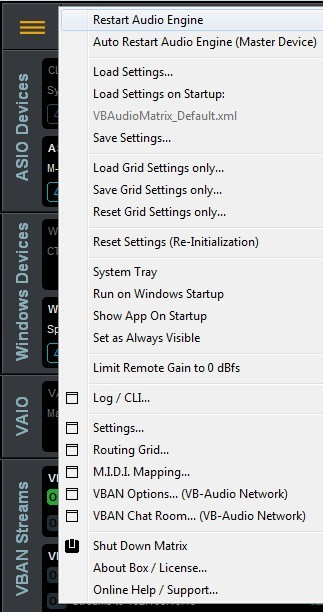

|Nenu |Functions |
|:--|:--|
|Restart Audio Engine |To Restart Audio Engine. |
|Auto Restart Audio Engine(Master Device) |To Automatically Restart Audio Engine if the Master device is disconnected. |
|Load Settings... <br>Save Settings |To load or save current settings in a given filename. |
|Load Settings on Startup |To Load a particular settings file on startup, then you restart with the same settings anyway. |
|Load Grid Settings only...<br>Save Grid Settings only...<br>Reset Grid Settings only... |To Load, Save, Reset the routing grid settings. |
|Reset Settings(Re-Initialization) |To reset complete settings.|
|System Tray |To set Matrix in system tray. |
|Run on Windows Startup |To run it on system startup. |
|Show App On Startup |To show Matrix on launch. |
|Set as Always Visible |To set Matrix as always visible (window on top).|
|Limit Remote Gain to 0 dBfs |To limit the remote gain (MIDI control) to 0dB (instead of +12 dB).|
|Log/CLI... <br>Settings... <br>Routings Grid... <br>M.I.D.I. Mapping... <br>VBAN Dialog Box |To open different configuration dialog boxes (Log/CLI, System settings, Routing Grid, M.I.D.I. mapping, VBAN Dialog Box).|
|Shut Down Matrix |To shutdown the application|

The **About Box** will show you your current activation code and **license** status and some link to get more information and buy your license online.

**System Settings** Dialog Box allows to configure parameters related to audio device management..

**M.I.D.I. Mapping** Dialog Box allows connecting a M.I.D.I. controller to Matrix.

**VBAN** Dialog Box will help you to configure the VB-Audio Network functions, to send/receive audio stream to/from any computer of your local network.

 14 本页有 1 张图

### Load Settings

The Matrix Settings contains all settings except some system one stored in registry only.

- Slot configuration (device selection, online / master state).
- Matrix Grid Configuration 
    - I/O name 
    - Routing points
- The MIDI mapping configuration
- VBAN settings.

### Load Grid Settings Only

Grid settings contains only the following settings

- Matrix Grid Configuration 
    - I/O name 
    - Routing points

### Preset Patch

Preset patch are independent routing map defined by

- Rectangle Zones (up to 64)
- Points in Zones.

These presets are independent from Settings or Grid Settings and are permanently stored in 
```
My Documents\VBAudioMatrix\PresetPatch folder (or PresetPatchCoconut).
```

The preset patch offers different button and a gain slider (all MIDI map able).
- A: Apply preset, apply all routing defined in zones (other points of the zone are removed). Unapply preset will remove all points of zones.
- M: Mute Preset, Mute all points in zones. 
- P: Phase Preset, Reverse phase on all points in zones. 
- SLIDER: Preset gain, change gain of all points in zones, relatively.

## MATRIX DETAILS

VB-Audio Matrix main view is composed of different slots, managing different audio modules / device. ASIO devices and Windows devices are represented by a slot that is activated after having selected a device, while VAIO, VBAN and VASIO slots must be activated by the ONLINE button.

### ASIO SLOT

ASIO and WINDOWS slots are driven by common principles. You can select a device and the slot will let you manage up to a max number of channels (according device capabilities).

ASIO 128 can manage an ASIO device up to 128 I/O. if the device is offering more channels, they will be ignored (only 128 first I/O will be used). If the ASIO device is offering less I/O than the slot capabilities, it is simply considering available I/O only, like in the example below with a M-Audio device offering 4 I/O.

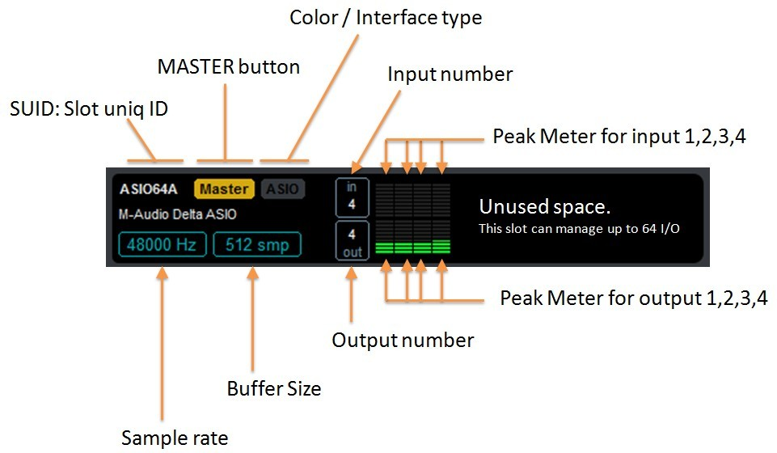

If you see level in Input peak meters, it means some signal is incoming in the ASIO device. If you see level in Output peak meters, it means the matrix is routing some inputs into these outputs. Outputs are exclusively defined by the routing grid.

### WINDOWS SLOT

WINDOWS devices slot are similar to ASIO slot but inputs and outputs are separated. There is WINx.IN Slots to select a recording device (offering inputs) and there is WINx.OUT slots to select playback device (offering outputs). WIN slots are able to manage up to 8 channels, except WIN32 and WIN64 on Matrix Coconut able to manage respectively 32 and 64 channels (experimental).

WIN slot can also be master, but it could not work with Windows Recording device. MASTER device needs to be very regular and stream with a fixed buffer size while Windows recording devices, usually not opened in exclusive mode, could produce various buffer size and then won't work correct as master device.

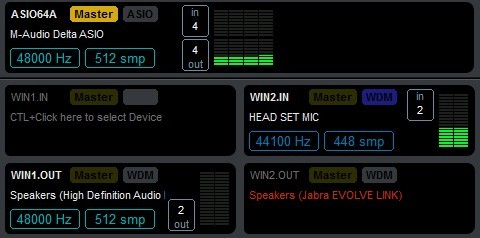

Sample Rate or buffer size displayed in dark blue means it is different from the master one. This should work anyway since the matrix audio engine is able to manage any kind of stream configured in different sample rate or buffering.

Device name displayed in red means the device is not running, or because not connected, or because not allowed by the system or because used by another application or because not supporting audio format.

### SEE I/O ROUTING

Clicking on peak meter I/O is showing the routing with very small white arrows.

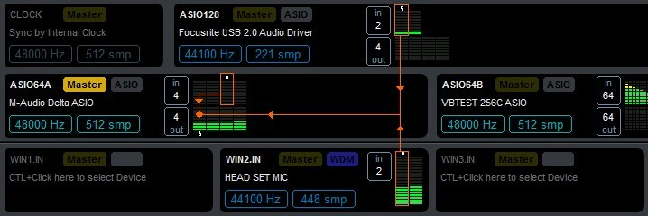

Click on OUT peak meter to see all inputs routed to this output. Click on IN peak meter to see all outputs getting audio from this input.

Using CTRL+Click on peak meter I/O allows to change the routing (without having to go in the routing grid).

### WINDOWS SLOT CONTEXTUAL MENU

Right Click to get the contextual menu on a slot and open device selector or the Windows Sound Dialog box.

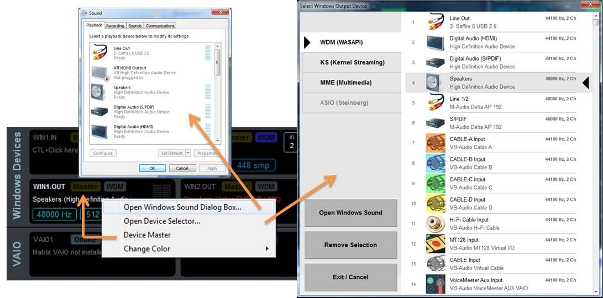

### ASIO SLOT CONTEXTUAL MENU

Right Click to get the contextual menu on a slot and open device selector or the Windows Sound Dialog box.

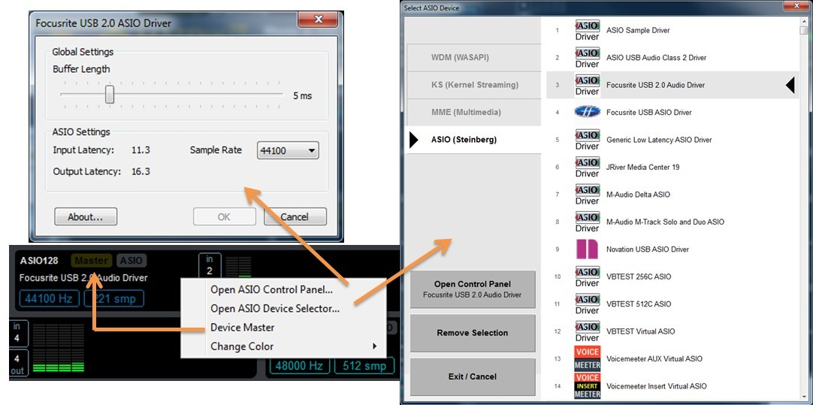

### VAIO SLOT

Virtual Audio I/O slots are managing the virtual I/O installed with matrix. VB-Audio Matrix VAIO is an audio driver providing up to 8 inputs and 8 output devices, each one offering up to 8 channels. This is made to connect any audio applications using MME, WASAPI, Direct X or KS audio interface to playback or record audio.

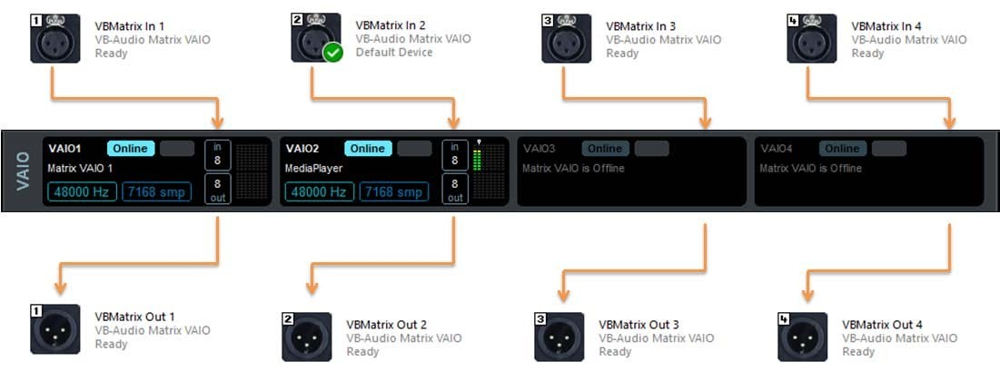

VAIO slots are offering direct access to this virtual audio device. VB-Audio Matrix is using the 4 first virtual I/O while Coconut version gives access to the 8 virtual I/O.

VB-Audio Matrix inputs 2,4,6,8 are presented as Speakers while VB-Audio Matrix inputs 1,3,5,7 are Line Out pin. Speaker Pins offer a CONFIGURE button to select the channel number:

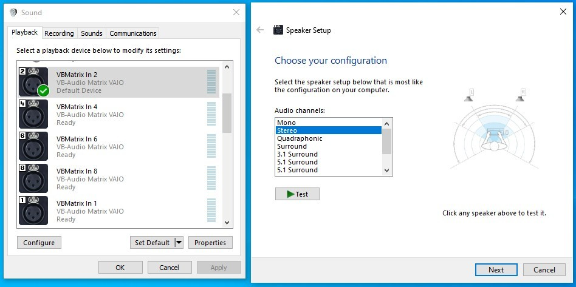

The default sample rate can be defined in the properties -> advanced thumbnail.

Line Out Pins must be configured by the properties dialog box only (configure button is disabled for this kind of pin).

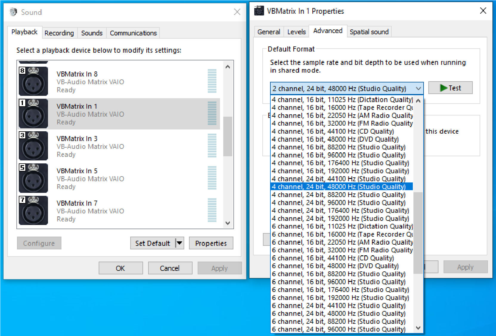

Default format defined in this dialog are Windows audio format used by application connected to the different devices. All I/Os can be configured with a different audio format, channel number or sample rate without problem. Matrix Virtual Audio I/O driver will convert it automatically to the format currently in use in Matrix.

VB-Audio Matrix VAIO work as virtual I/O for Matrix Application:

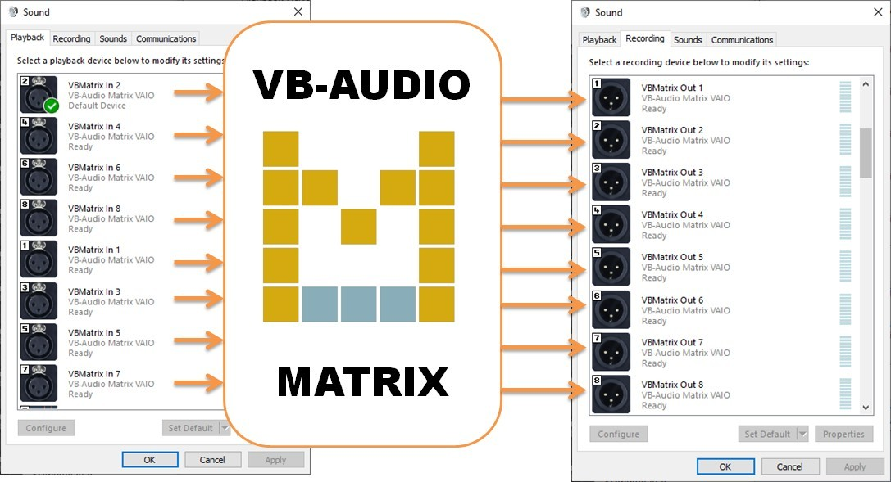

### VAIO SLOT CONTEXTUAL MENU

Right Click to get the contextual menu on a slot and open VB-Audio Matrix Control Panel.

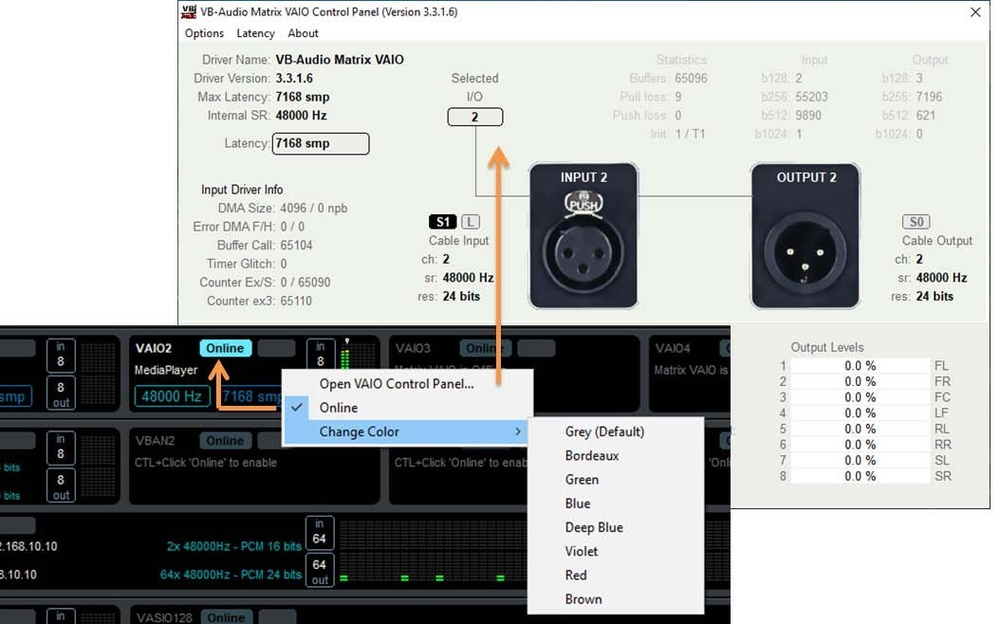

### VAIO LATENCY MENU

CTRL+ Click on Buffer size to get the latency menu to change the internal latency of the Matrix VAIO couple (in / out)

This latency is stored in registry by Matrix and recalled on audio engine start (overwriting possible change in VAIO Control panel it self).

The 7168 sample latency allow the VAIO working well for any cases because it allows connected application to work with buffer up to 2048 samples. In this case, stable stream would require 3x 2048 = 6144 samples, so 7168 is also working.

If you get problem (cut in the sound or no sound anymore) trying to find best internal latency, you may come back to default value.

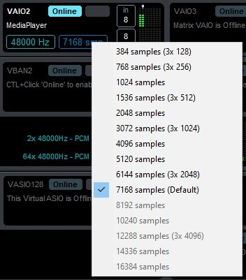

 21 本页有 2 张图

### VBAN SLOT

VB-Audio Matrix offers VBAN Slot to route audio to or from VBAN stream like Voicemeeter can do, by providing 4 regular VBAN in and output streams(8 on Coconut version) and for the first time, one 64 channels VBAN in and output stream (additional 128 channels VBAN slot on Coconut version).

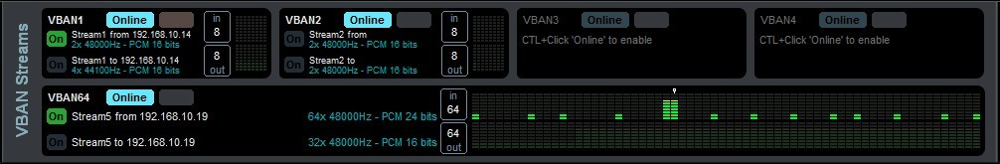

VBAN service must be switched ON and the VBAN Slot must be set ONLINE to be operational. Then VBAN stream configuration has to be done in additional VBAN configuration dialog box (only the ON button is represented in the VBAN SLOT).

If the VBAN output stream is OFF, the peak meters can show level in dark to indicate that some routing are made to feed this stream, but not sent on the network (OFF) as shown on the screenshot above.

### VBAN CONFIGURATION

VBAN Configuration dialog box allows to define more precisely each stream, first 4 streams are regular 8 channels VBAN stream, the 5th can be configured (send or received) up to 64 channels.

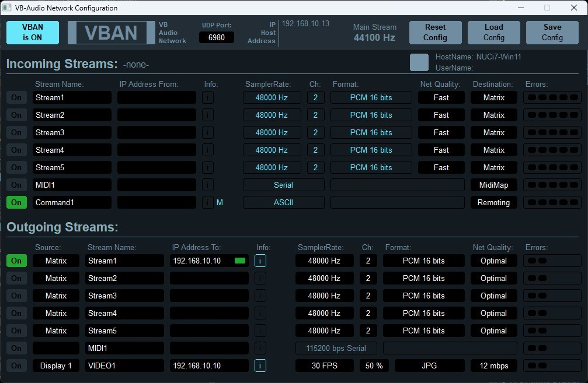

Matrix Coconut offers 10x I/O streams, the 9th able to manage up to 64 channels, the 10th able to manage 128 channels.

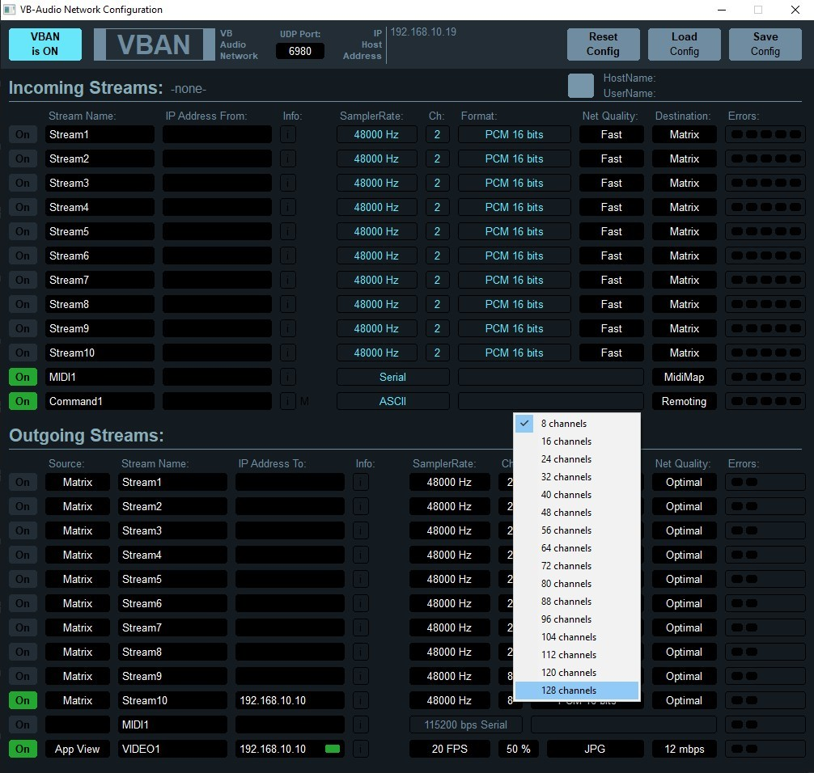

Like Voicemeeter, VBAN implementation provides a MIDI input and output stream and a VBAN-TEXT input stream ("Command1").

#### VBAN FRAME

As last outgoing stream, VB-Matrix introduces for the first time, the VBAN-Frame stream, allowing sharing screen with another computer using VBAN-Screen application.

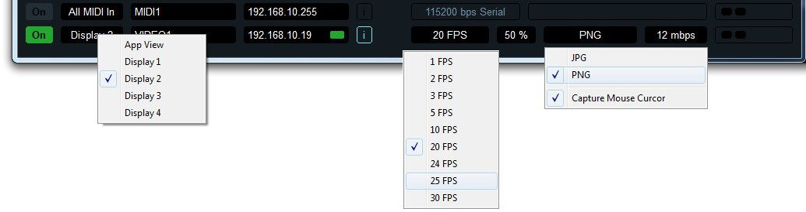

It can capture en entire display (from 4 connected screen – 4K resolution max) or the main window interface only (app view). It is done by sending PNG or JPG frame up to 30 times per second to the destination address through VBAN-Frame protocol.

The percent parameter is for JPG quality. The net quality is a theoretical limitation to give the priority to audio stream (12 mbps by default, does not prevent to have 30mbps or more).

Screen Sharing and remote control:

If using VBAN-Screen application to display VBAN-FRAME sent by Matrix. Matrix can receive Mouse events from VBAN-Screen application (by the VBAN-TEXT stream) to be controlled remotely.


To do so, right click on samplerate or format field to activate the Mouse Management. "M" is displayed to notify that we are processing Mouse Event so that we can be controlled remotely by VBAN-Screen.

### VASIO SLOT

Virtual ASIO slots are managing the virtual ASIO drivers installed with matrix. VB-Audio Matrix installs a set of 2x 4 ASIO driver providing different capabilities:

VB-Audio Matrix installs 4x virtual ASIO Drivers:

- VASIO8 (8 I/O – 4 client applications) VB-Matrix VASIO-8 
- VASIO128 (8 I/O – 1 client application) VB-Matrix VASIO-128 
- VASIO64A (8 I/O – 2 client applications) VB-Matrix VASIO-64A 
- VASIO64B (8 I/O – 2 client applications) VB-Matrix VASIO-64B

VB-Audio Matrix Coconut installs 4x other virtual ASIO Drivers:

- VASIO256A (256 I/O – 1 client application) VB-Matrix VASIO-256A 
- VASIO256B (256 I/O – 1 client application) VB-Matrix VASIO-256B 
- VASIO32 (32 I/O – 2 client applications) VB-Matrix VASIO-32 
- VASIO512 (512 I/O – 1 client application) VB-Matrix VASIO-512

VB-Matrix ASIO drivers are provided as 32bits and 64 bits DLL so can be used in any DAW application (32bits or 64bits).

Each DLL is endowed with an icon, one for VB-Audio Matrix and one for Coconut version. Some device selector might not display the associated icon.

Here it is on the right, the ASIO device list shown in Voicemeeter device selector.

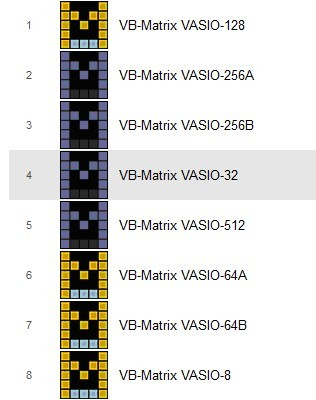

 25 本页有 1 张图

## Master Clock and Synchronization

The master clock gives the reference time for the main stream and audio processing. It gives the sample rate and buffer size used in the audio engine. Audio point (audio slot) are driven by the master clock in "soft" mode except Virtual ASIO, VAIOs (according system settings options), and VBAN output stream, driven in "Strict" Mode.

In strict mode, audio points are running strictly at the same clock than the master one, with the same sample rate and the same buffer size. In Soft mode, audio points are running with its own clock and possibly with a different sample rate and a different buffer size.

To be processed and synchronized, all audio point must be converted in the master sample rate and buffer size if required. This synchronization process can produce some more or less hearable artifact in the sound (for audio point with a "soft" synchronization to Master).

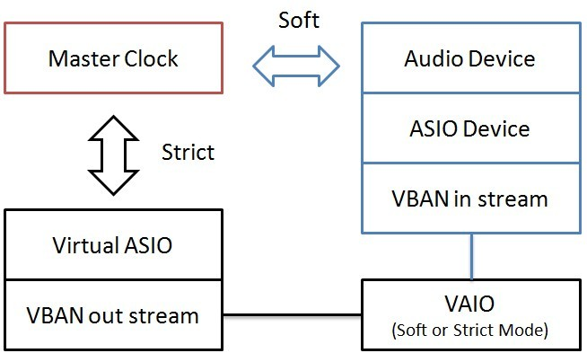

**The general recommendation** is to set your best audio device (ASIO one or Windows Output) as master, then you will be able to consider this audio device perfectly in sync with VAIOs, Virtual ASIO driver and VBAN output stream (VAIOs sync option set in STRICT mode).

The Internal Clock is interesting when having no audio device installed on the system, or when you want to keep your virtual ASIO drivers in the same sample rate while your audio device can run in different sample rate.

---
# VBAN
```
> VB-Audio Network

## VBAN: VB-Audio Network

VBAN Protocol, based on a simple UDP protocol, has been designed for real-time transport of digital audio stream in IP-based network environments. It provides an easy ways to send / receive audio to / from any computers on a local network.

VBAN-Talkie and VBAN-Receptor are applications for mobile device (iOs / Android) also implementing the VBAN Protocol to send and receive audio stream from or to Voicemeeter or Matrix (or MT64 Standard or MT128).

VBAN Protocol is free to use to be implemented everywhere. The PCM native Audio protocol, the VBAN-TEXT protocol and the VBAN-MIDI protocol are public. You can get specification document on our support page: https://vb-audio.com/Services/support.htm and find numerous projects using it on GitHub.

NOTE: two applications running on the same computer cannot use the same UDP port.

Open VBAN Configuration dialog box:

Click on VBAN icon to open the configuration dialog box below and configure your incoming stream (the audio streams from other computer you want to hear) and your outgoing stream (the audio streams you want to send to other computers).

 28 


th Matrix offers 5x I/O streams (the 5 able to manage up to 64 channels). Matrix Coconut offer

th th 10x I/O Streams (the 9 able to manage up to 64 channels and the 10 able to manage up to 128 channels).

A VBAN Stream can be set in any standard sample rate from 11025 Hz to 96 kHz in 16 or 24 bits resolution with 1 to 8, 64 or 128 channels (according stream capabilities and matrix version). It allows transporting high quality audio in native PCM format on your local network.

It is possible to broadcast an audio stream by using the 255 IP Address (on wire network only! WIFI AP are usually not broadcast capable). For example giving 192.168.1.255 as destination address will send stream to all computers of the network 192.168.1.xxx

VBAN can also transport serial and text to remote Matrix with MIDI message or specific request script. That's why Matrix also offers a Serial and an ASCII incoming stream.

For VBAN identification / VBAN-Chat service, it is also possible to define a USER NAME and a color.

VBAN outgoing stream section also includes a VBAN-MIDI stream, getting MIDI stream from the MIDI-Mapping. It allows sending all incoming MIDI or a particular MIDI source (including MIDI output for MIDI Feedback) through the network. Then it is possible to use a MIDI Controller on the network (by using VBAN2MIDI application) with both VBAN MIDI-IN and VBAN-MIDI Out

 29 


VBAN Services / Identification New services have been implemented to simplify user experience, especially to validate connections. The 'i' right after the IP-Address field is highlighted when the connection is validated by a VBAN-Ping hand check. Right click on 'i' to get further information about distant VBAN unit.

IP-Address field also accept hostname (instead of IP-Address).

The VBAN Chat service is implementing basic CHAT functions to talk between VBAN-units.

VBAN-Chat is list all IP-Address used by the VBAN configuration dialog box and all IP- Address identified by a VBAN-Ping. Then you may see all connected unit around.

When sending a TEXT message, all connected VBAN-unit will receive it and automatically display the VBAN-Chat Dialog box.

You can select one or several destinations in the left list to send message to a particular user or a group of several connected user.

OPTION menu allows changing some display option and font size. It is also possible to send \<nudge> and \<alert>

 30 


Configure VBAN Audio Stream We can configure VBAN stream just by clicking on black fields in the dialog box. An edit box or popup menu will appear to let you define parameters. UDP port used by VBAN is 6980 per default. An Audio Stream is defined by its NAME, IP-ADDRESS FROM (and UDP port). To receive an audio stream these 3 parameters must be the same on receiver.

Send audio stream to other computer / device: To select an outgoing stream, define stream name and destination IP-address of the target computer of your local network and switch it ON. The audio stream being sent will come from the selected source (BUS A or BUS B)

Receive audio stream from other computer / device: On incoming stream, RIGHT CLICK on "Stream name" area or "IP Address from" area to get the list of current detected incoming stream and select it directly. Otherwise it is possible to edit Stream Name and IP-Address manually. Switch ON the Stream to receive audio on virtual input strip.

NETWORK QUALITY: This parameter, more useful on incoming stream, allows tweaking the audio stream stability in case of bad or busy network. FAST means the network is able to transport audio without delay or error, SLOW is made for busy network, where audio packet can be delayed or lost more often than usual.

ERROR LED: shown on the right are blinking red in case of reception errors: 1- Overload: we received too much packets (audio stream comes too fast) 2- Corrupt: we received corrupted packets 3- Disorder: we received older packets 4- Missing: we missed packets (lost) 5- Underrun: not enough packets received (audio stream comes too slow or is stopped).

REM: If too much overload & underrun errors are appearing, you may change the Network Quality parameter to FAST or more SLOW settings (on receptor side).

 31 


Additional VBAN-MIDI or Command stream. Incoming streams section offers 2 other specific VBAN Streams to receive MIDI or TEXT. Opposite to Audio Stream, MIDI or TXT streams do not need an "IP-Address From" and can manage any message coming from anywhere. This is typically done to allow remoting Matrix from several points in the same time.

VBAN MIDI messages and TEXT commands can be sent by MacroButton (installed with Voicemeeter).

VBAN MIDI messages can also be sent by VBAN2MIDI application (installed with Voicemeeter).

VBAN2MIDI application. This simple standalone application allow converting a physical MIDI input into a VBAN outgoing stream (LEFT Side) and the opposite: from a VBAN MIDI Stream, send incoming data to a physical MIDI output (Right Side).

This application can also be used to connect a MIDI controller on second PC through the network with Matrix MIDI mapping as explained in the next page...

 32 


1- Connect your controller on PC1 with VBAN2MIDI to manage outgoing and incoming VBAN MIDI STREAM.

On the left side, the outgoing stream: MIDI Controller out -> MIDI Input Device -> VBAN2MIDI - \> Target IP Address On the right side, the incoming stream (MIDI feedback) from any IP Address -> VBAN2MIDI -> MIDI output device -> MIDI Controller In.

2- The MIDI mapping always take in account the incoming VBAN-MIDI stream activated in the VBAN -Dialog BOX (check the name is MIDI1 on transmitter and on receptor side).

You can see incoming MIDI message in VBAN Dialog box and go in MIDI mapping to learn on desired control. "VBAN MIDI Input" in MIDI mapping dialog box is an info box related to VBAN MIDI outgoing stream and should be labeled " VBAN MIDI Output" instead.

 33 

```
---


# EXTRA OPTIONS

> M.I.D.I. Mapping

> Specifications

> Recommendations

> Command line Installation

---
```
### M.I.D.I. Mapping:

Matrix allows connecting a MIDI remote surface to control Preset gain, apply, mute and phase buttons (with MIDI Feedback) and a secondary MIDI Controller (MIDI Extra Input Device).

You just need to select the right MIDI device and enter in Learn process to configure the M.I.D.I. Mapping. This is expected to work with any M.I.D.I. Remote. You can even give a title to your mapping and store it on disk or recall it from XML files.

Click on Learn (use TAB or up/down arrow key to learn next/previous control) and move your M.I.D.I. Control. Click on M.I.D.I. Code area (black) to reset the M.I.D.I. Implementation (as it was before learning process).

RESET MAP: reset entire M.I.D.I. mapping

LOAD / SAVE allow to recall and save M.I.D.I. Map from or to file (xml file).

REFRESH Controller: allows to send all MIDI message related to the current Matrix Preset states. This feature also exists as MIDI function (assignable to a MIDI button) – see last MIDI Mapping page.

 35 


M.I.D.I. Map name is a name defined by user to identify precisely the remote surface (stored in M.I.D.I. Map XML file). VBAN M.I.D.I. input gives the name of the possible incoming VBAN-MIDI stream, that can also be used in MIDI mapping (if a MIDI device is connected on network thanks to a MIDI2VBAN converter for example).

MIDI Control for selected preset: The MIDI map provides entries for all 64 presets, but the 6 first MIDI map entries are for the selected preset. First MIDI control allows selecting previous or next preset and 4 others allows you to control the different parameters of this selected preset.

Then after, the MIDI mapping dialog box is providing 4 controls for each 64 possible preset patch and a RECALL function to fully recall the preset.

Reminder: the gain slider is given by the max level of all points of the preset. This is working like a VCA fader and if same points are present in several preset, then the preset gain becomes automatically inter-dependent.

 36 


MIDI Feedback: Matrix MIDI mapping manages a MIDI Output Device to send back MIDI code and move motorized Fader or highlight LED Button. This is made automatically with the 'F' or 'FF' mode.

F: Simple feedback: The single 'F' mode is for simple feedback. The MIDI controller is receiving MIDI message when there is a change on related control only, but change made by Mouse or VBAN request or anything but the MIDI controller itself. 'F' Mode is usually enough for movable control like knobs and faders… But some remote surface can use motorized fader needing a MIDI feedback to confirm the position (like an acknowledgement) in this case 'FF' will be needed.

FF: double feedback: Double feedback is useful for MIDI controller LED Buttons. When you push a LED button, it must change its color to fit the state of the related Matrix Preset button. So it needs double feedback: FF. Some motorized fader can also require this mode to acknowledge the position (otherwise the fader automatically goes back to initial position, pending on remote surface type).

 37 


MIDI Advanced Feedback: MIDI mapping allows defining feedback value for 2 positions control. Per default the feedback value is 127 for ON and 0 for OFF state, but for MIDI control able to display different colors, it can be interesting to define other value here.

RIGHT CLICK on 'F' button to open the MIDI Feedback Options dialog box.

It is also possible to define complex MIDI feedback message (including SYS-EX) to send MIDI command to other MIDI device, or MIDI LCD or MACHINE CONTROL…

MIDI messages displayed in yellow mean this message is already used by one or several other MIDI map parameters. RIGHT CLICK on it to get the first parameters using the same MIDI message.

 38 

```
---


## Specifications

### Matrix Specifications

|||
|:--|:--|
|Application Type: |Real Time Audio Matrix, Audio Routing Application |
|Application Compatibility: |Windows XP(SP2), VISTA, WIN7, WIN8, WIN8.1, WIN10/11 (32 / 64 bits + ARM64 compatible) |
|Virtual Audio Driver Compatibility: |Windows 10/11 64 bits + ARM64 <br>(VAIOs not present on other Windows plateform) |
|PC Configuration: |Min: Celeron / Duo Core 1.8 GHz - 512 MB RAM - Disk < 100 MB |
|Audio Engine Capabilities: |44.1, 48, 88.2, 96, 176.4 or 192 kHz DSP Processing (defined by Master Device)|
|Windows Interfaces Capabilities: |WDM, KS, MME, (44.1 kHz to 192 kHz) - 1 to 8 channels |
|Virtual I/O (VAIO): |WDM, KS, MME, Direct-X (8 kHz to 192 kHz) - 1 to 8 channels |
|ASIO Interfaces Capabilities: |ASIO (44.1 kHz to 192 kHz) - 1 to 128 channles. |
|VBAN Implementation: |1x MIDI input stream / 1x TEXT input stream / 5x Audio Streams. |
|VBAN Audio Stream: |5x VBAN Bi-directional Stream (8 channels and 64 channels) |
|M.I.D.I. Implementation (remoting): |- PRESET PATCH selector <br>- PRESET PATCH Apply, Mute, Phase, Gain. <br>- VBAN-TEXT instruction set (see LOG / CLI) |
|Matrix Grid Max: |680 x 680 |
|Matrix Parameters: |Gain from -100 dB (-inf) to +24 dB, Mute, Phase reverse. |
|Matrix Preset: |XML files.|
|Number of Slots: |24. <br>- 3x ASIO Devices. <br>- 4x Windows Input devices. <br>- 4x Windows Output devices. <br>- 4x Windows Virtual I/O devices. <br>- 4x Bi-directional 8 channels VBAN stream. <br>- 1x Bi-directional 64 channels VBAN stream. <br>- 4x Virtual ASIO Driver (8, 64 and 128 channels).|
|Synchronization: |By a selected Master Device or by Internal Clock. <br>(Automatic Sample Rate Conversion if required)|
|Additional functions: |- Talkback / Monitoring. <br>- Log / CLI. <br>- Output Delay by slot.|

### Coconut Specifications

|||
|:--|:--|
|Application Type: |Real Time Audio Matrix, Audio Routing Application |
|Application Compatibility: |Windows XP(SP2), VISTA, WIN7, WIN8, WIN8.1, WIN10/11 (32 / 64 bits + ARM64 compatible) |
|Virtual Audio Driver Compatibility: |Windows 10/11 64 bits + ARM64 <br>(VAIOs not present on other Windows plateform) |
|PC Configuration: |Min: Celeron / Duo Core 1.8 GHz - 512 MB RAM - Disk < 100 MB |
|Audio Engine Capabilities: |44.1, 48, 88.2, 96, 176.4 or 192 kHz DSP Processing (defined by Master Device) |
|Windows Interfaces Capabilities: |WDM, KS, MME, (44.1 kHz to 192 kHz) - 1 to 64 channels |
|Virtual I/O (VAIO): |WDM, KS, MME, Direct-X (8 kHz to 192 kHz) - 1 to 8 channels |
|ASIO Interfaces Capabilities: |ASIO (44.1 kHz to 192 kHz) - 1 to 512 channles. |
|VBAN Implementation: |1x MIDI input stream / 1x TEXT input stream / 10x Audio Streams. |
|VBAN Audio Stream: |10x VBAN Bi-directional Stream (8 channels, 64 and 128 channels) |
|M.I.D.I. Implementation (remoting): |- PRESET PATCH selector <br>- PRESET PATCH Apply, Mute , Phase, Gain. <br>- VBAN-TEXT instruction set (see LOG / CLI) |
|Matrix Grid Max: |3112 x 3112 |
|Matrix Parameters: |Gain from -100 dB (-inf) to +24 dB, Mute, Phase reverse. |
|Matrix Preset: |XML files. |
|Number of Slots: |53. <br>- 7x ASIO Devices (32, 64, 128, 256 and 512 channels). <br>- 10x Windows Input devices. <br>- 10x Windows Output devices. <br>- 8x Windows Virtual I/O devices. <br>- 8x Bi-directional 8 channels VBAN stream. <br>- 2x Bi-directional 64 and 128 channels VBAN stream. <br>- 8x Virtual ASIO Driver (8, 32, 64, 128, 256 and 512 channels). |
|Synchronization: |By a selected Master Device or by Internal Clock. <br>(Automatic Sample Rate Conversion if required) |
|Additional functions: |- Talkback / Monitoring. <br>- Log / CLI. <br>- Output Delay by slot. |

## Matrix Activation Code

VB-Audio Matrix and Coconut are distributed as "donationware for activation code". Once you have activated your License, Matrix applications will stop to invite you to donate for your license. Note there is one License activation code for Matrix and one for Matrix Coconut. These are two different products with two different licenses.

The simplest way is to click on the "BUY ONLINE" button to be re-directed to our webshop with the Challenge Code already set. While the Challenge code is given by your PC, the Response code is given by the webshop after donation, and is also related to your e-mail used for your webshop account.

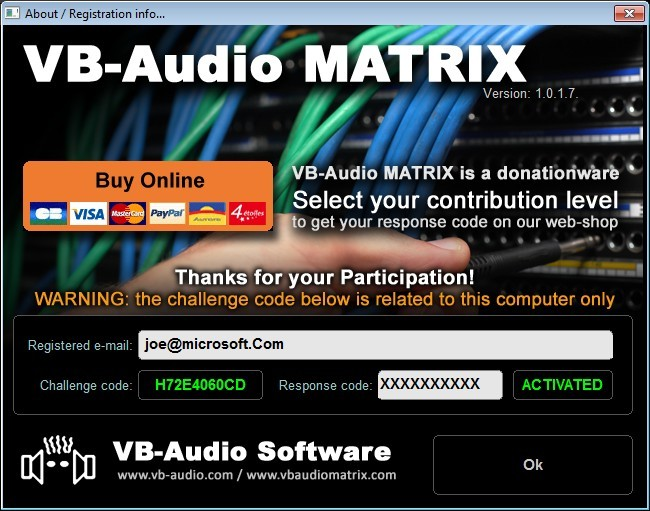

For each Matrix license purchased, a license slot is created in your webshop account "My License" page where you can retrieve your current Response code and possibly generate another one, for example in case of PC change or for a second PC. This is the REGEN option: simply click on it and enter carefully your new Challenge code to get another Response code.

Your challenge code is not expected to change for a given PC configuration, even after windows update (but can change after a Windows re-installation). The challenge code is also expected to change if you change the CPU or possibly Motherboard or all Ethernet devices. The license is given for one PC configuration and is not transferrable as specified in our general terms

### Hide e-mail address

If you right click on ACTIVATED area, you can see the option to hide your e-mail address if needed. This option is stored in registry and keeps your e-mail hidden until you change it here.

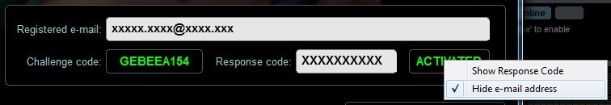

### Use Computer Footprint

If your license is activated (and if your computer has a network adapter), you can store your computer footprint on a USB key for example. Right Click on the challenge code to make appear the related menu (shown on the following screenshot).

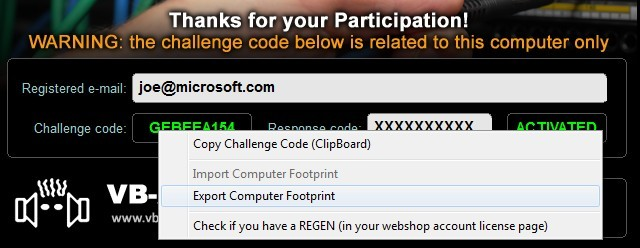

After re-installing Windows and later Matrix applications, you may import this footprint if your challenge code is not the expected one.

1. Enter your registered e-mail and previous response code. 
2. Load the footprint. Your license should be re-activated.

### Activation Log

You can also keep your VBAudioMatrix_ActivationLog.dat (located in My Document\\VBAudioMAtrix folder) from a Windows installation to another. It records the history of your different activations on the same computer and can be useful for us to understand what's happening if you get frequent problem with your activation code.

Simply copy the file VBAudioMatrix_ActivationLog.dat in a extra disk Simply paste it in "My Document\\VBAudiomatrix" folder after Windows installation.

### Activation Key for x64 version

Challenge / Response code are expected to be the same for Matrix version 32bits or 64 bits.

More info on our Challenge / Response code on our forum. [https://forum.vb-audio.com/viewtopic.php?f=6&t=878](https://forum.vb-audio.com/viewtopic.php?f=6&t=878)

### Matrix Coconut Activation Code

Matrix Coconut is another application with another License requiring another activation code.


The License activation code for VB-Audio Matrix cannot work with VB-Audio Matrix Coconut and vice versa. Challenge codes are not expected to be the same for Matrix and Coconut.

### License Activation Process

On first or new installation, your license activation fields are empty. And you get a unique challenge code given by your PC (currently the H-Code is composed by 8x hexadecimal digits + a suffix letter).


#### Buy Online

Clicking on BUY ONLINE button will drive you to the right VB-Audio webshop page with your challenge code automatically filled. See in the red ellipse below:

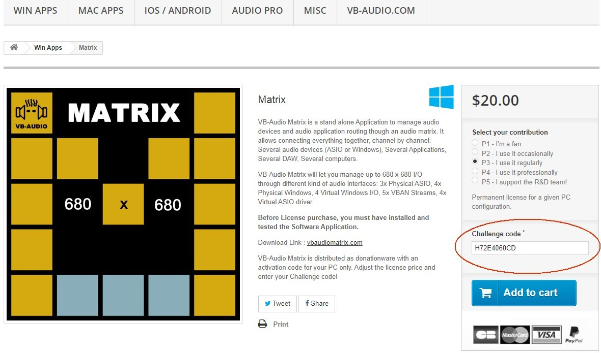

Read LICENSING INFORMATION section before selecting your contribution level, and then click "Add to cart" to continue your purchase.

Once you have paid your order, you can go in your account "My License" page to get your current response code and other information about all your VB-Audio licenses.

#### Get your Response code

In your webshop account "My License" page, you will find download link and activation code for all your licenses:

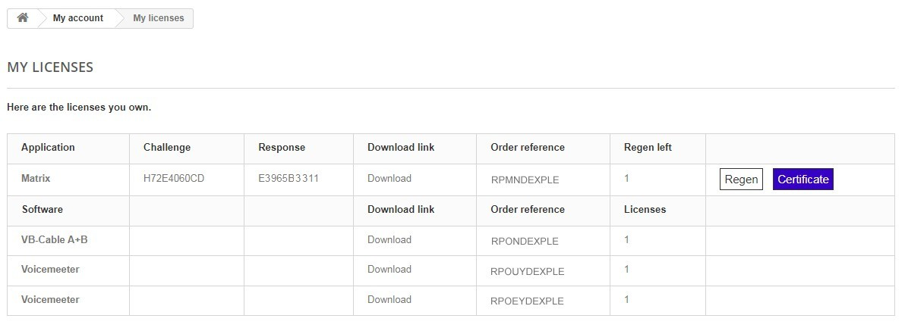

In License dialog box, enter carefully your e-mail (registered for your webshop account) and your response code. You can copy / paste to avoid bad char or reading mistake.


#### Activate your license

To activate your license you must click on the ACTIVATE button. It will ask to our server to generate an authentication certificate that will be stored in your computer to confirm that your license is valid.

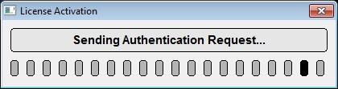

When your license is activate, your License Dialog box is saying ACTIVATED in green


#### Activate your license manually

If you are not connected to internet or if there is a problem to reach our server, the ACTIVATE process will propose you to enter the certificate manually.

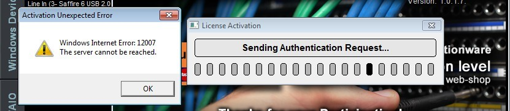

After getting the error box above, the following dialog box appears to let you enter your certificate manually (by PASTE function CTRL+V):

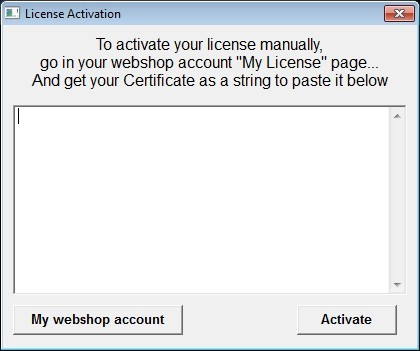

Click on "my webshop account" to directly come to your License pages here below. You will see the button "Certificate" on the right of the related license.

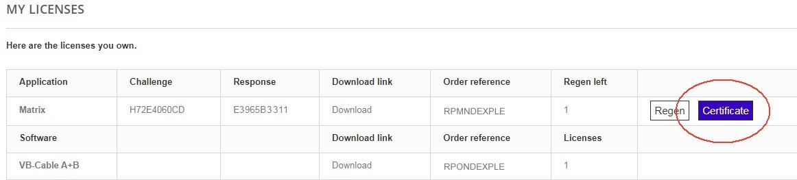

If you own several licenses, take care to select the right line, related to the right license.

The dialog box to get certificate will appear and will first ask you to confirm data.

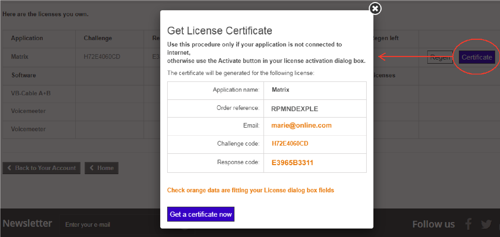

Check the information in orange are exactly the same than you entered in your license dialog box and click "Get a certificate now".

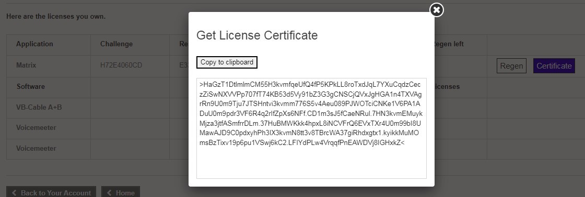

Simply copy / paste it in the application License activation box and click on "Activate" button.

REM: The certificate start with the char '>' and finishes with the char '<'.


 47 本页有 3 张图

## RECOMMENDATIONS

Matrix has been validated on different levels and should work 100% in most configurations with current default parameters. However Matrix remains a complex application by its ability to work with many different audio drivers, different audio interface and many different audio applications (also using different audio interfaces). To make it work together in stable way can become a challenge, especially in latency optimization.

### Known issues

Some ASIO application can be disturbed by the number of I/O in some of our ASIO driver. For example the ASIO 512 driver is providing 1024 pins, not usual but already existing in audio pro domain.

### Latency optimization

Regular Windows configurations are usually not able to manage less than 2.5 ms buffering. It means that an audio thread can expect to be interrupted for 2.5ms in 12 or 24 hours. This can be measured with a special test application you can run during days for example to get the maximum interruption time: [https://forum.vb-audio.com/viewtopic.php?t=519](https://forum.vb-audio.com/viewtopic.php?t=519)

2.5 ms is around 128 samples at 44.1 / 48 kHz. So, 128 samples buffer size is already a critical buffer size for windows (that is unable to protect the audio thread from interruptions). To go below 128 samples (and we know that some PC configuration can work with 64 or 48 samples buffer size) is requiring a validated PC configuration and possibly an audio pro expertise.

### Latency recommendation

With Win10 we recommend to use 5ms buffer size as minimum (around 256 sample at 44.1 / 48 kHz) to guarantee a good audio stream stability. All our default parameters are set to 512 samples (around 10 ms at 44.1 / 48 kHz) because we are sure that buffer size guarantees the good audio stream stability for any Windows PC configuration. If not, it usually means there is a system, driver or hardware problem.

## Command Line Installation

It is possible to make an automatic installation (or uninstallation) by using command line options. However it will need to reboot after installation (and after uninstallation). So it's recommended to first call the setup program to uninstall possible previous version, then reboot, and then install new version (and reboot again).

```
–h : to hide GUI 
–i : to install 
–u : to uninstall
```

### Matrix Command Line

vbaudiomatrix.exe support some command to restart audio engine or to run Matrix application with a pre-defined configuration file. It allows for example to add different shortcut on the desktop to run Matrix for different jobs.

To Restart Audio Engine by a shortcut use the following command line.
```
vbaudiomatrix.exe –R (or "–r")
```

To run Matrix with a specific configuration file, use these following command lines (Matrix must have been shut down before `– if` Matrix is already running, it will do nothing):
```
–l"filename.xml" or -L"filename.xml"
```

If the xml is in the same directories of voicemeeter.exe 
```
–l"filename.xml" or -L"filename.xml"
```

If the xml is in the same sub directories of VBAudioMatrix.exe 
```
–l"subfolder\filename.xml" or -L"subfolder\filename.xml"
```

Or you can use absolute patch 
```
–l"c:\folder\filename.xml" 
or 
-L"c:\folder\filename.xml"
```

### Registry Parameters

Some parameters in the registry (regedit) can be interesting for some expert users in very specific use case or rare technical problems. Do not modify these values without having getting advice on our support resource (forum, mail).

We are talking here about some values present in the following registry directory 
```
HKEY_CURRENT_USER\VB-Audio\VBAudioMatrix
```

`DelayedStartS`  
This value gives the countdown in second before starting audio engine on Matrix Startup (5 second per default).

`preferredResolution`  
This value gives the preferred bit resolution used by Matrix (24 bits per default).In any cases, the final bit resolution is the result of a negotiation with the audio interface (that can force to use other resolution than the preferred one).

`MaxOutDelayMS`  
500 ms per default to optimize memory allocation, this value gives the maximum delay for output delay options (in the system settings dialog box). It can be redefined by this registry key in millisecond, from 500 ms to 5000 ms (5 seconds max).

**WARNING: Other Registry Values must not be modified directly.**

### AUDIO EXPERT / DEVELOPPERS

`TimerResolution`  
This value can be created and set to '1' to force Matrix to set the system timer resolution to standard 1 ms (instead of 0.5 ms if this value is not set to '1' or not existing).

`EngineMode`  
This value gives a bit field of feature related to WASAPI audio engine. Must be ZERO per default.
```
0x00000001 : MODE_SWIFT 
0x00000100 : INPUT EXCLUSIVE MODE 
0x00000200 : OUTPUT EXCLUSIVE MODE      //set anyway
``` 