# VOICEMEETER

||
|:-:|
|**Patato** <br>The Ultimate Virtual Audio Device Mixer for Windows |
|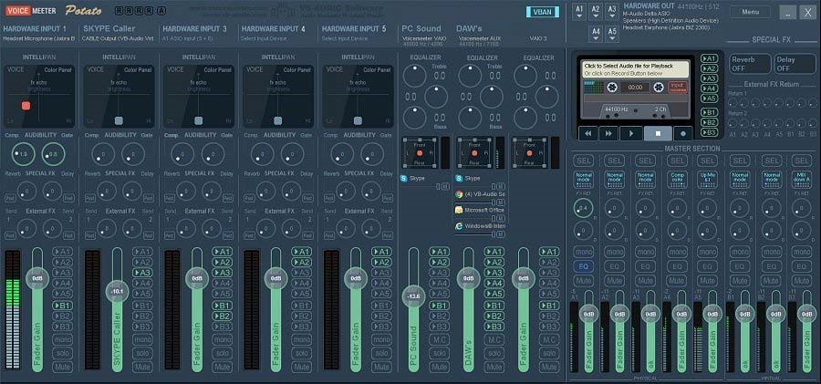 |

<div style="display: grid; grid-template-columns: 10fr 0.5fr 10fr; text-align: center;">
  <div style="grid-column: 1; grid-row: 1;">
    <p><strong>Banana</strong></p>
    <p>Advanced Virtual Audio Mixer for Windows</P>
  </div>
  <div style="grid-column: 1; grid-row: 2;">
  
  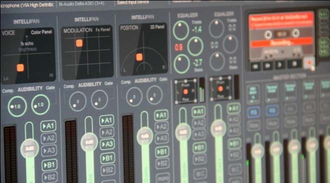
  </div>
  <div style="grid-column: 2; grid-row: 1 / span 2;"></div>
  <div style="grid-column: 3; grid-row: 1;">
    <p><strong>VoiceMeeter</strong></p>
    <p>Real Time Virtual Audio Mixer for Windows</P>
  </div>
  <div style="grid-column: 3; grid-row: 2;">
  
  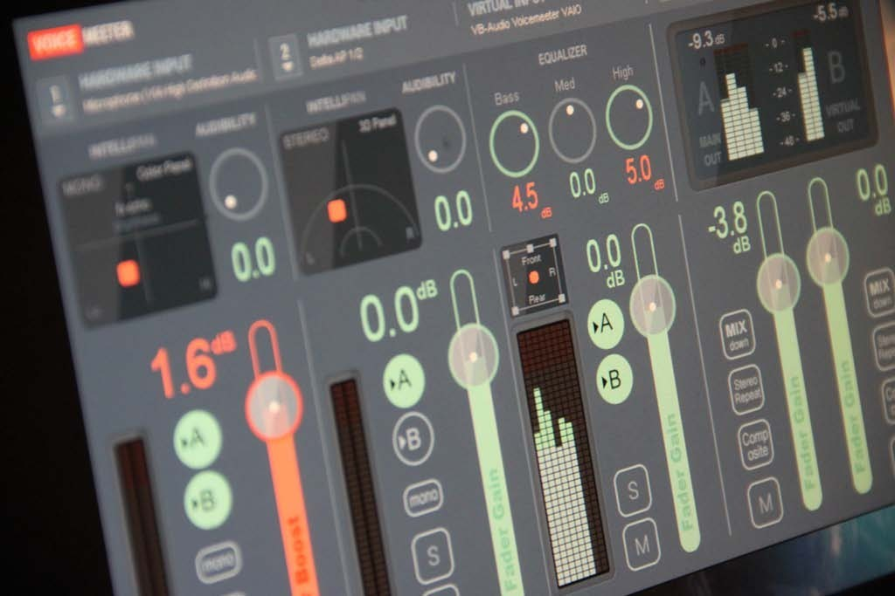
  </div>
</div>

## OFFICIAL WEBSITE 

[www.voicemeeter.com](https://www.voicemeeter.com)

> [!CAUTION]
> Official package URL is only based on **download. vb-audio.com** (and Microsoft Store), **DO NOT DOWNLOAD VOICEMEETER FROM OTHER LOCATION.**

## ONLINE SUPPORT 

[https://vb-audio.com/Services/support.htm](https://vb-audio.com/Services/support.htm)

## Fair Trade, Affordable For Everyone

> Voicemeeter is a donationware, free to download and free to use! It allows you to adjust the license price according to your means or usage.

> Voicemeeter Potato is distributed as Donationware with an activation code!  After 30 days period, it will periodically invite you to activate your license.

> For any professional use, you may pay the recommended license price on the webshop. For volume licensing / commercial distribution, you may contact us to get quotation / agreement.

More Licensing info: [https://www.vb-audio.com/Services/licensing.htm](https://www.vb-audio.com/Services/licensing.htm)

Thanks for your participation and support!  
[https://shop.vb-audio.com](https://shop.vb-audio.com)

Windows XP (SP2), VISTA, WIN7, WIN8, WIN8.1, WIN10 32/64 bits (MME, DX, WDM/WASAPI, KS, ASIO).

## INSTALLATION

- Run setup program and follow instructions.

- Reboot after installation or uninstallation

### FIRST INSTALLATION

> As prerequisite, you might have administrator rights otherwise you may run the setup program in administrator mode.

1. Run the Setup program and push the button INSTALL.

2. If already installed, push the button REMOVE.

3. REBOOT AFTER EACH OPERATION (IMPORTANT).  
**(Virtual Audio Device Driver needs this reboot to finalize uninstallation or installation)**

### HOW TO UPDATE

> Update requires you uninstall Voicemeter first. You can save your current Voicemeeter settings in a file before, but it should normally stay as it is (current settings are not deleted by the setup process):

> As prerequisite, you might have administrator rights otherwise you may run the setup program in administrator mode. Close applications that could use Voicemeeter Remote API (Touch portal, Elgato Steam Deck...).

1. Run the Setup program and push the button REMOVE.

2. REBOOT AFTER (IMPORTANT)

#### Before re-installing you may check different points

- In Windows Device Manager you may check that all voicemeeter virtual audio drivers are removed (from the game controller section and from the audio I/O section) - if still present you will have to uninstall them manually from there (right click to get menu option).

- In Windows Sound Dialog box Playback / Recording devices list: Voicemeeter virtual device are surely not present anymore but you may check that possible VB-CABLE are still well installed with the right name and icon.

more info on our forum: [https://forum.vb-audio.com/viewtopic.php?f=7&t=688](https://forum.vb-audio.com/viewtopic.php?f=7&t=688)

#### THEN RE-INSTALL

3. Run the Setup program and push the button INSTALL.

4. REBOOT AFTER (IMPORTANT)

#### Then you may

5. Check Windows audio parameters (default playback device, default recording device...)

6. Check soft phone parameters (for example Teams / Zoom / Discord… audio device selection).

7. Run the wanted Voicemeeter version and reply to firewall authorization (if VBAN service is running).

8. Possibly re-check some option in menu (System Tray, Run at Startup, Show App on Startup...).

## INTRODUCTION

Voicemeeter is a virtual mixing console able to manage 3 audio inputs (2 physicals and 1
virtual) and 3 audio outputs (2 physicals and 1 virtual) through 2 busses A & B.

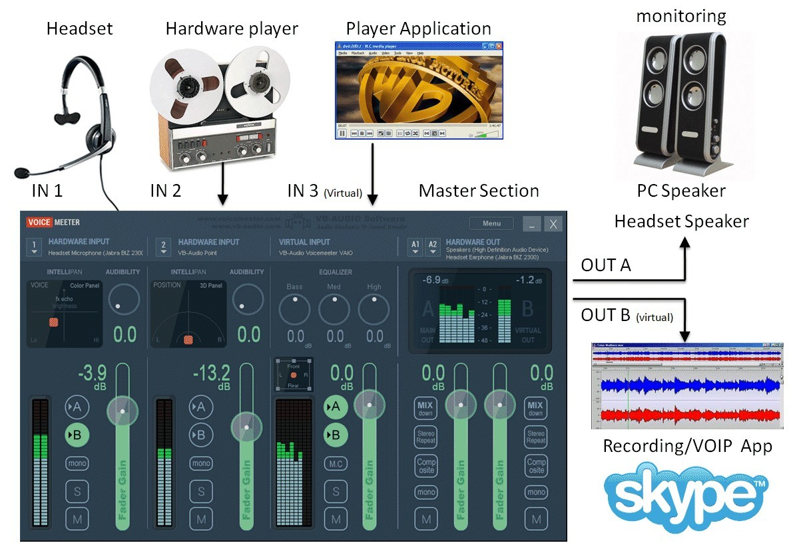

Voicemeeter Banana is an advanced virtual mixing console able to manage 5 audio inputs (3 physicals and 2 virtual) and 5 audio outputs (3 physicals and 2 virtual) through 5 multichannel busses (A1, A2, A3 & B1, B2).

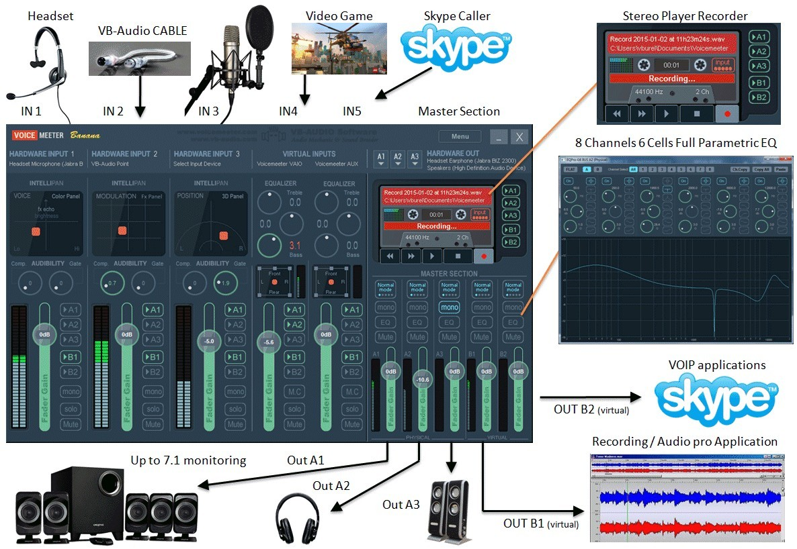

Voicemeeter Potato is an advanced virtual mixing console able to manage 8 audio inputs (5 physicals and 3 virtual) and 8 audio outputs (5 physicals and 3 virtual) through 8 multichannel busses (A1, A2, A3, A4, A5 & B1, B2, B3).

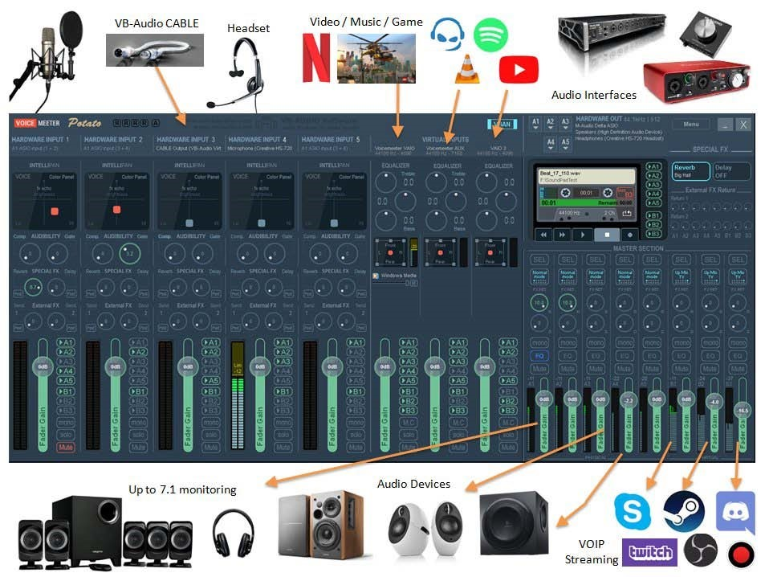

As Mixing Console, Voicemeeter offers large amount of use case combinations: To mix in real time your voice with your music, your movie, your video game or web radio and share it on internet through VOIP or Streaming applications. Voicemeeter is also able to let you manage 2 / 3 (Banana) / 5（Potato） Headsets and create new VOIP experiences …

Voicemeeter Banana integrates an audio recorder able to generate BWF, WAV, AIFF, or MP3 file in stereo. (and 4, 6, or 8 channels for WAV / AIFF format). Recording options allow recording any pre-fader inputs or post fader BUS. Special Composite Mode will allow to record pre or post fader inputs in multichannel mode.  

Voicemeeter Potato integrates the same recorder than Voicemeeter Banana and a new internal FX section offering a Reverb and a Multitap Delay through a regular Send / Return function. Potato also offers two true aux to manage external FX with an ASIO device (ASIO channel must be assigned to SEND / RETURN functions in system settings dialog box).

Voicemeeter Banana / Potato also offers a 6 cells full parametric EQ on every BUS, with the possibility to make independent equalization on each channel (1-to 8). This is made to correct your P.A. System from mono to 7.1 setup. In conjunction with Stereo Repeat Mode, it 's also possible to use this Equalizer as stereo Cross Over to drive 2, 3, or 4 ways active speakers system.

Finally Voicemeeter Banana provides a better control on Compression / Gate effect by presenting 2 different knobs and adds another modulation effect panel on the 3 physical input strips.  
Finally Voicemeeter Potato displays applications connected on its virtual input and gives you the same volume and mute control than the Windows volume mixer.

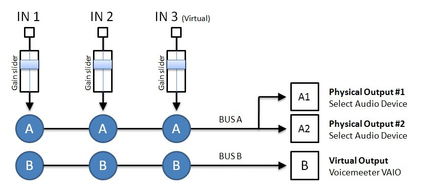
_Voicemeeter General Diagram (3 inputs / 2 Buses Mixing Console)_

Voicemeeter Banana implements a simple matrix to let you manage input to output routing, and make mix minus processing for every strips. So we have 5 push buttons per strip: A1, A2 A3 and B1, B2 to send each strip to assign any audio source to any busses.

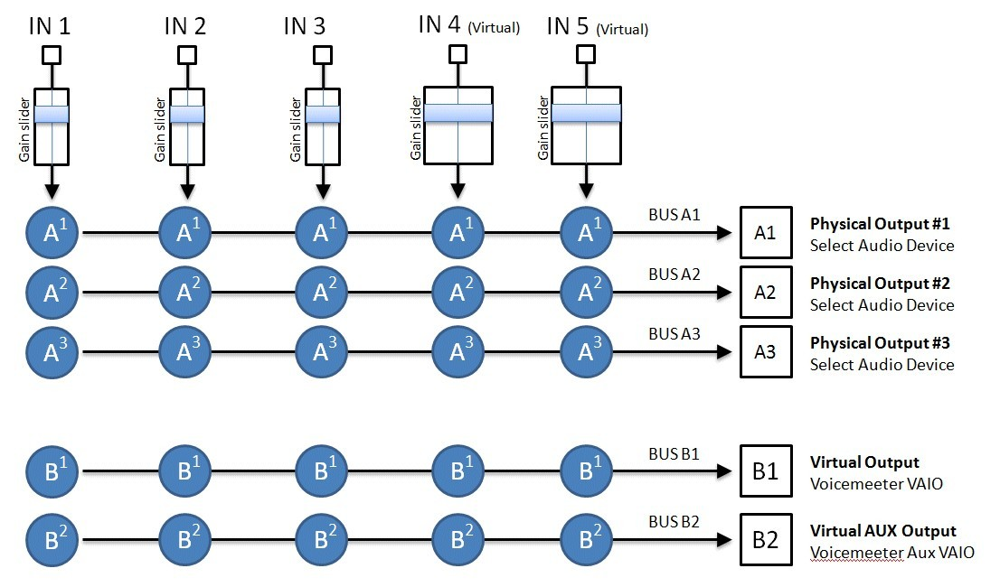
_Voicemeeter Banana General Diagram (5 inputs / 5 Buses / 5 outputs Mixing Console)_

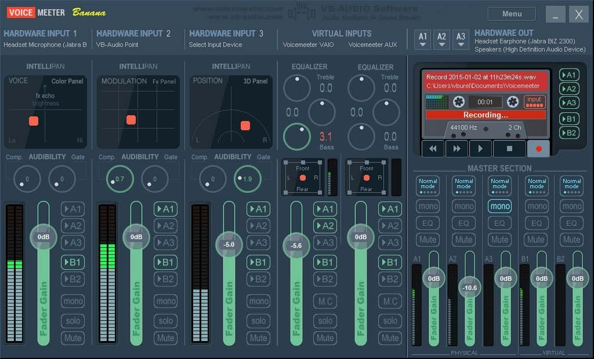

Voicemeeter Potato implements a full 8x8 matrix to let you mix your 8 possible inputs strip into 8 possible BUS outputs. BUS Assignation per strip work like on Banana but the SEL button per BUS allows setting input level for a particular BUS only. Then it is possible to define a MIX per BUS independently.

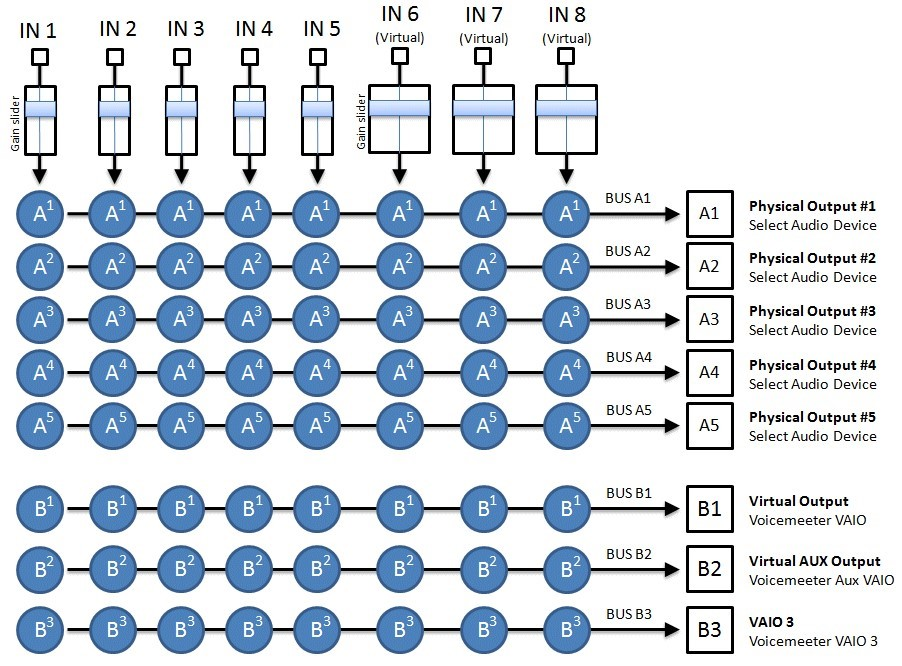

_Voicemeeter Potato General Diagram (8 inputs / 8 Buses / 8 outputs Mixing Console)_

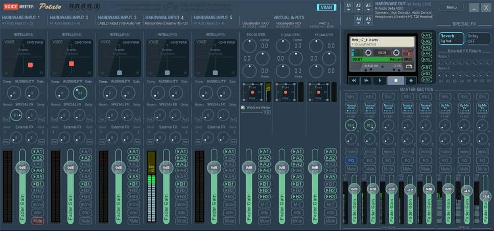

### Voicemeeter / Banana / Patato as Universal Virtual Audio Device

Voicemeeter offers Virtual Audio Point on Input #3 and on BUS B (Output B).   
Voicemeeter Banana offers Virtual Audio Point on Input #4 & #5 and on BUS B1 and B2.  
Voicemeeter Potato offers Virtual Audio Point on Input #6, #7 & #8 and on BUS B1, B2 and B3.  
These Virtual Audio I/O's (VAIO) support all possible Audio Interfaces and allows connecting any audio applications, including audio pro DAW or musical instrument working with ASIO devices.

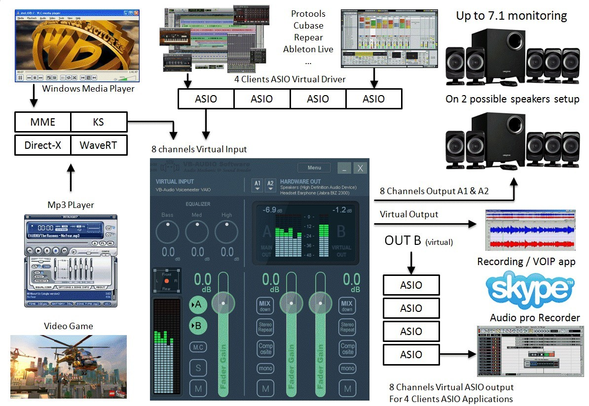

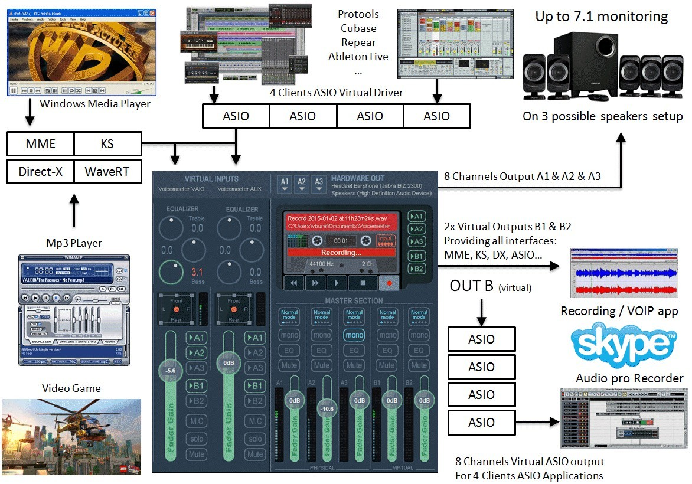

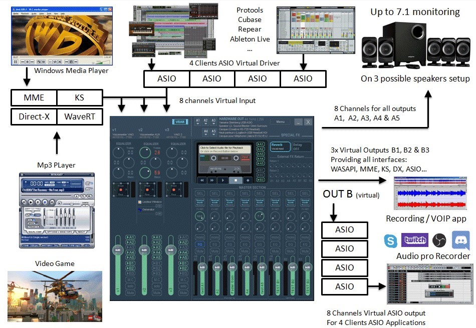

Audio interfaces type supported by Voicemeeter Virtual audio I/O (Voicemeeter VAIO). 

|Interface Type |Description |
|:--|:-|
|MME |The MME API or the Windows Multimedia API (also known as WinMM) was the first universal and standardized Windows audio API. This audio interface type is expected to work with whatever audio device but with latency time possibly around 100ms. |
|WDM |That we call WDM (Windows Driver Model) audio interface in Voicemeeter is handled by WASAPI : the Latest Microsoft Audio Functions to get best audio performances and small latency (< 30ms) – available since Windows VISTA |
|KS |Kernel Streaming or Direct Kernel streaming API allows low latency audio streaming, since Windows XP, but unfortunately not all audio devices provides this interface. |
|WaveRT |The WaveRT miniport driver is supported in Windows Vista and later Windows operating systems and can offers good audio performances and small latency (comparable to KS). |
|Direct-X |Direct-X Audio Interface is used by Video Game and some audio software. Latency is usually comparable to MME, |
|ASIO |Audio Stream Input/Output (ASIO) is a computer sound card driver protocol for digital audio specified by Steinberg, providing a low-latency and high fidelity interface between a software application and a computer's sound card.|

### Voicemeeter as Audio HUB and Next Gen Audio Engine

Voicemeeter now includes VBAN features and Voicemeeter Remote API. VBAN allows to send / receive audio stream to / from any computers of a local network. Voicemeeter Remote API allows developing client applications and taking advantage of all Voicemeeter features, inter connection with all audio interfaces type, audio device aggregation, mixing/routing functions, MIDI and VBAN features, to create new powerful audio applications.

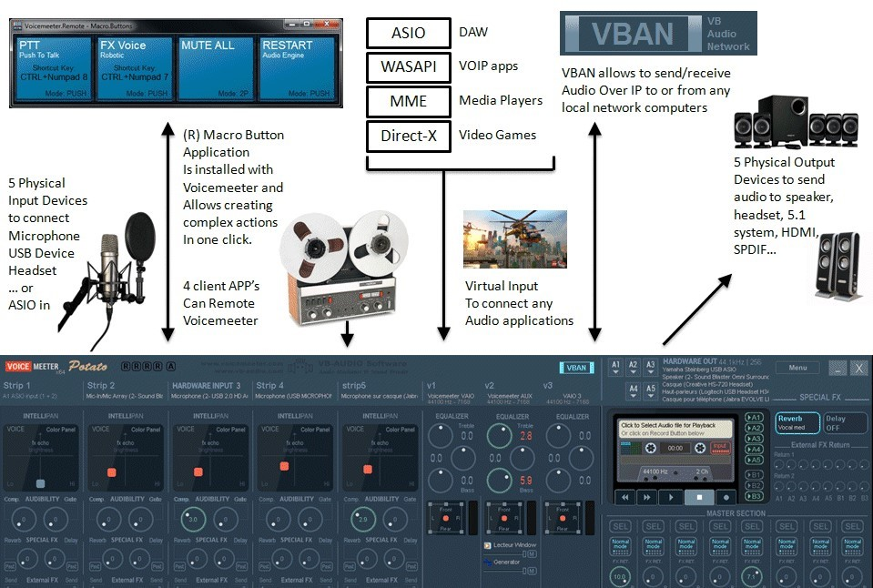

Voicemeeter is installed with Macro Buttons Application offering programmable buttons to act on Voicemeeter by simple request script

Voicemeeter package also installs VoicemeeterRemote.dll and VoicemeeterRemote64.dll for client application willing to control Voicemeeter by program.

More information and SDK download on our forum:  
[https://forum.vb-audio.com/viewtopic.php?f=8&t=346](https://forum.vb-audio.com/viewtopic.php?f=8&t=346)

---
std-11

### Audio Mixing Console Basis

An audio mixing console is a device able to sum different audio signals (audio sounds) coming from different inputs and route them to different outputs. Mixing desk is usually composed by Strips and Busses. While strips are connected to Inputs, busses are connected to outputs.

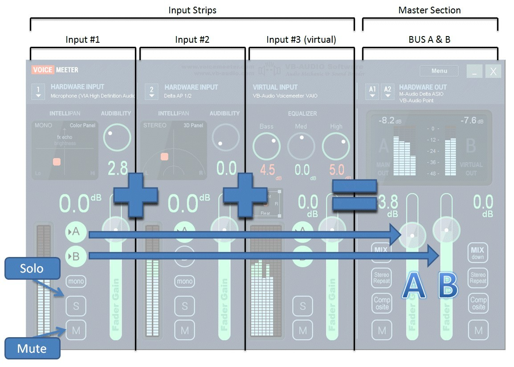

This schema above shows how basically Voicemeeter can mix 3 inputs into 2 busses (in BUS A if button A is switched on, on BUS B if button B is switched on). Typically BUS A can be used for monitoring (speakers) and BUS B for VOIP or audio recording applications.

Each strip (each input) can go through different processing before summing to the busses. Voicemeeter includes funny panels to tweak the sound on input #1 and #2 and a regular 3 bands Equalizer on input #3 (the Virtual Input).

Again on usual Mixing Console, we have on each strip a SOLO button (to listen one or several strips only) and a MUTE button to simply mute the signal of the Strip or Bus.

Finally the Fader Gain allows to adjust the sound volume for each Strip and Bus.

Other controls will be explained later, but basically we have described here the outlines of what is an Audio Mixer, generally speaking. 

std-11
---

## STEP 0: Quick Startup Guide

Voicemeeter is a virtual audio mixer intended to replace the Windows Mixer. The quickest way to configure Voicemeeter is to simply use it as default device and connect it to your main playback device. Then all PC sounds will go through Voicemeeter before playing back to your speakers.

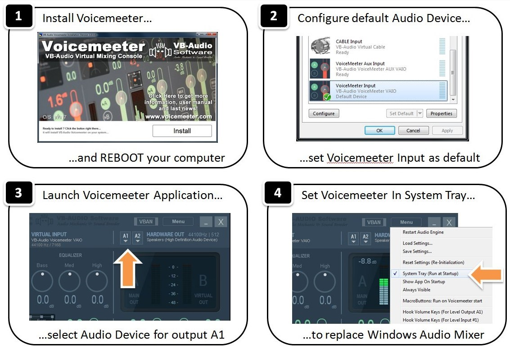

### Remarks in case of problem

Installing Voicemeeter means installing audio driver. In some cases, the system might declare this new driver as default driver (as default playback device for example). Consequently you do not hear anything anymore since you do not run and configure Voicemeeter and your system audio correctly (as it is shown above).

Windows System Audio Configuration is mainly located in Windows Control Panel / Sound Dialog Box. This is where you have to go to check or set what is your default playback device and what is your default recording device (and the Communications option has to be set to "Do Nothing" if you use Voicemeeter with VOIP applications).

In all cases, all is a question of audio configuration and it does not need to remove Voicemeeter in case of problem. Voicemeeter is a simple Application endowed with an audio device driver, if you don't use it, there is no way to get trouble. But if you do, you need to avoid possible audio device conflict and connect everything to Voicemeeter (to prevent other application to use audio playback device already used by Voicemeeter).

## STEP 1: Select main audio Output Device / Connecting Voicemeeter to Audio device

Voicemeeter can now work without audio device by running on its own internal clock (if no device is selected on output A1). If you have an audio output device, you can select it as output A1 for monitoring and give the master clock to Voicemeeter Audio Engine.

Just click on A1 button to select the main output device used for BUS A (A1). We recommend to select first ASIO (if exists) or WDM device type to get best Latency. WDM / KS playback device are used in exclusive mode per default, bypassing the windows mixer and possibly its Volume Control.

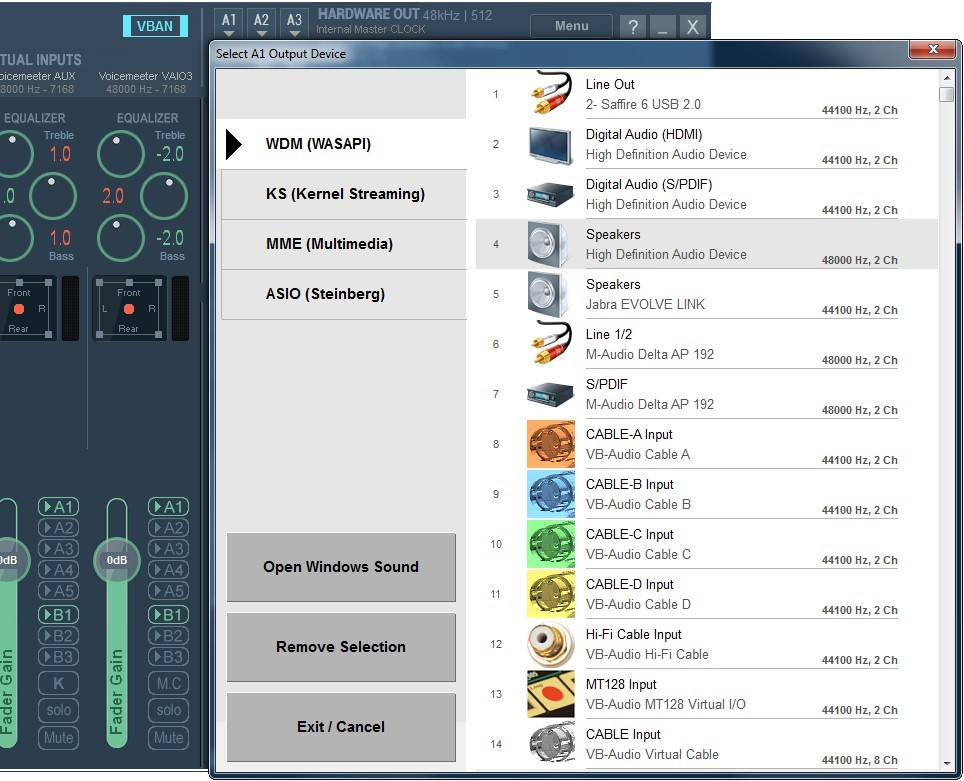

The device selector is now displaying your different audio devices by audio interface (WDM, KS, MME and ASIO) and driver name sorted by alphabetic order. Icons also help to find quickly the right device to select.

The main audio output device (A1) can work in 32 kHz, 44.1 kHz, 48 kHz, 88.2 kHz, 96 kHz, 176.4 kHz or 192 kHz. This will also be the main sample rate of the entire mixing process and Virtual ASIO points (Voicemeeter will support any sample rate on other inputs or outputs points).

"Open Windows Sound" button will open the Windows Sound Dialog Box to let you configure some audio system aspect and adjust the audio format of your audio devices.

### Windows Sound Panel / Sound Properties to configure device sound format

|||
|:--|:--|
|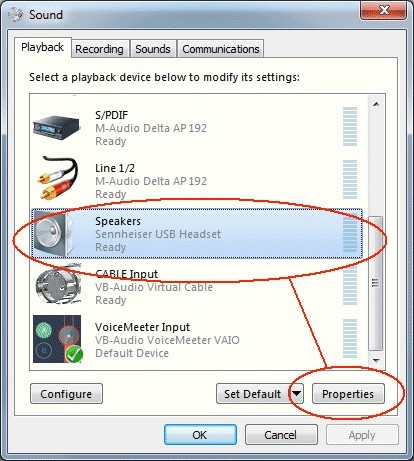 |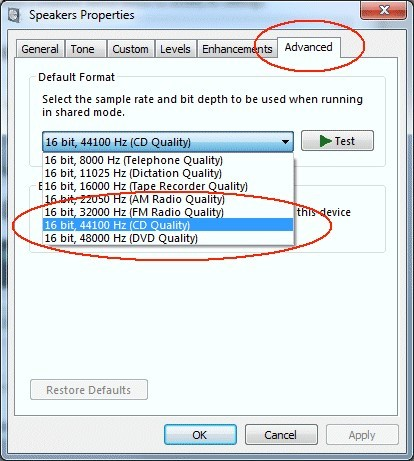 |

### Windows Sound Panel / Input level and Listen option

Windows "Listen" option can disturb Voicemeeter routing, so be sure that this option is disabled or makes sense for you. 

If your input level is too weak (or too loud), check the level of the selected input device. (Adjust possible pre-amp gain if any).

|||
|:--|:--|
|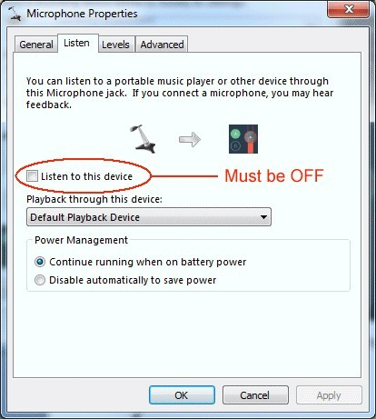 |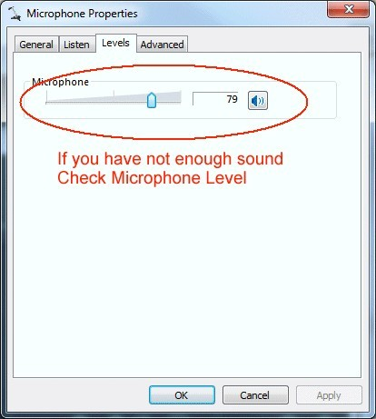 |

## STEP 2: Select an Input Device / Selecting Input Devices

An audio device can be selected for every physical strip by clicking on Stereo input area. Select audio input device on strip #1, for example your microphone! Then you will be able to listen to your voice in real time.

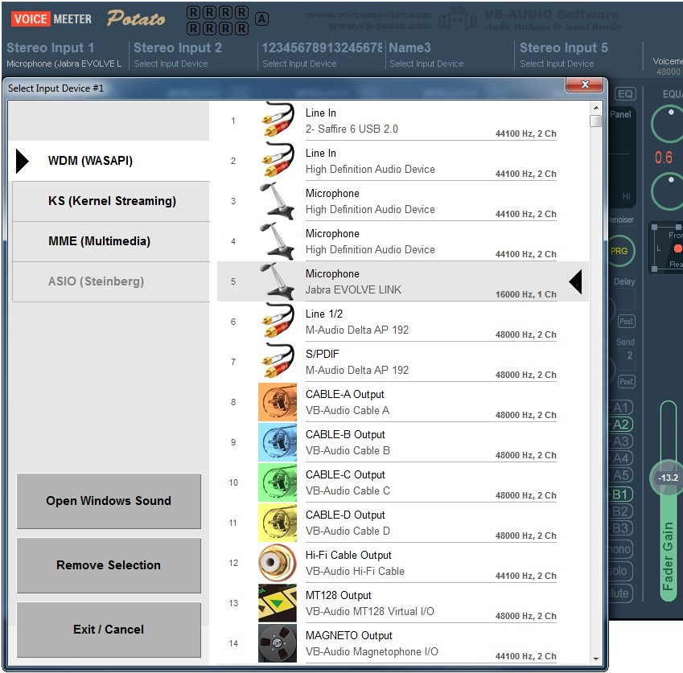

If you remove selection, Input strip can still get audio from VBAN stream or ASIO input from the ASIO device selected as output A1.

REM: it's better to select WDM driver (present since Windows VISTA) to get best latency and audio performances. If using MME driver you might have a bigger delay between input and output. Use MME driver only if WDM are not present or does not work correctly with your audio hardware configuration.

<div style="display: grid; grid-template-columns: 6fr 0.5fr 3.5fr;">
  <div>
  
  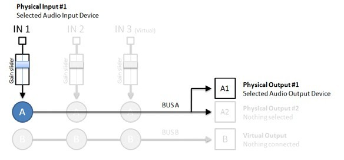
  </div>
  <div></div>
  <div>After Step 2, Voicemeeter is routing signal from selected input (e.g. Microphone) to A1 selected Output. Then you can hear from this audio output the sound coming in input #1. A & B button are switch to send signal in BUS A or/and BUS B.</div>
</div>

### Monitor Input in Real Time

After Step 2, you can hear what is coming in selected input. Blue VU-meter will show you level in real time. Input signal is per default sent to both busses (A & B) and we have routed the BUS A to an output device in Step 1.

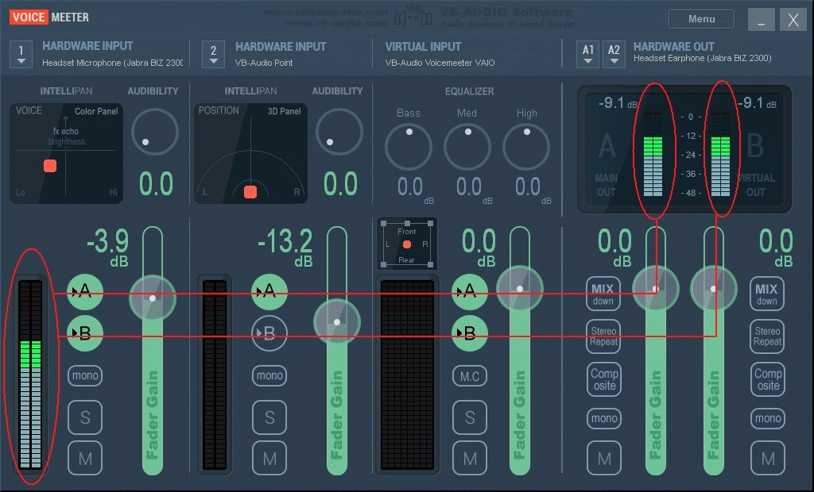


## STEP 3: Use Virtual Input as default playback device

Strip #3 is the virtual input of Voicemeeter. It is shown as regular system audio device and can be used by another application as playback audio device.

<div style="display: grid; grid-template-columns: 5fr 0.25fr 3fr; grid-template-rows: 7fr 3fr;">
  <div style="grid-column: 1; grid-row: 1;">
  
  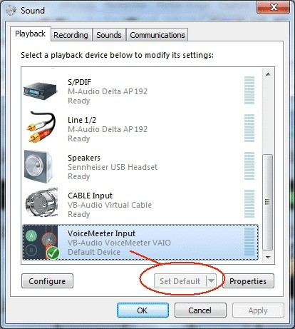
  </div>
  <div style="grid-column: 1; grid-row: 2;">
    <p>If Voicemeeter Input is set as default audio device, every sound played on the computer will go on the Virtual Input (Strip #3) of Voicemeeter Mixing Console.</p>
    <p>You can launch a Media Player or Web Radio and check that you can hear the sound coming from it on the Voicemeeter Virtual Input (IN 3).</p>
  </div>
  <div style="grid-column: 2; grid-row: 1 / span 2;"></div>
  <div style="grid-column: 3; grid-row: 1 / span 2;">
  
  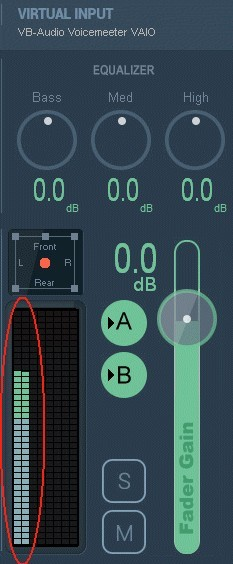
  </div>
</div>

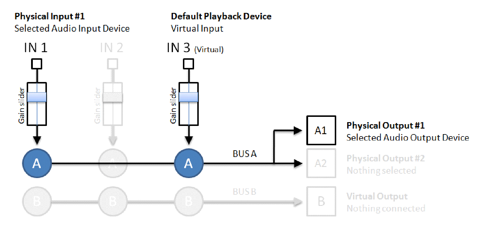


### Virtual Input is Multi-Channel

Strip #3, the virtual input of Voicemeeter can manage until 8 channels and get 5.1 audio from DVD for example. 

<div style="display: grid; grid-template-columns: 4.5fr 0.25fr 5.25fr;">
  <div>
  
  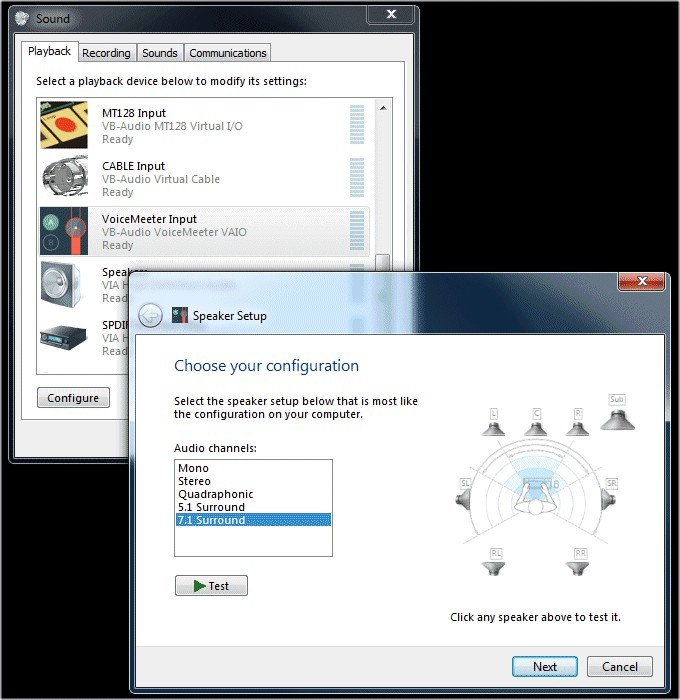
  </div>
  <div></div>
  <div>
    <p>Windows Control Panel /Sound Dialog Box allows configuring Audio device (playback and recording devices).</p>
    <p>To get multichannel audio from DVD player you need to configure the Voicemeeter Input in multi-channel (click on configure button on the left bottom after having selected the Voicemeeter input).</p>
    <p>When playing DVD you will see 5.1 audio signal incoming on Voicemeeter Virtual Input and also on possible A output level (if your output device supports the same number of channels).</p>
    <p>Note that BUS B is also multichannel but level meter shows always 2 first channels only.</p>
  </div>
</div>

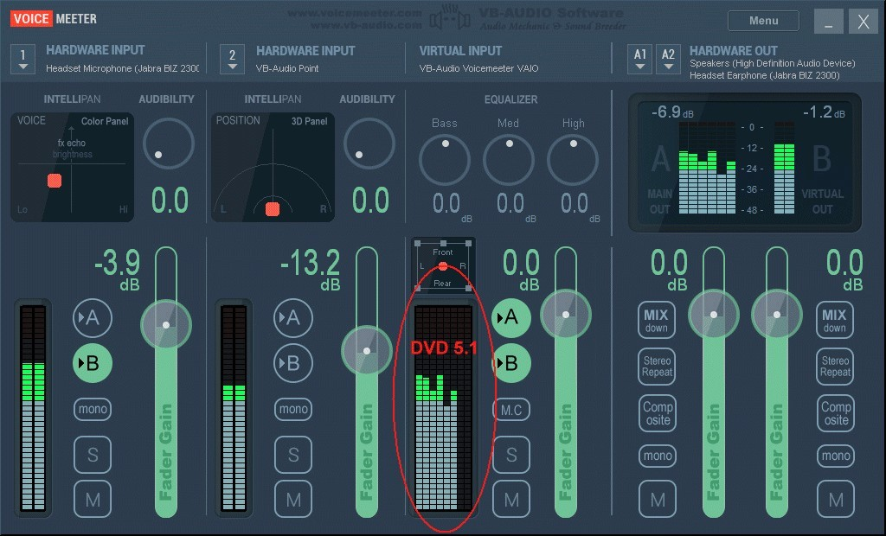

## Understanding Voicemeeter Virtual I/O in one picture

Virtual I/O are connected to virtual audio devices installed with Voicemeeter. Playback devices are used as virtual inputs while recording devices are fed with output B1, B2 and B3.

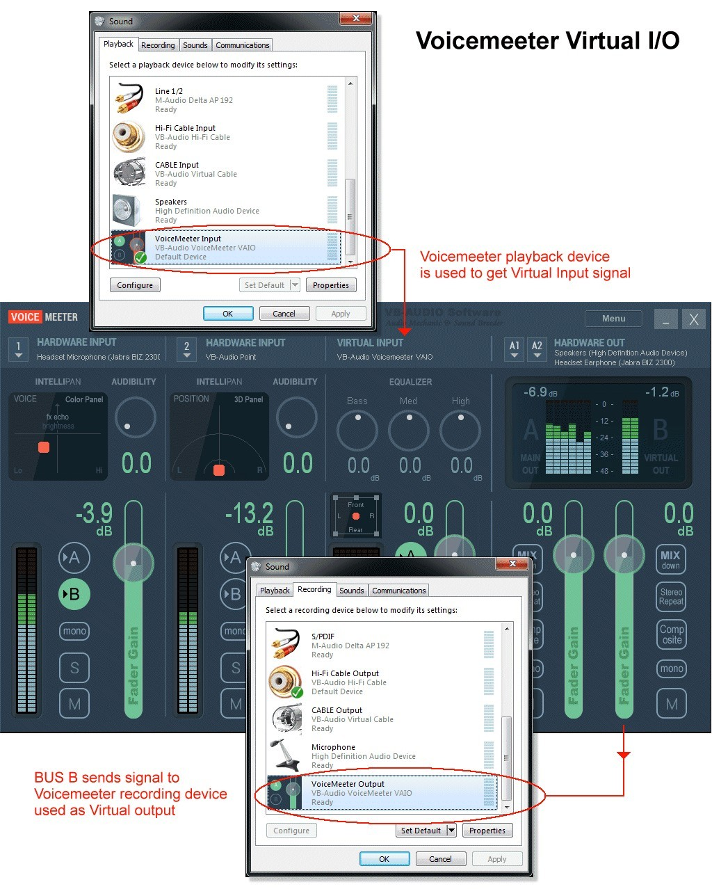

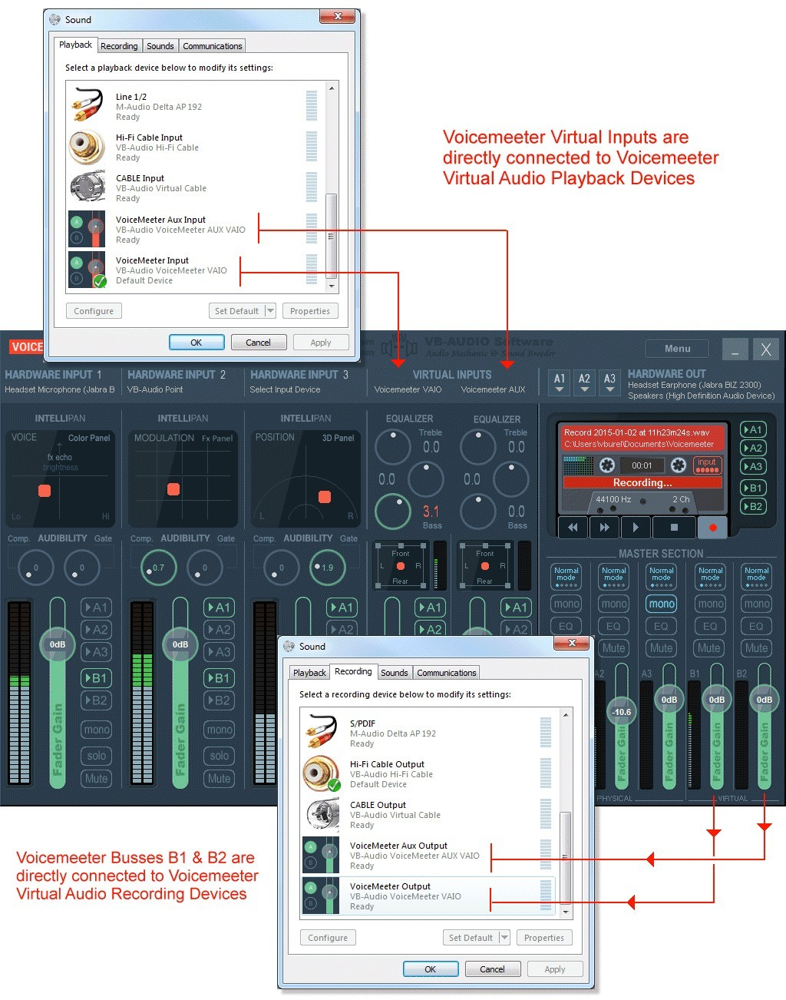

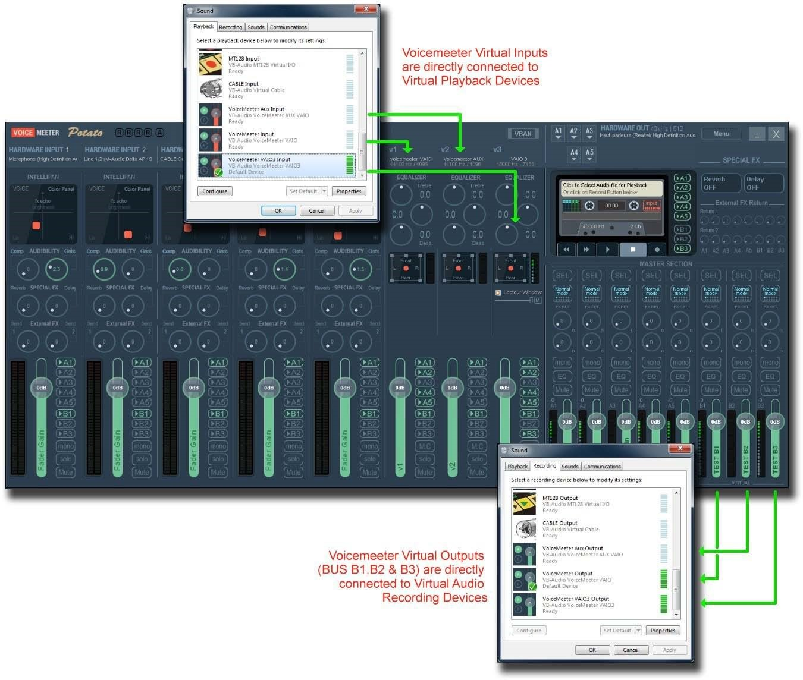

Voicemeeter VAIO: Playback Devices: 
|Virtual Audio Device Name |Description |Connected to |
|:--|:--|:--|
|Voicemeeter Input |First voicemeeter virtual audio driver |Virtual Input #1 |
|Voicemeeter Aux Input |Installed with Voicemeeter Banana |Virtual Input #2 |
|Voicemeeter VAIO3 Input |Installed with Voicemeeter Potato |Virtual Input #3|

Voicemeeter VAIO: Recording Devices: 
|Virtual Audio Device Name |Description |Connected from |
|:--|:--|:--|
|Voicemeeter Output |First voicemeeter virtual audio driver |BUS B1 |
|Voicemeeter Aux Output |Installed with Voicemeeter Banana |BUS B2 |
|Voicemeeter VAIO3 Output |Installed with Voicemeeter Potato |BUS B3|

### Understanding new Voicemeeter VAIOs driver (Win10 or higher)

Voicemeeter now offers up to 8 Virtual I/O. I/O 1 to 5 are VAIO extension.  
Standard: Voicemeeter input is also the Virtual input 6.  
Banana: Voicemeeter input is also the Virtual input 6. Voicemeeter Aux input is also the Virtual input 7.  
Potato: Voicemeeter input, AUX and VAIO3 are also the Virtual input 6, 7 and 8.

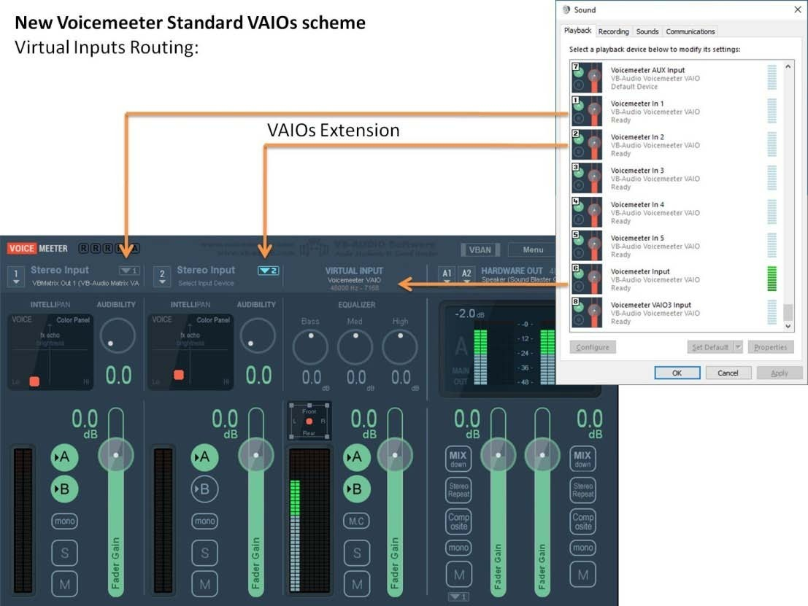

Voicemeeeter Output is now called Voicemeeter out B1 (Virtual output 6).

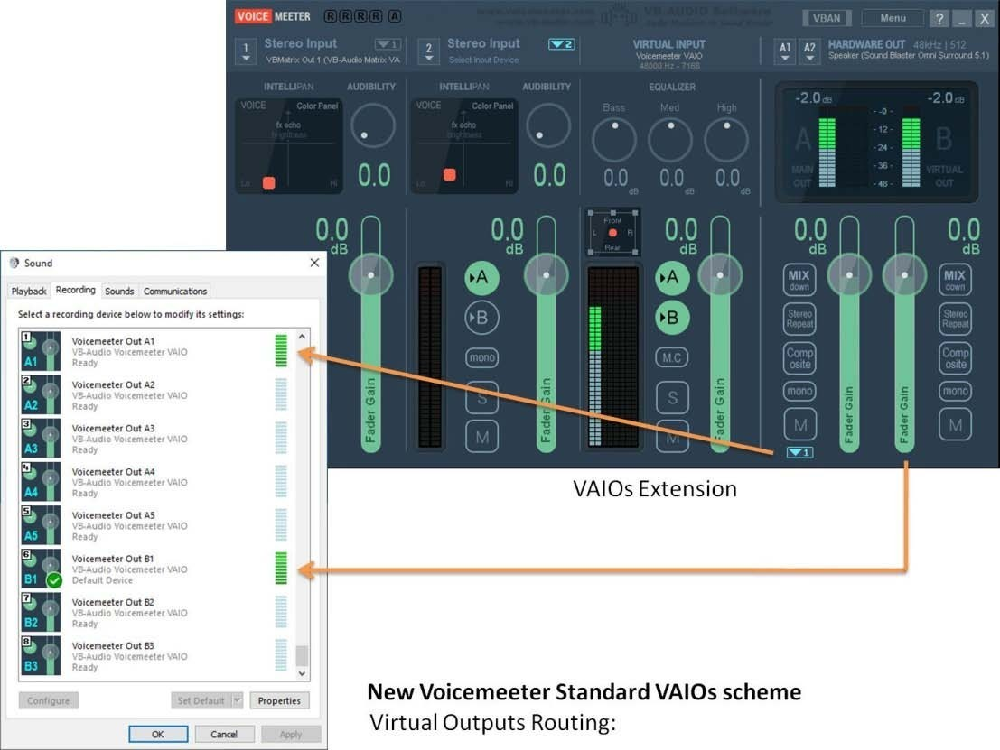

VAIO Extensions can be activated by an additional license (see Voicemeeter menu).

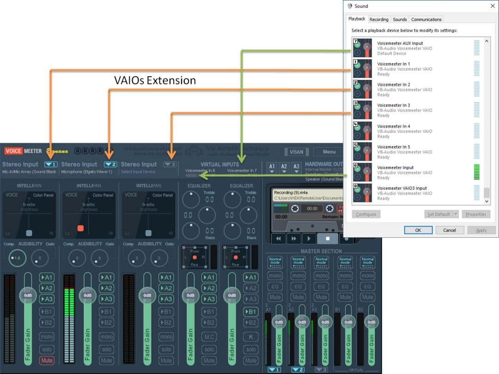

Voicemeeter output is now called Voicemeeter out B1 (Virtual output 6)  
Voicemeeter AUX output is now called Voicemeeter.out B2 (Virtual output 7).

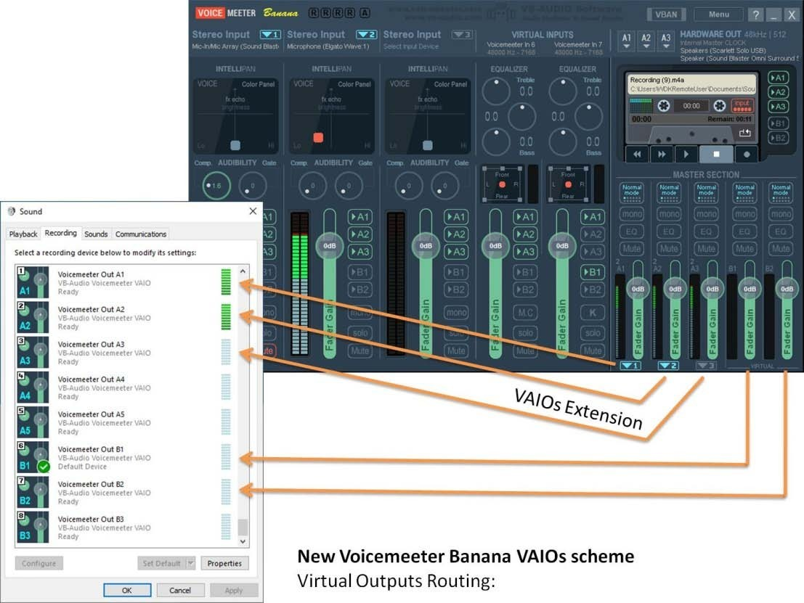

VAIO Extensions can be activated by an additional license (see Voicemeeter menu).

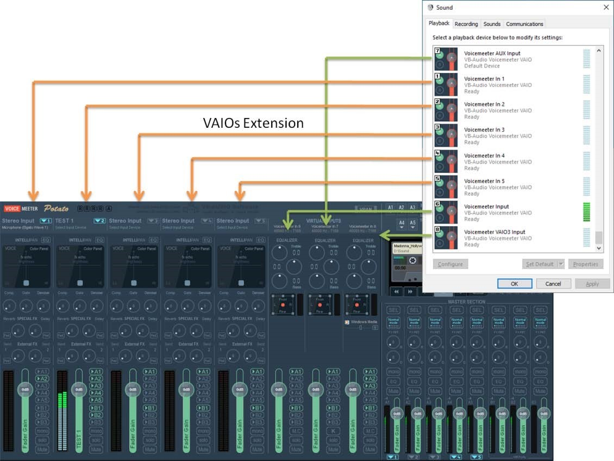

Voicemeeter output is now called "Voicemeeter out B1" (Virtual output 6)  
Voicemeeter AUX output is now called "Voicemeeter.out B2" (Virtual output 7).  
Voicemeeter VAIO3 output is now called "Voicemeeter.out B3" (Virtual output 8).

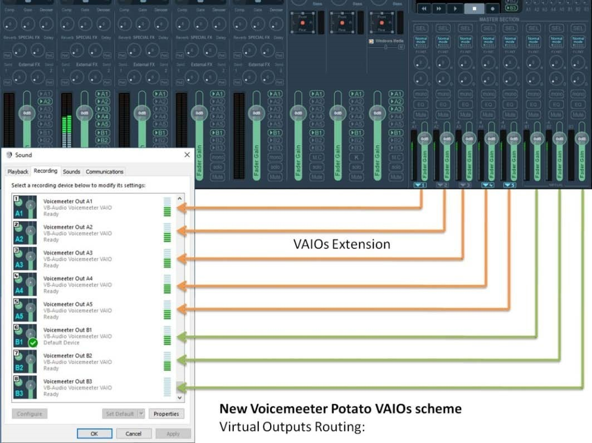

VAIO Extensions can be activated by an additional license (see Voicemeeter menu).

### Voicemeeter Virtual ASIO driver

---
std-25

Each Voicemeeter Virtual I/O also supports an ASIO interface able to manage 4 client applications. These 4 possible sources get signal from BUS B1 (for Voicemeeter Virtual ASIO) and their outputs are mixed together on the related Virtual Input (with possible PC Sound already coming from usual windows audio interfaces).

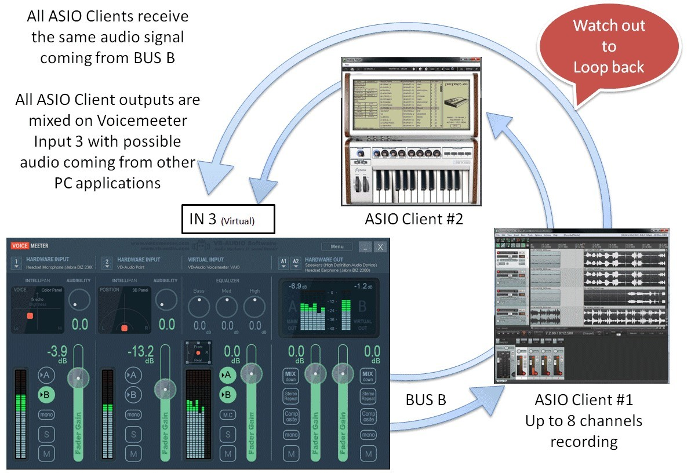

std-25
---
---
banana-18

Each Voicemeeter Virtual I/O also supports an ASIO interface able to manage 4 client applications. These 4 possible sources get signal from BUS B1 (for Voicemeeter Virtual ASIO) or BUS B2 (for Voicemeeter AUX virtual ASIO) and their outputs are mixed together on the related Virtual Input (with possible PC Sound already coming from usual windows audio interfaces).

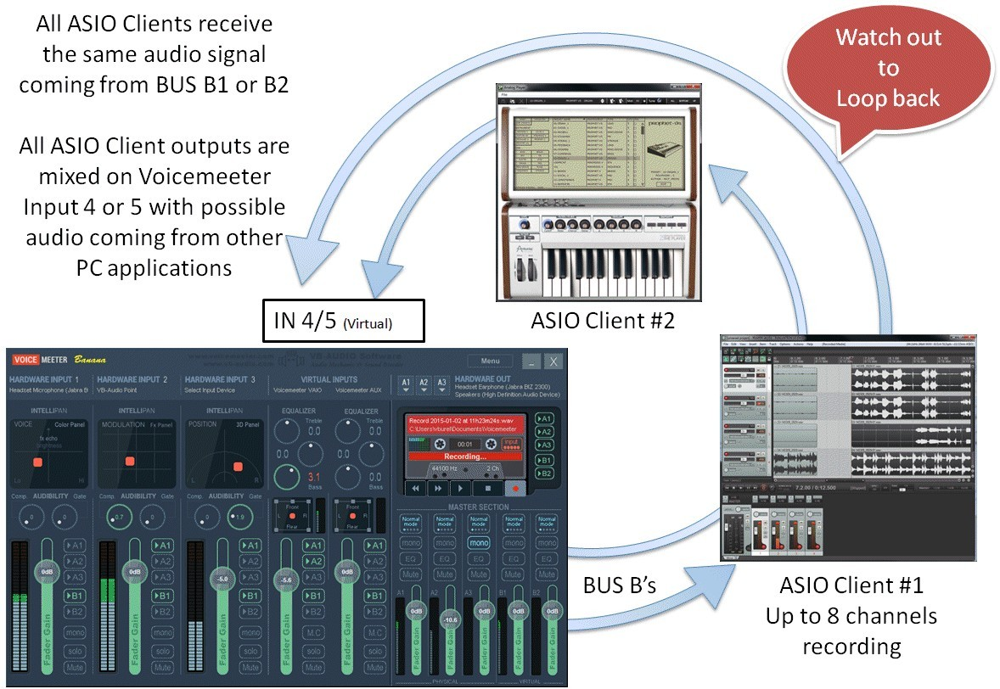

banana-18
---

Each Voicemeeter Virtual I/O also supports an ASIO interface able to manage 4 client applications. These 4 possible sources get signal from BUS B1 (for Voicemeeter Virtual ASIO) BUS B2 (for Voicemeeter AUX virtual ASIO) or BUS B3 (for Voicemeeter VAIO3 virtual ASIO) and their outputs are mixed together on the related Virtual Input (with possible PC Sound already coming from usual windows audio interfaces).

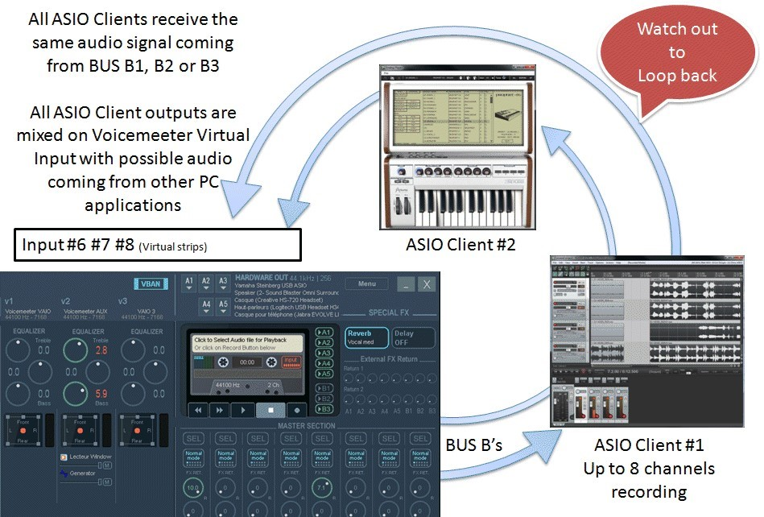

**For Recording Applications, take care about the loop back! You might have MUTED outputs or disable monitoring otherwise output signal will come back on input infinitely.**

|Configure DAW Application |Configure Musical Instrument |
|:--|:--|
|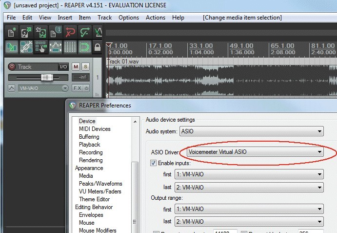 |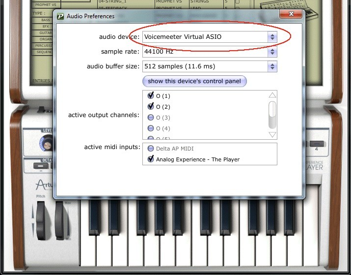 |

Select Voicemeeter Virtual ASIO device In any audio applications supporting ASIO

---
std-21

## STEP 4: Send the Mix Output to Skype Input

BUS B, not used yet, can be used to send the mix to virtual output that can be connected to another application (typically a recording or VOIP application).

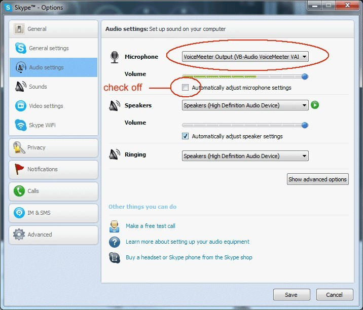

For example in Skype you can select the Voicemeeter Virtual Output as Microphone.

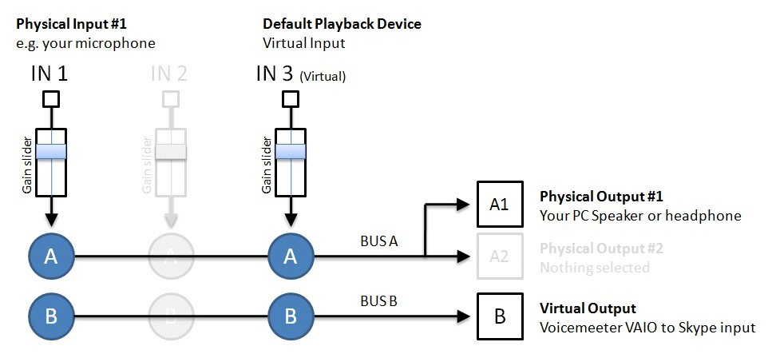

std-21
---

## STEP 5: Enjoy new Audio Controls

While you are talking you can tweak your voice in real time with different controls; 2D Panel, Audibility knobs or simple 3 bands Equalizer…

### INTELLIPAN COLOR PANEL

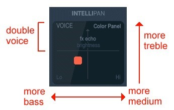

Based on basic equalizer, this panel will allow you to change the color of your voice in a quick way.

It gives a spectral identity to your voice by acting on 3 frequency bands and a tiny reverb on the half top.

### Position 3D Panel: The Binaural effect

If you right click on panel you can switch to another effect able to position audio sources with a simple room effect (works in stereo only).

<div style="display: grid; grid-template-columns: 5fr 0.25fr 3fr; ">
  <div>
  
  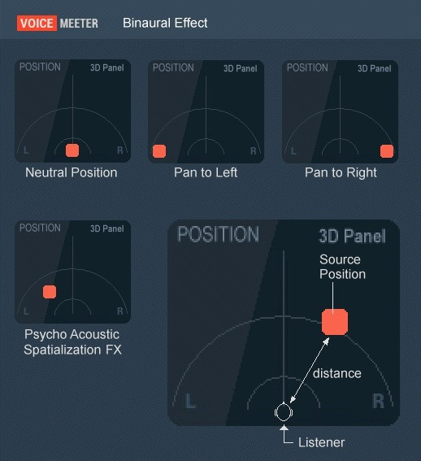
  </div>
  <div></div>
  <div>
    <p>Voicemeeter includes a binaural effect able to give a spatial identity to audio sources and then increase dialog intelligibility (especially when everyone is talking in the same time).</p>
    <p>This effect works in stereo, so can be used when recording a stereo stream to improve the sound of the global mix. This also can be used to simply enhance your voice to stereo.</p>
    <p>This kind of "psycho acoustic" effect is used a lot since decades in audio production to create a better "audio scene" by positioning some music tracks on different virtual location. Today several FOH live mixing consoles are proposing such advanced Pan Pot, mainly because it allows saving audio energy – while the regular pan pot could completely remove the sound from left or right.</p>
  </div>
</div>

### Modulation Fx

If you right click on 2D Panel you can also get the Modulation panel below.

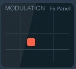

Based on Chorus effect, this panel allows to make various effects. Just experiment by placing cursor wherever you want. Basically chorus / phasing effect are on the bottom while modulations are on the top. Modulations with feedback are on the left side while simple modulation is on the right side. Depth is given by the distance to the middle of the panel.

### INTELLIPAN INDICATOR

On the top of this panel you now can see 3x points indicating if the effect is in use or not. First point becomes orange if the Color Panel is not in neutral position. Second point becomes orange if the Modulation Panel is not in neutral position. Third point becomes orange if the 3D Panel is not in neutral position.

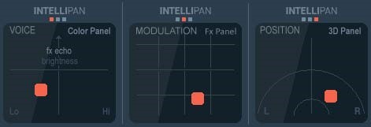

### Equalization / 5.1 Pan Pot

On both Virtual input strips, there is a simple 3 bands Equalizer and 5.1 Pan Pot.


_Banana / Patato Equalizer and 5.1 Pan Pot_

**EQUALIZER**

3 Bands Equalizer to boost or remove bass, medium and high frequency (treble).

  
_Voicemeeter Equalizer_

**5.1 Pan POT**

Below the Equalizer a small 2D Panel allows 5.1 balance. It's a simple process to position the sound source in one of your 5 speakers:

- front left
- Front Center
- Front Right
- Rear Left
- Rear Right

#### PAN POT MODE

Right Click on Pan POT to get the menu and select how you want to transform your multichannel sound before sending it to BUS.

TIPS: Double click on pan pot to reset to Normal mode with the cursor on the exact center.


MONO mode works like the MONO button on stereo strips.

Repeat MONO mode is duplicating the left channel into 7 others.

Repeat STEREO mode is duplicating the left+right channels into 6 others, 2 y 2. So Left + Right will be copied to channels 3+4 , 5+6, and 7+8

Mix Down, Up Mix and Only modes work like BUS Modes (see BUS mode to get detailed processing in next pages).

### AUDIBILITY CONTROL


_VoiceMeeter Standard_

This single knob controls a compressor / gate allowing to boost your voice and manage noisy talk. It needs to be adjusted according microphone capabilities and sound environment.

### Compressor / Gate

On each input strip there are two knobs to set compression and gate effect.


_Banana_

### Compressor / Gate / Denoiser

On each hardware input strip, there are three knobs to set simplified Compression effect, simplified Gate effect and a Denoiser knob to reduce or remove the noise floor.


Compression is made with "auto make up". Consequently it gives a big boost to your voice while compressing it. Then you can adjust the level by decreasing the fader gain.

Denoiser knb will help you to reduce or remove the noise floor according the amount (0 to 10). If not zero, the Denoiser effect will add some latency to this strip.

#### Compressor / Gate detailed parameters

Right clicking on compressor or gate knob will open the detailed parameters view to get access to all parameters of the compressor and gate effect.

Right click again will switch back the view to original Voicemeeter Potato Strip view.

The Compressor / Gate detailed view show the compressor transfer graph on top (in place of the INTELLIPAN panel). Horizontal level meters show input levels, red meters shows gain reduction (due to compression or gate closing).

#### Compressor Details


**Input Gain:** To control the gain before compression.

**Ratio:** Gives the compression rate.

**Threshold:** Define a level to start the compression when the input signal goes over this threshold.

**Attack Time:** to control the compression behavior on sound attack (when the input signal starts to go over the threshold).

**Release Time:** to control the compression behavior when the signal goes down.

**Knee:** To control the compression transition softness on threshold point.

**Output Gain:** To control the gain after compression.

**Auto make Up:** apply an output gain automatically computed to compensate the compression.

#### Gate Details

**Threshold:** If input gain is below this level the gate is closing, above this level the gate is opening.

**Damping Max:** Allows limiting the gain reduction when the gate is closing. Per default OFF = -inf, the gate completely remove the signal when closing.

**BP Sidechain:** This parameters allows to define a Band Pass frequency (1,5 octave) in the sidechain (input signal controlling the gate). Then the gate will react on specific frequency range only.

**Attack time:** Define how long it takes to open the gate (gain increasing time).

**Hold Time:** Define the minimal time the gate stays opened anyway (whatever the input gain).

**Release Time:** Define how long it takes to close the gate (gain decreasing time).

---

REM: CTRL+ RIGHT CLICK to edit parameter value.

<div style="display: grid; grid-template-columns: auto 1fr; gap: 16px;">
  <div>
  
  
  </div>
  <div>
  
  SHIFT + CLICK on a parameter to open the TRI Precision Slider. It will allow you to adjust some time values for example with high precision.
  
  CTRL+ RIGHT CLICK on parameter to edit its value
  
  RIGHT CLICK: to switch back to original view.
  
  CTRL+ RIGHT CLICK on Comp or Gate knob = UNDO
  </div>
</div>

<div style="display: grid; grid-template-columns: auto 1fr; gap: 16px;">
  <div>
  
  
  </div>
  <div>

  PRG is displayed in the Comp or Gate Knob when detailed parameters are changed. If moving this Comp or Gate Knob after, all detailed parameter will be changed again to fit the default behavior of these Comp / Gate knob. .
  
  To get your detailed parameter back (UNDO): CTRL + RIGHT CLICK on this Comp or Gate Knob.
  
  </div>
</div>

### Denoiser Details

Right clicking on Denoiser knob will open the detailed parameters view to get access to a new voice effect.

<div style="display: grid; grid-template-columns: auto 1fr; gap: 16px;">
  <div>
  
  
  </div>
  <div>

  **Noise Floor Remover:** To control the denoiser amount (same as denoiser knob).

### Voice Modeler

  **Enable Fx:** Activate the Voice Modeler effect.

  **Dry / Wet Balance:** gives the amount of dry signal (original input = -100%) and wet signal (Fx = +100%). 0% mean same amount for dry and wet signal.

  **Pitch:** pitch amount in semi tone (from -12 to +12 semi tone).

  **Formant Lo:** Pitch for low frequency formant (from -12 to +12 semi tone).

  **Formant Med:** Pitch for medium frequency formant (from -12 to +12 semi tone).

  **Formant Hi:** Pitch for high frequency formant (from -12 to +12 semi tone).

  **Formant Group:** 3 Formant average control, to change all formant in the same time.

  REM: CTRL+ RIGHT CLICK to edit parameter value.

  **Preset**

  8 configurable user presets. Left click to recall it. Right click to get contextual menu..
  </div>
</div>

<div style="display: grid; grid-template-columns: auto 1fr; gap: 16px;">
  <div>
  
  
  </div>
  <div>
  
  PRG is also displayed in Denoiser knob if the Voice Modeler is in use. Moving this Knob will switch off the voice Modeler and act on Noise floor Remover parameter only. Set it to ZERO to disable all Denoiser Fx.

  To get your detailed parameter back (UNDO): CTRL + RIGHT CLICK on Denoiser knob Knob.
  </div>
</div>

### Strip Limiter

<div style="display: grid; grid-template-columns: auto 1fr; gap: 16px;">
  <div>
  
  
  </div>
  <div>

  With Voicemeeter Banana comes a Brick-Wall Limiter on each physical or virtual strip to define a threshold for each audio source. Click directly in the meter bar to set the limit by the mouse or right click to enter the value directly (-40 to +12 dB).

  WARNING: Strip Limiter is made before Slider Gain (BUS Limiter is made after Slider Gain).

  **Trick: All controls go back to default value if double click on it!**
  </div>
</div>

#### Green or Yellow Limiter

With the version x.1.3.0 Voicemeeter Banana is offering two limiter types, the original Yellow limiter and the Green limiter. Use CTRL+Click to swap from one to another.

<div style="display: grid; grid-template-columns: auto 1fr; gap: 16px;">
  <div>
  
  
  </div>
  <div>

  The green Limiter is also a Brick-Wall Limiter but with a 5ms integration time (this predictive time introduces 5ms latency). This is made to avoid distortion and remove any crackling.

  Noise attack is usually not hearable on a full audio track, but if the sound is a single instrument (e.g. guitar or bass) or a voice from a Soft-Phone or any sound without treble (nothing above 5kHz), then yellow limiter can produce hearable attack noise. That's why we now offering the Green Limiter.
  </div>
</div>

#### What is Limiter noise attack?

<div style="display: grid; grid-template-columns: 1fr 1fr; gap: 16px;">
  <div>
  
  
  </div>
  <div>

  **Without limiter**, the signal over zero dBfs is just clipped, squashed against a boundary. This is producing a C-MOS type distortion. Sinus signal tends to become a square signal.

  The **yellow limiter** tries to reduce the gain to keep the signal into the 0 dBfs limit. But since it's a real time algorithm, it can be surprised on big attack and finally produces clipping effect (hearable in some cases, pending on material).

  **Green Limiter** is expected to be perfect because it uses a 5ms latency as integration time to anticipates all signal peaks.
  </div>
</div>

#### Limiter on BUS

With the version x.1.3.0 Voicemeeter Banana is offering limiter also on BUS.

<div style="display: grid; grid-template-columns: auto 1fr; gap: 16px;">
  <div>
  
  
  </div>
  <div>

  Limiter on BUS work like on strip except it can be set between -20 dB and 0dB (because directly outputting to audio device). REM: Limiter on strip allows defining a limit over 0 dB (+12 dB max) because this signal is routed internally to BUS and can be reduced by different after effects, gain or BUS Limiter. However if the Strip Limiter introduces attack noises, the BUS Limiter won't be able to remove them.

  REM: if OUT Limiter option is ON in system settings dialog box, yellow limiter is set as 0 dBfs by default (even if not explicitly set) This is the original Voicemeeter default behavior.
  </div>
</div>

### M.C Button / M.C. Means Mute Center

<div style="display: grid; grid-template-columns: auto 1fr; gap: 16px;">
  <div>
  
  
  </div>
  <div>

  M.C. Button is made to mute the center channel on virtual input on a 5.1 or 7.1 audio material, coming from DVD for example. This is the button to mute the channel 3 (CENTER) containing the dialogs of the movie. Then it is possible to make real time movie dubbing by using this button as this video tutorial is showing it: https://youtu.be/EdnD8b6n-Fw
  </div>
</div>

### Karaoke Button

<div style="display: grid; grid-template-columns: auto 1fr; gap: 16px;">
  <div>
  
  
  </div>
  <div>

  With Voicemeeter Banana version 2.0.5.3 and Potato version 3.0.1.3 comes a K button on Virtual AUX input to offer 4 different real time algorithms to remove the voice on a stereo material..

  **K-m:** Karaoke Voice Remover Removes the common part of a stereo track material. All mono sound will be removed

  **K-1:** For some material, other sounds than voices can be removed, so the K-1 mode will keep some bass and treble.

  **K-2:** Like the K-1 mode, K-2 mode will keep more bass and more treble.

  **Kv:** If nothing works (like on a MONO track), this last mode will simply remove the voice frequence range (200- 4000 Hz) by a simple filter
  </div>
</div>


### Parametric EQ on hardware input

With Potato November 2022 version comes a full Parametric Stereo EQ on each hardware input.

Right click on the small EQ button (on the right of INTELLIPAN label) to open the 6 bands Full parametric EQ graphic user interface. This is exactly the same EQ than on Master BUS, except it is applied to stereo signal (hardware input are stereo when master BUS are multi channels (8 channels).


PEAK Gain range has been extended to -36 db - +18 dB , that's why different scale are proposed in contextual menu if required.

Channel parameters are compatible with all EQ and can be copied from an EQ strip to an EQ master or in the other way.

EQ settings can also be saved / loaded by the dialog box sys-menu (click on icon on top-left) or the Strip menu (see next page).

### Strip Menu

Right click on top of the input strip to display the Strip Menu (Right Click on INTELLIPAN label for hardware inputs, Click on EQUALIZER label for virtual Inputs).

<div style="display: grid; grid-template-columns: 1fr 1fr; gap: 16px;">
  <div>
  
  
  </div>
  <div>

  The strip Menu allows performing 3 kinds of operation on all parameters of the strip (except slider, Solo / Mute and BUS assignation).

  **RESET:** to reset all parameters or just a particular effect to default values.

  **COPY / PASTE:** to copy / paste all parameters or just a particular effect from a strip to another.

  **LOAD / SAVE:** to save / load all parameters or just a particular effect from a strip to another, through a xml file, that you can also share with other users / computers.

  Strip menu is different for Virtual Input than for Hardware input since it offers different strip tools.

  
  </div>
</div>

### Applications shown on Virtual Input Strip

With Voicemeeter Potato, the virtual input strips are showing the 4 first applications connected to the related virtual input (through the windows audio interface). It does not list application connected by ASIO interface). Then for each application, it displays the volume and the mute control coming directly from the Windows Volume Mixer.


If you move the cursor on the Windows Volume Mixer, it will be shown on the Voicemeeter virtual strip and vice versa. The Mute control is represented by the "M" button and is also related to the Mute control on the Windows Volume Mixer.

Generally speaking, the virtual inputs strip should reflect the related Windows Volume Mixer state (without the System Sounds Control) up to 32 applications. If an application is disconnected, Voicemeeter should be notified and will remove it from the list. If it remains in the list, a "Restart Audio Engine" should correctly refresh the list of connected applications.

Some applications like Discord can open all available device and appears in All Windows Volume mixers. This is confusing and must be notified to the software manufacturer, it makes no sense to open all audio devices. Just the one selected is enough.

With last version of Voicemeeter Potato, the level meter is also displayed in real time. It helps to see what application is sending audio in Voicemeeter virtual inputs. A right click allows extending area to show up to 32 connected applications.

Note also that the 4 first applications can be handled by a MIDI controller thanks to the MIDI mapping.


### Master Section: BUS Assignation

Banana: The Master section allows managing all outputs BUS. BUS A1, A2, A3 are connected to physical audio device while BUS B1, B2 are connected to related virtual audio output (appearing as recording device in Windows system).

Potato: The Master section allows managing all outputs BUS. BUS A1, A2, A3, A4, A5 are connected to physical audio device while BUS B1, B2, B3 are connected to related virtual audio output (appearing as recording devices in Windows system).


### Master Section: Output BUS

Each BUS offers different function to manage audio output behavior:


**SELECT MIX:** SEL button allows selecting the mix assigned to a particular BUS. CTL+CLICK allows to select several BUS in the same time. When a BUS is selected, Input Sliders are displaying the related MIX.

**BUS Mode:** BUS Mode can change the contents or the channel organization of the BUS (see MODE next pages). Normal mode is just letting the 8 channels AS IS.

**Mono / Cross:** MONO button allow to turn stereo to mono and if you click twice, cross the channel 1 and 2 of the BUS.

**Master EQ:** Master EQ button allows switching ON/OFF the Parametric EQ. Right click to open the Master EQ Dialog box.

**MUTE:** MUTE button allows to mute the BUS

**Gain Slider:** Finally, the Gain Slider allows to adjust the output volume of the BUS.

#### BUS SEL Button and sub-mix view

BUS Selector allows defining sub mix with strip gain sliders, but version 3.1.3.0 offers an overview on all sub-mix by right clicking on assignation buttons (Right click to swap view).


Then you can see all mix for all strips in the same time, and also possibly make the link with VM-Streamer View.

The Strip Gain Slider is giving the max level of all sub-mix (or of the SELected sub-mix by BUS SEL buttons).

The submix value can be adjusted directly by using CTRL+Wheel. The value can be edited by CTRL+Click.

### BUS Master Parametric EQ

Each BUS offers an EQ button to switch ON/OFF the Master 6 Cells Full Parametric EQ. Right Click on this EQ button to open the EQpro-G6 Dialog Box.


It provides 6 EQ Cells (with a master gain / delay) for the 8 possible channels of the BUS. The Channel Selector allows working on all channels in the same time or on a given channel only.

FLAT button will reset the Equalizer (according the channel selector)

A / B provides two different memories to define 2 different equalization settings and compare them just by switching to A or B. EQ settings are always done in current selected preset (A or B).

CH COPY: copy EQ settings of the current channel (to copy current channel equalization to another channel for example).

COPY ALL: copy EQ settings of all channels (to copy entire equalization to another BUS for example).

RIGHT CLICK on Gain / Q / Frequency Control to open a small Edit Box to enter value manually / precisely.

<div style="display: grid; grid-template-columns: auto 1fr; gap: 16px;">
  <div>
  
  
  </div>
  <div>

  The EQ button can give information about the current Equalizer state for the 8 channels

  **Green:** channel is equalized or gain changed.   
  **Red:** channel is delayed.   
  **Yellow:** channel is equalized and delayed.   
  **Black:** nothing applied on channel.  
  </div>
</div>

<div style="display: grid; grid-template-columns: auto 1fr; gap: 16px;">
  <div>
  
  
  </div>
  <div>

  EQ Dialog Box System Menu offers two functions to simply LOAD / SAVE your EQ settings as a XML File (for the current BUS with its 8 channels).

  Then it is possible copy the BUS EQ settings from a BUS to another... or/and share it with other users.

  Right click on graph opens a menu to change dB Scale range
  </div>
</div>

### Special Routing Options on Output BUS

Voicemeeter provides additional routing modes for all Busses in order to use the possible 8 output channels in different ways.

<div style="display: grid; grid-template-columns: auto 1fr; gap: 16px;">
  <div>
  
  
  </div>
  <div>

  **MIX DOWN MODE**

  This mode is made to make a stereo mix- down with 5.1 or 7.1 sound coming from DVD player on virtual input (strip #3). Left and right channels, Center, Sub and rear are combined to output on stereo speakers.

  MIX DOWN A  
  Rear & side Speaker are mixed out of phase to simulate surround effect in stereo

  MIX DOWN B  
  Rear & side Speaker are mixed in phase

  **STEREO REPEAT**

  This button is made to use possible 8 outputs channels with a stereo signal. This stereo signal is repeated to channel 3,4 / 5,6 and 7,8.
  </div>
</div>

MIX DOWN A (Processing)
- LEFT = FL + (70% FC) + SW + RL - SL  
- RIGHT = RL + (70% FC) + SW - RR + SR

MIX DOWN B (Processing)
- LEFT = FL + (70% FC) + SW + RL + SL 
- RIGHT = RL + (70% FC) + SW + RR + SR

#### Use Master EQ as crossover

STEREO REPEAT mode also allows using Master EQ as crossover for 2, 3 or 4 ways active speakers system (thanks to 6 full parametric cells, especially LPF or HPF filters).


Since the stereo signal is duplicated on channel 3+4, 5+6 and 7+8. You can connect up to 4 stereo amplifier for different speakers and use the parametric EQ (that is multichannel) to make a full crossover processing.

Also master EQ are now offering a trim / delay knob per channel, so you can manage the gain compensation and the delay adjustment per channel if needed.

---
std-26

<div style="display: grid; grid-template-columns: auto 1fr; gap: 16px;">
  <div>
  
  
  </div>
  <div>

  **COMPOSITE**

  This last button is made for audio post production. The 8 channels are composed in this way:

  - ch 1,2 : usual BUS stereo output
  - ch 3,4: Voicemeeter input #1 before gain fader
  - ch 5,6: Voicemeeter input #2 before gain fader
  - ch 7,8: Virtual input channel 1,2 before gain fader

  With composite signal, it's possible to record all Voicemeeter Inputs (each in stereo) with a DAW connected to Voicemeeter virtual ASIO for example. It allows recording VOIP interview or conference and making post production process after with the 3 audio stereo tracks.

  **MONO**

  MONO button simply merges channel 1 & 2 to make mono signal in both channel 1 & 2. Made for single speaker monitoring.
  </div>
</div>

std-26
---

#### COMPOSITE MODE

This mode is made for audio post production. The 8 channels of the BUS can be composed by any pre-fader or post fader inputs (or default BUS channel): In the System Settings Dialog Box, user can define the Composite Patch.


With composite signal, it's possible to record up to 8 channels composed by any Voicemeeter Inputs or with a DAW connected to Voicemeeter virtual ASIO, or with the integrated recorder. for example. It allows recording VOIP interview or conference and making post production process after, with up to 8 different tracks.


To switch the PRE-Fader input mode to POST-Fader input mode, just click on text here below:


Since version 2.0.3.4, additional BUS modes are also present to up mix or extract specific channels:

For example

- To extract LFE channel and send it to sub devices (sub woofer, Buttkicker, Subpac…).
- To send 5.1 Rear channel to wireless speaker (Bluetooth).
- To send Center channel on specific speaker device.
- To use 2.1, 4.1, 5.1 or 7.1 PA system with stereo audio sources.


<div style="display: grid; grid-template-columns: 1fr 1fr; gap: 16px;">
  <div>
  
  
  </div>
  <div>

  **Additional application**

  It is also possible to get total control on 8 channels with a small application called **8x8 Gain Matrix**, to redistribute all 8 channels of a 5.1 or 7.1 audio signal coming from your DVD player or Video Game.

  This free application for Voicemeeter can be found on our forum here:  
  [https://forum.vb-audio.com/viewtopic.php?f=8&t=394](https://forum.vb-audio.com/viewtopic.php?f=8&t=394)
  </div>
</div>

#### All Voicemeeter BUS Mode (14)

Here below the list of 14 BUS Mode to manage the 8 channels of the BUS in 14 different ways.

||||
|:--|:--|:--|
| |**Normal Mode** |All channels are sent AS IS |
| |**MIX DOWN A** |LEFT = FL + (70% FC) + SW + RL - SL <br>RIGHT = RL + (70% FC) + SW - RR + SR |
| |**MIX DOWN B** |LEFT = FL + (70% FC) + SW + RL + SL <br>RIGHT = RL + (70% FC) + SW + RR + SR |
| |**STEREO REPEAT** |ch1 = FL, ch3 = FL, ch5 = FL, ch7 = FL <br>ch2 = FR, ch4 = FR, ch6 = FR, ch8 = FR |
| |**COMPOSITE MODE** |Contains pre fader inputs given by the COMPOSITE PATCH |
| |**UP MIX TV (create 7.1 from stereo)** |FL = L, FC = 20%(L+R), RL = 70%(L-R), SL = 70%(L-R) <br>FR = R, SW=50%(L+R), RR = 70%(R-L), SR = 70%(R-L) |
| |**UP MIX 2.1** |FL = L, FR = R, SW=50%(L+R). |
| |**UP MIX 4.1** |FL = L, FR = R, SW=50%(L+R). <br>RL = L, RR = R |
| |**UP MIX 6.1** |FL = L, FR = R, SW=50%(L+R). <br>RL = L, RR = R SL = L, SR = R |
| |**LEFT ONLY (extract Left Channel)** |LEFT = FL <br>RIGHT = FL |
| |**RIGHT ONLY (extract Right Channel)** |LEFT = FR <br>RIGHT = FR |
| |**CENTER ONLY (extract Center)** |LEFT = FC <br>RIGHT = FC |
| |**LFE ONLY (extract sub woofer)** |LEFT = SW <br>RIGHT = SW |
| |**REAR ONLY (extract rear)** |LEFT = RL <br>RIGHT = RR |

## Special Fx

With Potato comes an internal Special FX section offering a stereo reverb and a stereo MutliTap Delay. Internal FX Section requires to offer SEND / RETURN knobs. One on each Strip to send the audio source in the FX , one on each BUS to get the FX result.


All Physical inputs provide a rotary knob to send the related audio source in the Reverb and in the MultiTap Delay. The POST button allows switching between PRE or POST fader mode (in POST mode the SEND level is also pending on the gain slider).

All Busses also provide a rotary knob to get the return of the reverb and the return of the Delay FX. Then you can control the amount of special FX you get in each bus.

### Internal Reverb: JustVerb III

The justverb III is a special version of the AphroVx reverb series developed in 1999. It has been developed in 2006 for Innovason live mixing console (based on Analog Device SHARC DSP) with a graphic user interface adapted to live production workflow. Based on a series of usual reverb preset, Justverb III offer a 3 band full parametric equalizer to give the exact wanted color to your reverb effect.

With 10 x 3 Preset, JustVerb III gives the most regular reverb sound you need. Then you may adjust them with the different control and the equalizer.

DRY : amount of original signal (usually minimum when used with a SEND / RETURN path).

WET : amount of reverb effect (usually 0.0 dB when used with a SEND / RETURN path).

DELAY knob allow to define the pre-delay (up to 1000 ms).

E.Ref: control the Early Reflection amount (to add early reflexion, re-inforce the beginning of the reverb).

DECAY knob allow to change the reverb time from 50% to 200% (1 = 100% = original preset).

BYP: the bypass button allows bypassing the entire reverb (soft bypass) or the Equalizer only.


### Internal Delay: MultiTap 8

The MultiTap Delay is also a special FX originally developed for Innovason Mixing Console in 2006 and allow to manage 8 Stereo Tap on a musical timeline (to make rhythm). Each TAP has a gain control, left / right pan control and LPF /HPF filter.

The big LCD display the time line where each tap are located with a musical scale 4/4 beat on top and 3/4 beat on bottom. The Gain Timeline allows defining gain and delay of each tap. The Pan Time Line allows defining the panoramic for each tap.

The musical scale is function of the current Tempo (bpm = beat per minute). The Time Ratio knob allow to scale current rhythm to another tempo.

Like on the reverb effect, we retrieve the regular control DRY, WET, and Pre-delay:

DRY: amount of original signal (usually minimum when used with a SEND / RETURN path).

WET: amount of reverb effect (usually 0.0 dB when used with a SEND / RETURN path).

PRE-DELAY knob allow to define the pre-delay (up to 1000 ms).

BYPASS: the bypass button allows bypassing the entire delay fx (soft bypass).

The two balance knobs allow considering left and right input channels independently and re- balance them to get a mono or a reverse stereo input signal.


The Feedback knob allows to loop the output and re-send it into the FX input.

"Set Note" button opens a dialog box to let you define a delay time by a musical note duration (pending on current Tempo).

The TAP button allows defining a new tempo by typing on it, in rhythm with what you hear. The new tempo is displayed in blinking red (after 4 taps) then you can decide to keep it by pushing the small button "Scale Fit". Then you can adjust your TAP rhythm with the Time Ratio knob to adjust your current rhythm to the new tempo. Then you can push the button FIX DELAY to set all delay with the right value (Time Ratio is reset to 0).

If AUTO FIT button is ON, the new tempo is automatically kept and the delay of all activated taps, are adjusted to keep the same rhythm on new tempo.

### Internal MultiBand Compressor: C5

The C5 has also been originally developed for Innovason Mixing Console in 2007 but never been used because replace by the C4. Now the C5 is available in Voicemeeter potato to apply a Multi Band Compression to any Hardware inputs.

<div style="display: grid; grid-template-columns: auto 1fr; gap: 16px;">
  <div>
  
  
  </div>
  <div>

  The C5 effect must me selected first, to replace the Delay Fx in the Voicemeeter System Settings Dialog box. Click on Delay to Swith to C5 and vice versa.
  </div>
</div>

The C5 graphic user interface is basically made of 5 bands showing the different levels (input, output and gain reduction) and offering a complete Compressor/Limiter processing for each.


Frequency of the 5 bands can be adjusted by the 4 controls between bands (below meters). Then for each band the following parameters are available:

**Gain:** Input gain before compression

**Threshold:** Compression threshold. Above this level the signal is compressed according the ratio parameter.

**Ratio:** Compression ratio.

**Attack:** to control the compression behavior on sound attack (when the input signal starts to go over the threshold).

**Release:** to control the compression behavior when the signal goes down.

**Knee:** To control the compression transition softness on threshold point.

**Out Gain:** Gain after compression, allows to compensate the gain reduction due to the compression, or apply a final equalization / balance.

**Limit:** define a brckwall limit on the ouput of the related band.

**Distorsion:** Controls the limiter reaction rate. More distorsion will make the limiter react faster, less distorsion slower (softer limitation).

Each compressor / Limiter can be disabled / enabled. The LINK Type gives the way the band are linked together when modifying a parameter, in ABSolute mode, RELative more or completely independently.

**SOLO / MUTE:** control allows to listen to particular bands. The settings can be saved / loaded by the sys-menu (click on icon on top-left of the dialog box).

**OUTPUT GAIN:** To adjust the final ouput gain.

**AUTO MAKE UP:** Apply an output gain automatically computed to compensate the compression, for all bands.

**BYPASS:** bypass the entire processing

#### C5 Routing

To use the C5 to compress hardware input sources, you may consider routing your input signal into the C5 only. It means you must not assign BUS to your strip if it uses the FX return (otherwise you will double the signal in BUS: one coming from the C5 Return, one coming from the Strip BUS assignation).


Of course you can use BUS Assignation if the related BUS does not use C5 return. But in the example above, all BUS are getting the C5 Return, so all BUS assignation buttons must be all OFF on the strip sending signal to the C5. POST button means POST FADER (after gain slider and mute) and allow using the Slider to control the input gain (finally sent to C5).

### External FX

External FX management provides two true AUX paths through regular SEND / RETURN knobs. These AUX work only if the External FX I/O are assigned to ASIO channel (from the ASIO device selected as output A1 – having enough channel to be assigned to External FX path points).

## ASIO Routing Capabilities

---
std-27

With Voicemeeter 1.0.5.0 / 2.0.3.0 it is possible to route all physical inputs and busses to possibly 64 I/O of the ASIO Driver selected as output A1. It is the optimal way to use Voicemeeter with a professional audio board.

This is possible by selecting no device for physical input / physical bus. Then the system settings dialog box proposes to select input channels / or output channels for bus A2 (BUS A1 always uses the 8 first output channels of the ASIO driver):


In this example:

- Physical Input #2 gets audio from ASIO input channels 3+4
- BUS A1 automatically uses 8 first output channel of the ASIO board
- BUS A2 will send audio to ASIO output channels 63+64

WARNING: BUS outputs are copied in the ASIO output channels in logical order A1, A2, A3. It means that A1 channels (1 to 8) could be replaced by A2 channels (if overlapping). For example if A2 is routed to channel 1+2, it will overwrite output A1 channel 1+2 (you won't hear the BUS A1 anymore, since it is replaced by A2).

std-27
---
---
banana-33

With Voicemeeter 1.0.5.0 / 2.0.3.0 it is possible to route all physical inputs and busses to possibly 64 I/O of the ASIO Driver selected as output A1. It is the optimal way to use Voicemeeter with a professional audio board.

This is possible by selecting no device for physical input / physical bus. Then the system settings dialog box proposes to select input channels / or output channels for bus A2 and A3 (BUS A1 always uses the 8 first output channels of the ASIO driver):


In this example:
- Physical Input #2 gets audio from ASIO input channels 3+4
- Physical input #3 gets audio from ASIO input channels 5+6
- BUS A1 automatically uses 8 first output channel of the ASIO board
- BUS A2 will send audio to ASIO output channels 63+64
- BUS A3 will send audio to ASIO output channel 10 to 17 (8 channels).

WARNING: BUS outputs are copied in the ASIO output channels in logical order A1, A2, A3. It means that A1 channels (1 to 8) could be replaced by A2 channels (if overlapping). For example if A2 is routed to channel 1+2, it will overwrite output A1 channel 1+2 (you won't hear the BUS A1 anymore, since it is replaced by A2).

banana-33
---

If selecting an ASIO device as output A1, it is possible to route all physical inputs, all physical busses and external FX functions to possibly 64 I/O. Note that selecting an ASIO device as output A1 is the optimal way to use Voicemeeter with a professional audio board.

This is possible by selecting no device for physical input / physical bus. Then the system settings dialog box proposes to select input channels / or output channels for bus A2, A3, A4 and A5 (BUS A1 always uses the 8 first output channels of the ASIO driver):


In this example:

- Physical Input #1, #2, #3, #4 gets audio from ASIO input channels 1 to 8
- Physical input #5 gets audio microphone Sennheiser USB Device.
- BUS A1 automatically uses 8 first output channels of the ASIO board
- BUS A2 will send audio to ASIO output channels 10+11
- BUS A3 will send audio to ASIO output channel 17 to 22 (6 channels).
- BUS A4 will send audio to ASIO output channel 63 to 64 (Stereo Monitoring).
- BUS A5 is connected to a WDM device (Speaker Sennheiser USB Device).

WARNING: BUS outputs are copied in the ASIO output channels in logical order A1, A2, A3, A4 and A5. It means that A1 channels (1 to 8) could be replaced by A2 channels (in case of channel overlap), and A2 could be replaced by A3 etc….

### External FX ASIO routing

External FX (true AUX) is working only with ASIO driver connected to output A1 and can be routed to ASIO channels by the External FX Patch (yellow diagram). In the example above, the External FX Send 1 knob will send audio to ASIO output channel 32+33 (Stereo AUX) and the return signal (Return 1) will be taken on the ASIO input channel 40,41 (Stereo RETURN).

## Integrated Recorder

Voicemeeter Banana provides a simple player recorder to playback whatever WAV, AIFF, MP3, M4A, MP4, MOV, AVI, WMA, WMV files and to record easily everything in WAV, BWF, AIFF or even MP3 format:


Click on cassette top to select audio file to playback. Click on progress bar to position playback cursor in audio file. You can click on RECORD at any moment. It will generate an audio file in your document / Voicemeeter folder with an automatic name with a prefix, the current date, start time and current file extension:

Example: Record 2015-01-02 at 11h23m24s.wav

### Recording Options

Right Click on Tape Desk to get this recording option dialog box below:


Per default recording options allows to record all pre-fader inputs to simply record everything coming in Voicemeeter But you can decide to record as well the output of a BUS.

PRE-FADER INPUTS  

This option allows recording one or all inputs in stereo (mixed together), independently from the fader gain (and all fx, mute and solo states). This option is made to record original incoming audio signal, but all sources are mixed together with its original gain.

POST FADER OUTPUTS  
This options is made to record the outputs of a BUS (from 2 to 8 channel) possible with COMPOSITE options. In other word this option allows to record what you hear on the selected BUS. Note that you can use a BUS not connected to an audio device to make a source assignation only for recording.

FILE OPTIONS  
The target directory and prefix of the filename can be defined by clicking on the related field and select new directory or enter new prefix (prefix is "Record" if nothing is defined).

PRE-RECORDING BUFFER  
Voicemeeter is permanently recording with the current buffer allocation (20 second per default). Then it is possible to store this pre-recording buffer by defining a value in second (0 = no pre- recording buffer). This pre-recording buffer will be stored at the beginning of the file (when clicking on REC).

FILE TYPE  
File type can de defined as WAV, BWF, AIFF or MP3 (32 to 320 kbps). MP3 can record stereo only while other format can support up to 8 channels (when recording a BUS).

File format, including sample rate, is defined independently than the format used by Voicemeeter. For example, the recording file format can be set in 48 kHz while Voicemeeter is running in 44100 Hz.

MULTITRACK OPTION  
If set to YES, the recording will also generate one file per track / channel. The file name will be suffixed by "\_Track1", "\_Track2", "\_Track3"… according the number of channel defined for the file format.

PLAY ON LOAD  
This option will playback the file automatically just after selecting it.

LOOP  
This option will playback the file in loop, continuously.

PLAYBACK GAIN  
This slider control the gain of the audio file being played back.

STOP RECORD AFTER DURATION  
Let you define the time of a record session. It's a simple timer that will stop recording automatically after the given duration (set it to 00:00:00 to disable it). This is for example practical to record a movie or podcast with a known duration.

## Voicemeeter Main Menu

By clicking on "menu" area, user gets access to different functions:


The additional menu is there to provide additional functions:

- To Restart Audio Engine.
- To Automatically Restart Audio Engine if the Output A1 if disconnected.
- To Automatically Restart Audio Engine if any device is disconnected.
- To Release Audio File (used by the tape recorder).
- To load or save current settings in a given filename.
- To Load a particular settings file on startup, then you restart with the same settings anyway.
- To reset Voicemeeter complete settings.
---
- To set Voicemeeter in system tray.
- To run it on system startup.
- To show Voicemeeter on launch.
- To set Voicemeeter as always visible (window on top).
- To Lock main graphic user interface to prevent to change settings.
---
- To Run Macro Button or Streamer View on Voicemeeter launch. To run other applications installed with Voicemeeter.
- To hook key to control volumes on Voicemeeter with keyboard (Output A1 or A2 or Strip #1 level).
- To limite the remote gain (MIDI control) to 0dB (instead of +12 dB).
- To Show contextual help in caption (enabled by default).
- To Show Preset Scene dialog box on startup.

- To open different configuration dialog boxes (System settings, Recording options, M.I.D.I. mapping, VBAN Dialog Box).
- To shutdown the application.

- The About Box will show you some link to get more information and donate on our webshop.
- VAIO Extension License Dialog box is present on Win10 64bit and higher version, when the new VAIO driver is installed and when extra virtual I/O (1 to 2) can be activated by a specific activation code.
- System Settings Dialog Box allows to configure parameters related to audio device management..
- M.I.D.I. Mapping Dialog Box allows to connect a M.I.D.I. Remote surface to Voicemeeter.
- VBAN Dialog Box will help you to configure the VB-Audio Network functions, to send/receive audio stream to/from any computer of your local network.
- Click on "Check Driver Installation" to run the VBDeviceCheck.exe program and get a detailed diagnostic on VB-Audio Driver Installation. More information on our forum: [https://forum.vb-audio.com/viewtopic.php?f=6&t=442](https://forum.vb-audio.com/viewtopic.php?f=6&t=442)

### Other Voicemeeter Tools & Accessories

To demonstrate Voicemeeter Remote API audio callback mechanism, Voicemeeter is installed with two audio plug-ins applications (8x8 Gain Matrix & Graphiq EQ). A standalone application called VBAN2MIDI to convert physical MIDI stream into VBAN protocol is also installed.

<div style="display: grid; grid-template-columns: 1fr 1fr; gap: 16px;">
  <div>
  
  
  </div>
  <div>

  **8x8 Gain Matrix**

  This simple application provides a single 8x8 gain matrix applicable on the selected BUS.

  This can be helpful to re-distribute audio channels into different multi channel speaker systems.

  This application has been developed with the gain matrix example provided in the Voicemeeter Remote API SDK: [https://forum.vb-audio.com/viewtopic.php?f=8&t=346](https://forum.vb-audio.com/viewtopic.php?f=8&t=346)
  </div>
  <div>
  
  **15 Bands graphic EQ**

  This simple application provides a 15 bands graphic EQ applicable on the selected BUS.

  This can be helpful to adjust the sound of your P.A. System (stereo only).
  </div>
  <div>

  
  </div>
  <div>

  
  </div>
  <div>

  **VBAN2MIDI**

  Standalone application to send VBAN-MIDI stream from a MIDI input device or send MIDI message to physical MIDI Output from an incoming VBAN-MIDI Stream.

  Warning: 2 applications cannot use the same UDP port in the same time. 
  </div>
</div>

### Streamer View: 

Installed with Voicemeeter, the Streamer View application is a simplified and resizable Graphic User Interface for streamer to control Voicemeeter, or directly (by using Voicemeeter Remote API) or through network (using VBAN).

You can launch the VM Streamer view from the Voicemeeter Menu or from the Windows Applications list. The Streamer View is a regular user application installed with Voicemeeter.


Streamer View displays only labeled Strip and labeled BUS. It means you have to give a label to your input and BUS output to see them in this interface (to label a strip or a bus, RIGHT CLICK on Voicemeeter slider bottom).

One of the big interest of the streamer view with Voicemeeter potato is to get a direct access to sub mixes (mix per bus) so you can quickly adjust the mix for ouput A1 or for virtual output B1 (Skype) or virtual output B2 (OBS) because you have a slider gain for each on all strips.

The MON button on each BUS allows listening to a particular output BUS according monitoring option set in Voicemeeter System Settings Dialog box.

<div style="display: grid; grid-template-columns: auto 1fr; gap: 16px;">
  <div>
  
  
  </div>
  <div>

  Monitoring BUS give the output BUS where you will listen the selected BUS to monitor.

  For consistency with possible remoting, Slider Mode might be set in RELATIVE mode, then all sub mixes will keep there differences when using MIDI controller on Strip Gain Slider.
  </div>
</div>

Streamer Slider Mode is a local mode to let you move strip sliders independently (NO LINK) fully dependently (ABSolute mode) or relatively (RELative mode).

The sys-menu (click on dialog box icon on top–left) allows configuring the connection type to Voicemeeter. DIRECT if you want to conrol Voicemeeter on the same computer, or you can define up to 4x VBAN connections to control Voicemeeter on another computer of your network.


VBAN Command protocol and RT Packet service can support multiple clients and consequently allow Voicemeeter to be controlled from several points. For example 2 or more VM-Streamers can be connected to Voicemeeter to control it from different rooms. In the same way, you can have other connected PC using the MacroButton to send VBAN command to the same Voicemeeter already remoted by distant VM-Streamer View.


### Preset Scene

Each Voicemeeter version offer a Preset List (64 presets) automatically stored in My Document \\ Voicemeeter dedicated folder. "Scene_Standard" for Voicemeeter Standard, "Scene_Banana" for Voicemeeter Banana, "Scene_Potato" for Voicemeeter Potato.

<div style="display: grid; grid-template-columns: auto 1fr; gap: 16px;">
  <div>
  
  
  </div>
  <div>

  Voicemeeter Scene is an independent resizable window.

  Click ENTER or CTRL+Click to recall a preset. F1 to F24 key can be used to recall first 24 presets.

  Right Click to get the contextual menu and store the Voicemeeter current setting in an empty preset (or overwrite already defined preset).

  You can define a Name and a comment. If the Comment is not defined, it displays date and hours of the preset creation.

  Preset can also be exported or imported thanks to Load/Save functions. Or copy / paste

  Preset contains all mixing settings. All audio controls in main Voicemeeter graphic user interface and audio fx.

  Presets do not contain device selection, system settings, MIDI or VBAN parameters…
  </div>
</div>

## WINDOWS AUDIO MAP

With Voicemeeter 1.1.3.0 / 2.1.3.0 / 3.1.3.0 come the windows audio map dialog box showing all Windows Audio paths and options around Voicemeeter. This view is interesting to see what's happening around Voicemeeter according current different Windows options (Listen, Spatial, Exclusive mode, Audio path by application and devices…).


Click on this button on top, to open the Windows Audio Map, Right click to get this contextual menu to open most of Windows audio settings dialog box.

Audio Map is a big workspace where you can move in by mouse dragging, zoom in/out with the wheel. By default it shows all devices around Voicemeeter, (possibly used by Voicemeeter): The recording devices on top, the virtual in and out around Voicemeeter and the playback devices on bottom.


Voicemeeter Potato is represented by screen capture of its caption and bottom to take minimal place on this map. Orange and blue arrows are giving the audio path for physical and virtual devices.

### Device Information and connected applications

All devices show many Windows parameters, level and connected applications:


Spatial and Listen option are also shown by a small blue or red icon:


LISTEN option is capability to route a recording device to a playback device. This option managed by Windows can bring chaos in audio routing if not known by user.

Applications and device Level can be set by CTRL+Mouse.

### Additional information managed by Voicemeeter

Loopback and exclusive use is not given by Windows, but Voicemeeter knows if their virtual input is used with a loopback stream (represented by a red arrow) and if it uses output device in exclusive mode ("Ex C" shown in red). Voicemeeter also knows if their VAIO are used in exclusive mode.


Loopback streaming is the capabilities of an application to capture audio from a playback device (instead of a recording device). OBS, Audacity and other capture applications can propose to get audio from a playback device. In Windows Audio Map we can see if an application is connected through this loopback pin.

REM: VAIO Loopback option is enabled by default in Voicemeeter.

### Windows Audio Map Menu

<div style="display: grid; grid-template-columns: 1fr auto; gap: 16px;">
  <div>
  
  Right click in audio map to get the contextual menu. The "Refresh" option updates all display with current parameters (all settings are gathered again on refresh). This is useful because not all settings are real time updated. Some information requires a "refresh" to be updated.

  Zoom level can be change by Mouse Wheel or keyboard '+' and '-'. Type ZERO PAD to reset zoom to 100%

  When you are on a VAIO device, the option "Open VAIO Control Panel" is available.
  </div>
  <div>

  
  </div>
</div>

We also retrieve access to different windows settings dialog box:

- Windows Sound Settings
- Windows Apps Volume and Device Preferences.
- Windows Privacy for Microphone.
- Sound Dialog box (playback devices thumbnail).
- Sound Dialog box (recording devices thumbnail).

The 3 first Windows audio settings dialog box are not present under Windows 7 but most of information are shown, with the old VAIO drivers of course:


## VAIO options and menu

VAIO latency are now stored as system parameter and recalled on each Audio Engine Start.

<div style="display: grid; grid-template-columns: auto 1fr; gap: 16px;">
  <div>
  
  
  </div>
  <div>

  RIGHT + CLICK on Virtual Input caption to display the latency menu.

  VAIO must have an internal latency not below 3x time the buffer size used by Voicemeeter Audio Engine and the Applications connected to the Virtual I/O.

  7168 samples value is expected to work 100% but you can try 3072 or less sample to reduce the latency on Virtual Audio Input and related output.

  It means the latency is applied to the

  - Virtual input stream
  - Possible loopback stream
  - Virtual output stream

  If you modify the latency for Voicemeeter input for example, it will be modified for the output B1 too.

  Select Show Control Panel to display the VAIO control panel (here below)
  </div>
</div>


### VAIO Control Panel

VAIO Control Panel (shown in the previous page) displays all information about the 8 Virtual I/O provided by the new audio driver.

You can change latency here for test. Statistic could be displayed in red if the latency is considered as too small according current running stream. But the final latency must be set by the Voicemeeter VAIO Latency menu, because Voicemeeter stores its own parameters to recall them on Audio Engine Start.

New Voicemeeter Audio driver is offering 8 couples of I/O where VAIO 1-5 are VAIO extension, and VAIO 6,7,8 are related to initial Voicemeeter Virtual inputs or B BUS

|Virtual Input |Voicemeeter input |Virtual Output |Voicemeeter Output |
|:--|:--|:--|:--|
|VAIO in 6 |Voicemeeter input |VAIO out 6 |Voicemeeter BUS B1 |
|VAIO in 7 |Voicemeeter AUX input |VAIO out 7 |Voicemeeter BUS B2 |
|VAIO in 8 |Voicemeeter VAIO3 |input VAIO out 8 |Voicemeeter BUS B3|

VAIO Extension If activated (by a specific license), other VAIOs can be used by physical input and output BUS

|Virtual Input |Voicemeeter input |Virtual Output |Voicemeeter Output |
|:--|:--|:--|:--|
|VAIO in 1 |Voicemeeter input #1 |VAIO out 1 |Voicemeeter BUS A1 |
|VAIO in 2 |Voicemeeter input #2 |VAIO out 2 |Voicemeeter BUS A2 |
|VAIO in 3 |Voicemeeter input #3 |VAIO out 3 |Voicemeeter BUS A3 |
|VAIO in 4 |Voicemeeter input #4 |VAIO out 4 |Voicemeeter BUS A4 |
|VAIO in 5 |Voicemeeter input #5 |VAIO out 5 |Voicemeeter BUS A5|


### VAIO Loopback Mode

VAIO Loopback mode is normally activated by default. It allows capture applications like OBS to get audio from the Voicemeeter input directly.

This option can be checked in the Voicemeeter VAIO control panel menu as shown below:


Reset Pin Name and Icon can be useful to reset all Voicemeeter virtual I/O Name and Icon. Or because this has been changed or not set correctly.

Run this application in administrator mode if you want to change any option (because requires access to the system registry).

### VAIO Volume Control

The option "Enable Windows Volume Control" will enable the volume control on all Voicemeeter inputs (all playback devices). If set as default playback device, it will be possible to change the volume by the Speaker Windows Control:

<div style="display: grid; grid-template-columns: 1fr auto; gap: 16px;">
  <div>

  By default Windows Volume Control has no effect on Voicemeeter VAIOs inputs (playback devices). To make this windows control work, you have to enable it in the VAIO Control panel application.

  Voicemeeter outputs provide no gain management.
  </div>
  <div>

  
  </div>
</div>

---
std-38

# CASE

## CASE STUDY #1 How to talk and send music in the same time on Skype?

How to talk and send music in the same time on Skype or Google Voice? To make it, we will use a configuration very closed to our current setup after Step 5 of this document.


For this configuration, we need to install VB-Audio Virtual Cable, it makes the things more comfortable since we have control on the 3 sounds: our voice (IN 1), Skype output (IN2) and computer sound (IN 3).

VB-Audio Virtual cable will be used to connect the Skype output to Voicemeeter Input #2.


### STEP 1

Install VB-AUDIO Virtual Cable: download it on www.vb-cable.com


After Installation, you have a new audio installed driver called CABLE Input (as playback device) and CABLE Output (as recording device). These are the two ends of the cable, and like every cable, all sounds sent to cable input will go on cable output.

|||
|:--|:--|
| ||

### STEP 2

Configure Skype to receive audio from Voicemeeter B Output (Virtual Output) and send audio to CABLE (newly installed).


Note it's important to check off Automatic gain control because it's now Voicemeeter mixing console which takes care about levels. Also you can set level to max for the same reason.

In this above configuration, Skype will still continue to use your PC speaker to ring you, but for communication, you will need to launch Voicemeeter to make it work of course (see menu to set Voicemeeter in system tray and run on Windows startup)..

### STEP 3

Configure Voicemeeter to connect it to skype through the VB-CABLE.

**Already done in last document steps**

- Select A1 Output device: your headphone/headset speakers.
- Select Input device IN1: your headset microphone.
- Set Voicemeeter Virtual Input as default playback device (to get all computer sound in IN3 – all computer sound played on default playback device of course).

**To be done to get skype output**

- Select Input device IN2: CABLE output (where Skype output is routed to).


With A / B Switches, you can decide what sound you send to monitor (speaker) and what you send to Skype (through Bus B).

Basically you will send to your headphone everything but your voice (except if you want to also hear your own voice in speaker). That's why A is off on strip #1.

Regarding Skype, you will want to send everything (your voice and music) but skype sound (Skype caller coming in input 2). That's why B is off on strip #2. Otherwise we could have a loop back and the caller could hear his own voice again and again and again…

## CASE STUDY #2 How to manage 2 headsets on Skype?

How to manage 2 Headsets in the same time on Skype or Google Voice? To manage 2 headsets is maybe simpler than the previous case, since we don't need additional VB-Cable.


To manage 2 Headset, we need to manage 2 different microphones, but also 2 different headphones. That's why Voicemeeter allows selecting 2 physical output devices on BUS A outputs (A1 and A2). Then both headset speakers will give the sound coming from Skype (IN3).


B button on strip #3 must be OFF to avoid Skype feedback (otherwise audio coming from Skype on strip #3 would be sent again to Skype through Voicemeeter Virtual Output).

### STEP 1

Configure Voicemeeter to manage 2 headsets

It just means to select audio output A1 and A2 for your headphone 1 and 2. Then Select Input Device 1 for your microphone headset #1 and Device 2 for your microphone headset #2.

### STEP 2

Configure Skype Audio Settings to use both Voicemeeter virtual audio i/o :


Do not forget to click on SAVE button to validate your settings. Now you are ready to use VOIP application with 2 Headsets.

## CASE STUDY #3 How to record Conference-Call in 8 tracks for post production?

Since Voicemeeter is providing ASIO interface, we can connect audio pro DAW to Voicemeeter, not only to playback into Voicemeeter Virtual input, but also to record the Voicemeeter Virtual Output (which is composed of 8 channels).


If we connect for example REAPER to the Voicemeeter Virtual ASIO point, we can manage 8 channels recording. And the COMPOSITE buttons is there to feed these 8 channels with the 3 Voicemeeter inputs before fader (pre fader).

Of course channel 1,2 remain unchanged compared to other modes, but the 6 other channels are replaced by Voicemeeter inputs. This allows for example to make multi track recording of interview made on Skype or Google Voice and record everything on a pro audio DAW to make post production after.

Be careful to disable input monitoring in your recorder application to avoid feedback loop (prevent signal to go again into Voicemeeter virtual input).

  
_REAPER recording 4 stereo tracks coming from Voicemeeter virtual ASIO output._

std-48
---

# VBAN

> VB-Audio Network

## VBAN: VB-Audio Network

VBAN Protocol, based on a simple UDP protocol, has been designed for real-time transport of digital audio stream in IP-based network environments. It provides an easy ways to send / receive audio to / from any computers on a **local network**.

**VBAN-Talkie** and **VBAN-Receptor** are applications for mobile device (iOs / Android) also implementing the VBAN Protocol to send and receive audio stream from or to Voicemeeter.


VBAN Protocol is free to use to be implemented everywhere. The PCM native Audio protocol, the VBAN-TEXT protocol and the VBAN-MIDI protocol are public. You can get specification document on our support page: [https://vb-audio.com/Services/support.htm](https://vb-audio.com/Services/support.htm) and find numerous projects using it on GitHub.

NOTE: two applications running on the same computer cannot use the same UDP port.

### Open VBAN Configuration dialog box

Click on VBAN icon to open the configuration dialog box below and configure your incoming stream (the audio stream from other computer you want to hear) and your outgoing stream (the audio stream you want to send to other computers).


Voicemeeter Banana & Potato offer to listen 8x(Voicemeeter is 4x) streams (on any input) and to send 8x streams to 8x(Voicemeeter is 4x) different computers or mobile devices (audio source is given by selected BUS output).

Matrix offers 5x I/O streams (the 5th able to manage up to 64 channels). Matrix Coconut offer 10x I/O Streams (the 9th able to manage up to 64 channels and the 10th able to manage up to 128 channels).

A VBAN Stream in Voicemeeter can be set in any standard samplerate from 11025 Hz to 96 kHz in 16 or 24 bits resolution with 1 to 8 channels (mono sound to 7.1), 64 or 128 channels (according stream capabilities and matrix
version). It allows transporting high quality audio in native PCM format on your local network.

It is possible to broadcast an audio stream by using the 255 IP Address (on wire network only! WIFI AP are usually not broadcast capable). For example giving 192.168.1.255 as destination address will send stream to all computers of the network 192.168.1.xxx (REM: such broadcast UDP stream could not pass through router or WIFI Access
Point – usually forbidding UDP broadcast)

VBAN can also transport serial and text to remote Voicemeeter with MIDI message or specific request script. That's why Voicemeeter also offers a Serial and an ASCII incoming stream.

For VBAN identification / VBAN-Chat service, it is also possible to define a USER NAME and a color.

VBAN outgoing stream section now includes a VBAN-MIDI stream, getting MIDI stream from the MIDI-Mapping. It allows sending all incoming MIDI or a particular MIDI source (including MIDI output for MIDI Feedback) through the network. Then it is possible to use a MIDI Controller on the network (by using VBAN2MIDI application) with both VBAN MIDI-IN and VBAN-MIDI Out

### VBAN Services / Identification

New services have been implemented to simplify user experience, especially to validate connections. The 'i' right after the IP-Address field is highlighted when the connection is validated by a VBAN-Ping hand check. Right click on 'i' to get further information about distant VBAN unit.


IP-Address field also accept hostname (instead of IP-Address).

<div style="display: grid; grid-template-columns: 1fr 1fr; gap: 16px;">
  <div>
  
  
  </div>
  <div>

  The VBAN Chat service is implementing basic CHAT functions to talk between VBAN-units.

  VBAN-Chat is list all IP-Address used by the VBAN configuration dialog box and all IP- Address identified by a VBAN-Ping. Then you may see all connected unit around.

  When sending a TEXT message, all connected VBAN-unit will receive it and automatically display the VBAN-Chat Dialog box.

  You can select one or several destinations in the left list to send message to a particular user or a group of several connected user.

  OPTION menu allows changing some display option and font size. It is also possible to send \<nudge> and \<alert>
  </div>
</div>

### Configure VBAN Audio Stream

We can configure VBAN stream just by clicking on black fields in the dialog box. An edit box or popup menu will appear to let you define parameters. UDP port used by VBAN is 6980 per default. An Audio Stream is defined by its NAME, IP-ADDRESS FROM (and UDP port). To receive an audio stream these 3 parameters must be the same on receiver.


### Send audio stream to other computer / device

To select an outgoing stream, define stream name and destination IP-address of the target computer of your local network and switch it ON. The audio stream being sent will come from the selected source (BUS A or BUS B)

### Receive audio stream from other computer / device

On incoming stream, RIGHT CLICK on "Stream name" area or "IP Address from" area to get the list of current detected incoming stream and select it directly. Otherwise it is possible to edit Stream Name and IP-Address manually. Switch ON the Stream to receive audio on virtual input strip.

NETWORK QUALITY: This parameter, more useful on incoming stream, allows tweaking the audio stream stability in case of bad or busy network. FAST means the network is able to transport audio without delay or error, SLOW is made for busy network, where audio packet can be delayed or lost more often than usual.

ERROR LED: shown on the right are blinking red in case of reception errors:

1. Overload: we received too much packets (audio stream comes too fast) 
2. Corrupt: we received corrupted packets 
3. Disorder: we received older packets 
4. Missing: we missed packets (lost) 
5. Underrun: not enough packets received (audio stream comes too slow or is stopped).

REM: If too much overload & underrun errors are appearing, you may change the Network Quality parameter to FAST or more SLOW settings.

### Additional VBAN-MIDI or Command stream

Incoming streams section offers 2 other specific VBAN Streams to receive MIDI or TEXT. Opposite to Audio Stream, MIDI or TXT streams do not need an "IP-Address From" and can manage any message coming from anywhere. This is typically done to allow remoting Voicemeeter / Matrix from several points in the same time. Note the MIDI Stream feeds Voicemeeter MIDI Mapping and is also received by MacroButton.


VBAN MIDI messages and TEXT commands can be sent by MacroButton (see next pages).

VBAN MIDI messages can also be sent by VBAN2MIDI application (installed with Voicemeeter).

### VBAN2MIDI application

This simple standalone application allow converting a physical MIDI input into a VBAN outgoing stream (LEFT Side) and the opposite: from a VBAN MIDI Stream, send incoming data to a physical MIDI output (Right Side).


This application can also be used to connect a MIDI controller on second PC through the network with Voicemeeter / Matrix MIDI mapping as explained in the next page...

1. Connect your controller on PC1 with VBAN2MIDI to manage outgoing and incoming VBAN MIDI STREAM.

   On the left side, the outgoing stream: MIDI Controller out -> MIDI Input Device -> VBAN2MIDI -> Target IP Address On the right side, the incoming stream (MIDI feedback) from any IP Address -> VBAN2MIDI -> MIDI output device -> MIDI Controller In.


2. The MIDI mapping always take in account the incoming VBAN-MIDI stream activated in the VBAN -Dialog BOX (check the name is MIDI1 on transmitter and on receptor side).

   You can see incoming MIDI message in VBAN Dialog box and go in MIDI mapping to learn on desired control. "VBAN MIDI Input" in MIDI mapping dialog box is an info box related to VBAN MIDI outgoing stream and should be labeled " VBAN MIDI Output" instead.


### Screen Sharing / mirroring with VBAN-Frame

Thanks to the new VBAN-Frame protocol, it is possible to send video stream on your local network from a screen capture. Voicemeeter can screen capture one of your 4 possible display or its own main view to mirror the Voicemeeter main view on another device.

#### VBAN FRAME outgoing stream

As last outgoing stream, Voicemeeter offers the VBAN-Frame stream, allowing sharing screen with another computer using VBAN-Screen application.


It can capture en entire display (from 4 connected screen – 4K resolution max) or the main window interface only (app view). It is done by sending PNG or JPG frame up to 30 times per second to the destination address through VBAN-Frame protocol.

The percent parameter is for JPG quality. The net quality is a theoretical limitation to give the priority to audio stream (12 mbps by default, does not prevent to have 30mbps or more).

#### Screen Sharing and remote control

If using VBAN-Screen application to display VBAN-FRAME sent by Voicemeeter. Voicemeeter can receive Mouse events from VBAN-Screen application (by the VBAN-TEXT stream) to be controlled remotely.


To do so, right click on samplerate or format field (on incoming VBAN-TEXT stream) to activate the "Mouse Management". "M" is displayed to notify that Voicemeeter is processing Mouse Event so that it can be controlled remotely by VBAN-Screen.

#### Screen Mirroring

By using "App View" as source, you can share your Voicemeeter main view with VBAN-Screen application through VBAN-Frame Stream (on your local network).


The Capture works if Voicemeeter main interface is opened, in foreground or not. As the screenshot below is showing it, you get the entire Voicemeeter main view capture even if hidden by other windows.


VBAN-Screen application is installed with VB-Audio Matrix package but can also be downloaded from our VBAN web page: [https://vb-audio.com/Voicemeeter/vban.htm#DownloadVBANScreen](https://vb-audio.com/Voicemeeter/vban.htm#DownloadVBANScreen)

VBAN-Screen is resizable so also can be used to get a smaller Voicemeeter view on the same computer or any computer of the network.

#### Screen Sharing

By using "Display" as source, you can share your entire screen with VBAN-Screen application through VBAN-Frame Stream (on your local network).


As you can see on the following screenshot, VBAN-Screen application now shows the entire captured screen


VBAN-Screen application is installed with VB-Audio Matrix package but can also be downloaded from our VBAN web page: [https://vb-audio.com/Voicemeeter/vban.htm#DownloadVBANScreen](https://vb-audio.com/Voicemeeter/vban.htm#DownloadVBANScreen)

#### VBAN-Screen

To monitor a VBAN-Frame stream, you need to use VBAN-Screen application, available for PC (but will be available for MAC and other device soon). VBAN-Screen can monitor up to 4 video stream through VBAN-Frame and VBAN-Audio stream.


VBAN-Screen can also display some drawing through the VBAN-Text incoming stream (to be used as magic board).

Finally, VBAN-Screen also offers an outgoing VBAN-TEXT stream to send Mouse Command. Mouse Move, Left and Right Click (by using the CTRL key).


# MACRO-Buttons

> Voicemeeter Remote API

## MACRO Buttons

Delivered and installed with Voicemeeter, MACRO BUTTONS Application allows creating programmable buttons to control Voicemeeter parameters. It is displaying several (4 to 80) push or 2 positions buttons with a title / sub title and the possibility to assign a keyboard shortcut / mouse / Game pad / MIDI message or even Audio Trigger.


MACRO Button is an independent application using Voicemeeter Remote API. It is also demonstrating the capability to develop a client application to control Voicemeeter by program. This is made to allow creating any new applications, with custom graphic user interface, to make automation, to make VCA or Auto Ducking process or even to process audio directly inside Voicemeeter thanks to the different possible audio interfaces and API's.

MACRO BUTTON application has been designed for Voicemeeter users, to make custom action, or group of actions on the different Voicemeeter controls and parameters:

- To mute a strip or a bus.
- To change the gain on one or several strips / busses.
- To change or toggle BUS assignations on one or several strips.

It is also possible to combine different requests to create a complex action on Voicemeeter. For example a PUSH TO TALK or AUTO DUCKING function could set the MUSIC Gain to -10db and mute other talker in the same time.

- To change voices color/audibility to make special announces.
- To Restart Audio Engine.
- To save or load a complete configuration file.

On Voicemeeter BANANA version, it is also possible to:

- Make voice FX by changing Modulation and Color Panel.
- Launch Sound by the integrated audio player
- Make special correction with the bus parametric EQ
- Remote all VBAN functions

Finally MACRO Buttons also provides system functions to:

- Send Keyboard Event to System Queue (to remote other applications).
- Execute any program (with possibly a command line).
- Send M.I.D.I. Message to 2x possible devices.
- Send VBAN-MIDI / VBAN TXT requests.

### Configuring MACRO Buttons

Right click on the button to open the dialog box below and configure your button. It is basically possible to define 3 scripts of request(s); one for initial condition(s) (sent on startup), one sent when the button is pushed and one when the button is released.


**Button type** can be PUSH or 2 POSITIONS. Keyboard shortcut dropdown list proposes different Key and Mouse buttons combinations. Button color proposes 9 different buttons backgrounds.

**M.I.D.I.** Implementation allows assigning one M.I.D.I. Event to the button as well. The M.I.D.I. codes are coming from the M.I.D.I. device selected in the Voicemeter M.I.D.I. Mapping Dialog Box and possibly incoming VBAN MIDI stream. Check LEARN box to get message from M.I.D.I. Device. Click on RESET to remove the M.I.D.I. Code.

**TRIGGER** will allow handling the button according 2 thresholds on a selected input strip level. IN threshold (green cursor) will push the button when level goes over… OUT threshold (red cursor) will release the button when the level goes under. HOLD time define a minimal time to let gate opened.

**XINPUT** section will let you use up to 4 game pad to control a button.

**HID Device Button** allows connecting directly to any HID device (see details on next pages).

#### Button Color

The parameter called "Button Color" allows selecting 8 other background colors for the button.


#### Button Image

A button can display an image (one for OFF state, one for ON state). The button "Select File Off" allows selecting image for the button OFF state (button "On" for ON State). Native resolution is 130 x 108 pixels but any image size can be loaded in BMP, PNG, JPG or TIF format. If bigger than 130 x 108, the image is reframed and scaled, otherwise the image is centered.


Transparent layer (including shadow effect) is managed correctly only for PNG smaller than the native resolution (130 x 108). When an image is selected, the keyboard shortcut is not displayed.

#### Voicemeeter Event

The button can also react according some event coming from Voicemeeter, especially the tape recorder (Tape PLAY, STOP, REC and EndOfFile).


### Voicemeeter Remote Requests 

Request is composed by a structured name (related to voicemeeter control or parameter) and a value or a string behind. Some instruction can be case sensitive so we recommend writing all instructions with a capital letter of each word first letter.


Request example with numbers

```
Strip(0).mute=1;        // MUTE ON the first strip of Voicemeeter 
Strip(0).mute=0;        // UNMUTE the first strip of Voicemeeter 
Strip(0).mute +=1;      // Change the current state of the Mute button

Bus(0).mono=1;          // Set the first BUS in Mono mode

Bus(0).gain=-10.0;      // set BUS Slider Gain to -10.0 dB 
Strip(0).gain=+6.0;     // set Strip Slider Gain to +6.0 dB

Bus(0).gain +=3.0;      // Add 3 dB to current BUS Slider Gain 
Strip(0).gain -=3;      // Remove 3 dB to current Strip Slider Gain

Command.Restart = 1;    // request to restart audio engine
```

Request example with string

```
Command.Load= "C:\My Documents\VMConfig1.xml"; //load Config File in Voicemeeter
```

#### Input Strip Parameters

Strip index is a zero based index related to Voicemeeter version (3 strips on Voicemeeter, 5 on Voicemeeter Banana)

Strip functions/parameters 
|Parameter Name |Value Range |Remark |Ver. |
|:--|:--|:--|:-:|
|Strip[i].Mono |0 (off) or 1 (on) |Mono Button |1 |
|Strip[i].Mute |0 (off) or 1 (on) |Mute Button |1 |
|Strip[i].Solo |0 (off) or 1 (on) |Solo Button |1 |
|Strip[i].MC   |0 (off) or 1 (on) |Mute Center Button |1 |
|Strip[i].Gain |-60 to +12 dB     |Gain slider |1 |
|Strip[i].GainLayer[j] |-60 to +12 dB |Gain slider for a bus |3 |
|Strip[i].Pan_x |-0.5 to +0.5                 |        |1 |
|Strip[i].Pan_y |0 to 1.0 -0.5 to 0.5 for 5.1 |pan pot |1 |
|Strip[i].Color_x |-0.5 to +0.5 |Physical Strip Only |1 |
|Strip[i].Color_y |0 to 1.0     |Physical Strip Only |1 |
|Strip[i].fx_x    |-0.5 to +0.5 |Physical Strip Only |2 |
|Strip[i].fx_y    |0 to 1.0     |Physical Strip Only |2 |
|Strip[i].Audibility |0 to 10 |Voicemeeter 1 only |1 |
|Strip[i].Comp           |0 to 10      |                          |2 |
|Strip[i].Comp.GainIn    |-24 to +24   |COMP: Input Gain          |3 |
|Strip[i].Comp.Ratio     |1 to 8       |COMP:Ratio                |3 |
|Strip[i].Comp.Threshold |-40 to -3 dB |COMP: Threshold           |3 |
|Strip[i].Comp.Attack    |0 to 200 ms  |COMP: Attack Time (ms)    |3 |
|Strip[i].Comp.Release   |0 to 5000 ms |COMP: Release Time (ms)   |3 |
|Strip[i].Comp.Knee      |0 to 1       |COMP: Knee.               |3 |
|Strip[i].Comp.GainOut   |-24 to +24   |COMP: Output Gain         |3 |
|Strip[i].Comp.MakeUp    |0 or 1       |COMP: Auto Make Up Option |3 |
|Strip[i].Gate             |0 to 10        |                          |2 |
|Strip[i].Gate.Threshold   |-60 to -10 dB  |GATE: Threshold           |3 |
|Strip[i].Gate.Damping     |-60 to -10 dB  |GATE: Damping Max         |3 |
|Strip[i].Gate.BPSidechain |100 to 4000 Hz |GATE: Band Pass Sidechane |3 |
|Strip[i].Gate.Attack      |0 to 1000 ms   |GATE: Attack Time (ms)    |3 |
|Strip[i].Gate.Hold        |0 to 5000 ms   |GATE: Hold Time (ms)      |3 |
|Strip[i].Gate.Release     |0 to 5000 ms   |GATE: Release Time (ms)   |3 |
|Strip[i].Denoiser           |0 to 10 |Denoiser Knob                     |3 |
|Strip[i].Denoiser.Threshold |0 to 10 |Noice Floor Remover Threshold     |3 |
|Strip[i].Denoiser.Threshold |0 to 10 |Noice Floor Remover Threshold     |3 |
|Strip[i].Denoiser.Bypass    |0 (off) or 1 (on) |Bypass Denoiser process |3 |
|Strip[i].Pitch.On           |0 (off) or 1 (on) |Enable Pitch Fx         |3 |
|Strip[i].Pitch.DryWet       |-100 to +100 %    |Dry / Wet Balance.      |3 |
|Strip[i].Pitch.PitchValue   |-12 to +12        |Pitch Value (semi tone) |3 |
|Strip[i].Pitch.LoFormant    |-12 to +12        |Pitch Value (semi tone) |3 |
|Strip[i].Pitch.MedFormant   |-12 to +12        |Pitch Value (semi tone) |3 |
|Strip[i].Pitch.HiFormant    |-12 to +12        |Pitch Value (semi tone) |3 |
|Strip[i].Pitch.RecallPreset |0 to 7         |Preset Number (Write Only) |3 |
|Strip[i].Karaoke |0,1, 2, 3,4 |OFF or one of 4 karaoke algorithm |2|
|Strip[i].Limit |-40 to +12 dB ||2 |
|Strip[i].EQGain1 |-12 to +12 db |Virtual Strip Only |1 |
|Strip[i].EQGain2 |-12 to +12 db |Virtual Strip Only |1 |
|Strip[i].EQGain3 |-12 to +12 db |Virtual Strip Only |1 |
|Strip[i].Label |String |Strip Label |1 |
|Strip[i].A1 |0 (off) or 1 (on) |Out BUS Assignation |1 |
|Strip[i].A2 |0 (off) or 1 (on) |Out BUS Assignation |2 |
|Strip[i].A3 |0 (off) or 1 (on) |Out BUS Assignation |2 |
|Strip[i].A4 |0 (off) or 1 (on) |Out BUS Assignation |3 |
|Strip[i].A5 |0 (off) or 1 (on) |Out BUS Assignation |3 |
|Strip[i].B1 |0 (off) or 1 (on) |Out BUS Assignation |1 |
|Strip[i].B2 |0 (off) or 1 (on) |Out BUS Assignation |2 |
|Strip[i].B3 |0 (off) or 1 (on) |Out BUS Assignation |3 |
|Strip[i].FadeTo |String |(dBTarget, msTime); |1 |
|Strip[i].FadeBy |String |(dB relativechange, msTime); |1 |
|Strip[i].Reverb |0 to 10 |Send Level To Reverb |3 |
|Strip[i].Delay  |0 to 10 |Send Level To Delay  |3 |
|Strip[i].Fx1 |0 to 10 |Send Level To External Fx1 |3 |
|Strip[i].Fx2 |0 to 10 |Send Level To External Fx2 |3 |
|Strip[i].PostReverb |0 (off) or 1 (on) |Post Reverb button |3 |
|Strip[i].PostDelay  |0 (off) or 1 (on) |Post Delay button  |3 |
|Strip[i].PostFx1 |0 (off) or 1 (on) |Post Fx1 button |3 |
|Strip[i].PostFx2 |0 (off) or 1 (on) |Post Fx2 button |3 |
|Strip[i].EQ.on |0 (off) or 1 (on) |EQ Button |3 |
|Strip[i].EQ.AB |0 (A) or 1 (B) |EQ Memory Slot |3 |
|Strip[i].VAIO |0 (off) or 1 (on) |Physical strip only |1 |
|Strip[i].Mode |0 to 15 |Virtual Strip Only |2 |

i= strip zero based index. J= Bus zero based index.

Voicemeeter Potato 2022 November version offers full parametric EQ on hardware inputs: 
|Parameter Name |Value Range |Remark |Ver. |
|:--|:--|:--|:-:|
|Strip[i].EQ.channel[j].cell[k].on   |0 (off) or 1 (on) |EQ cell On/Off  |3 |
|Strip[i].EQ.channel[j].cell[k].type |0 to 6        |EQ type of the Cell |3 |
|Strip[i].EQ.channel[j].cell[k].f    |20 to 20 kHz  |Cell Frequency      |3 |
|Strip[i].EQ.channel[j].cell[k].gain |-12 to +12 db |Cell Gain           |3 |
|Strip[i].EQ.channel[j].cell[k].q    |1 to 100      |Cell Quality        |3 |

i= strip zero based index. j=channel zero based index (0 to 7), k=cell zero based index (0 to 5).

Additionally, it is possible to control Applications Gain / Mute connected to virtual input strips (Potato version only – Write Only): If using AppName (Application Name) all applications beginnings by the given string will be changed.

|Parameter Name |Value Range |Remark |Ver. |
|:--|:--|:--|:-:|
|Strip[i].App[k].Gain |0.0 to 1.0 |Application gain |3 |
|Strip[i].App[k].Mute |0 (off) or 1 (on) |Application Mute |3 |
|Strip[i].AppGain |String |(AppName, Gain) |3 |
|Strip[i].AppMute |String |(AppName, MuteState) |3 |

i= strip zero based index. k= app zero based index.

Example of AppGain & AppMute:
```
Strip(5).AppGain= ("Skype", 0.5); //gain is in the range [0.0 to 1.0]
Strip(5).AppMute= ("Spotify", 1); //Mute Spotify if exist
```

Strip Audio Devices (physical strip only) 
|Parameter Name |Value Range |Remark |Ver. |
|:--|:--|:--|:-:|
|Strip[i].device.name |String      |Read only  |1 |
|Strip[i].device.sr   |samplerate  |Read Only  |1 |
|Strip[i].device.wdm  |Device Name |Write only |1 |
|Strip[i].device.ks   |Device Name |Write only |1 |
|Strip[i].device.mme  |Device Name |Write only |1 |
|Strip[i].device.asio |Device Name |Write only |1 |

i= strip zero based index.

#### BUS Parameters

Bus index is a zero based index related to Voicemeeter version (2 busses on Voicemeeter, 5 on Voicemeeter Banana)

Bus functions/parameters

|Parameter Name |Value Range |Remark |Ver. |
|:--|:--|:--|:-:|
|Bus[i].Mono |0 (off), 1 (mono) 2 (stereo reverse) |Mono Button |1 |
|Bus[i].Mute |0 (off) or 1 (on) |Mute Button |1 |
|Bus[i].EQ.on |0 (off) or 1 (on) |EQ Button |2 |
|Bus[i].EQ.AB |0 (A) or 1 (B) |EQ Memory Slot |2 |
|Bus[i].Gain |-60 to +12 db |Gain slider |1 |
|Bus[i].Label |String |Strip Label |1 |
|Bus[i].mode.normal |0 (off) or 1 (on) |BUS Mode |1 |
|Bus[i].mode.Amix |0 (off) or 1 (on) |BUS Mode |1 |
|Bus[i].mode.Bmix |0 (off) or 1 (on) |BUS Mode |2 |
|Bus[i].mode.Repeat |0 (off) or 1 (on) |BUS Mode |1 |
|Bus[i].mode.Composite |0 (off) or 1 (on) |BUS Mode |1 |
|Bus[i].mode.TVMix |0 (off) or 1 (on) |BUS Mode |2 |
|Bus[i].mode.UpMix21 |0 (off) or 1 (on) |BUS Mode |2 |
|Bus[i].mode.UpMix41 |0 (off) or 1 (on) |BUS Mode |2 |
|Bus[i].mode.UpMix61 |0 (off) or 1 (on) |BUS Mode |2 |
|Bus[i].mode.LeftOnly |0 (off) or 1 (on) |BUS Mode |2 |
|Bus[i].mode.RighttOnly |0 (off) or 1 (on) |BUS Mode |2 |
|Bus[i].mode.CenterOnly |0 (off) or 1 (on) |BUS Mode |2 |
|Bus[i].mode.LFEOnly |0 (off) or 1 (on) |BUS Mode |2 |
|Bus[i].mode.RearOnly |0 (off) or 1 (on) |BUS Mode |2 |
|Bus[i].EQ.channel[j].cell[k].on |0 (off) or 1 (on) |EQ cell On/Off |2 |
|Bus[i].EQ.channel[j].cell[k].type |0 to 6 |EQ type of the Cell |2 |
|Bus[i].EQ.channel[j].cell[k].f |20 to 20.000 Hz |Cell Frequency |2 |
|Bus[i].EQ.channel[j].cell[k].gain |-12 to +12 db |Cell Gain |2 |
|Bus[i].EQ.channel[j].cell[k].q |1 to 100 |Cell Quality |2 |
|Bus[i].EQ.channel[j].Trim |-24 to +24 dB |Master Gain |2 |
|Bus[i].EQ.channel[j].Delay |0 to 500 ms |Master Delay |2 |
|Bus[i].FadeTo |String |(dBTarget, msTime); |1 |
|Bus[i].FadeBy |String |(dB change,msTime); |1 |
|Bus[i].Sel |0 (off) or 1 (on) |BUS SEL Button |3 |
|Bus[i].ReturnReverb |0 to 10 |Reverb return |3 |
|Bus[i].ReturnDelay |0 to 10 |Delay return |3 |
|Bus[i].ReturnFx1 |0 to 10 |FX1 return |3 |
|Bus[i].ReturnFx2 |0 to 10 |FX2 return |3 |
|Bus[i].Monitor |1: exclusive sel. 0: unselect all |Target BUS selection for Monitor on SEL |3 |
|Bus[i].VAIO |0 (off) or 1 (on) |Physical BUS only |1 |
|Bus[i].Limit |-20 to +12 |(all value > 0 is considered as 0 dB) |2|

i= bus zero based index, j=channel zero based index (0 to 7), k=cell zero based index (0 to 5).

BUS Audio Devices (physical bus only) 
|Parameter Name |Value Range |Remark |Ver. |
|:--|:--|:--|:-:|
|Bus[i].device.wdm |Device Name |Write only |1 |
|Bus[i].device.ks |Device Name |Write only |1 |
|Bus[i].device.mme |Device Name |Write only |1 |
|Bus[i].device.asio |Device Name |Write only |1 |

i= bus zero based index.

#### FX Settings

Voicemeeter Potato Internal FX button can also be controlled by the following instructions.

Internal FX
|Parameter Name |Value Range |Remark |Ver. |
|:--|:--|:--|:-:|
|Fx.Reverb.On |0 (off) or 1 (on) |Switch On/Off |3 |
|Fx.Reverb.AB |0 (A) or 1 (B) |Change A/B Mem |3 |
|Fx.Delay.On |0 (off) or 1 (on) |Switch On/Off |3 |
|Fx.Delay.AB |0 (A) or 1 (B) |Change A/B Mem |3|

#### Special functions to make timed fade in/out

Strip().FadeTo or Bus().FadeTo function allow to set the gain slider with a progressive fade by settings a dB value and a time to reach it (time in ms between 0 and 120000). The parameter is a string since it needs 2 parameters, example:
```
Strip(0).FadeTo= (-10.0, 500);  //will set the slider to -10 dB in 500ms 
Strip(0).FadeTo= (-20.0, 2000); //will set the slider to -10 dB in 2 seconds 
Bus(0).FadeTo= (0.0, 1500);     //will set the bus slider to 0 dB in 1,5 seconds
```

Same remark is valid for the instruction FadeBy

#### System Settings Option

Voicemeeter remote API also allows changing different configuration parameters: Patch and System Settings.

Patch Options
|Parameter Name |Value Range |Remark |Ver. |
|:--|:--|:--|:-:|
|patch.asio[i] |0 to ASIO input |ASIO Patch |1 |
|patch.OutA2[i] |0 to ASIO output channel |ASIO Patch A2 Bus |2 |
|patch.OutA3[i] |0 to ASIO output channel |ASIO Patch A3 Bus |2 |
|patch.OutA4[i] |0 to ASIO output channel |ASIO Patch A4 Bus |3 |
|patch.OutA5[i] |0 to ASIO output channel |ASIO Patch A5 Bus |3 |
|Patch.composite[j] |0 to 22 (1 = first channel) |0 = default BUS |2 |
|Patch.insert[k] |0 (off) or 1 (on) |Virtual ASIO insert |2 |
|Patch.PostFaderComposite |0 (PRE) or 1 (POST) |COMPOSITE Mode |2 |
|Patch.PostFxInsert |0 (PRE) or 1 (POST) |Virtual INSERT Point |2 |

i= input channel zero based index (for physical strips only – 2 channels per strip).  
j= composite channel zero based index (0 to 7) COMPOSITE mode is made of 8 channels.  
k= input channel zero based index (0 to 21).

System Settings
|Parameter Name |Value Range |Remark |Ver. |
|:--|:--|:--|:-:|
|Option.sr |44.1, 48, 88.2, 96, 176.4 or 192 kHz |Preferred samplerate |1 |
|Option.ASIOsr |0: default ASIO Samplerate 1: preferred samplerate. |For ASIO driver connected on output A1 |1 |
|Option.delay[i] |0 to 500ms max |BUS output delay |1 |
|Option.buffer.mme |128 to 2048 |MME buffer size |1 |
|Option.buffer.wdm |128 to 2048 |WDM buffer size |1 |
|Option.buffer.ks |128 to 2048 |KS buffer size |1 |
|Option.buffer.asio |128 to 2048 |ASIO Buffer Size |1 |
|Option.mode.exclusif |0 (off) or 1 (on) |WDM input exclusive |1 |
|Option.mode.swift |0 (off) or 1 (on) |WDM swift mode |1 |
|Option.MonitorOnSEL |0 (off) or 1 (on) |Option Monitor on SEL |3 |
|Option.SliderMode |0 (ABS) or 1 (RELATIVE) |Option Slider Mode |3 |
|Option.LimTypeIn[j] |0 (yellow) or 1 (green) |Input Limiter type |2 |
|Option.LimTypeOut[i] |0 (yellow) or 1 (green) |BUS Limiter type |2 |

i= output zero based index for physical bus / j = input zero based index for physical strip.

#### Tape Recorder Options

Voicemeeter remote API allows controlling the integrated recorder in Voicemeeter Banana.

Recorder Options
|Parameter Name |Value Range |Remark |Ver. |
|:--|:--|:--|:-:|
|recorder.stop |0 (off) or 1 (on) |STOP |2 |
|recorder.play |0 (off) or 1 (on) |PLAY |2 |
|recorder.replay |1 |PLAY FROM 0 |2 |
|recorder.ff |0 (off) or 1 (on) |Fast Forward button |2 |
|recorder.rew |0 (off) or 1 (on) |Reward |2 |
|Recorder.goto |00:00:00 (hh:mm:ss) |position in seconds |2 |
|recorder.A1 |0 (off) or 1 (on) |Out BUS Assignation |2 |
|recorder.A2 |0 (off) or 1 (on) |Out BUS Assignation |2 |
|recorder.A3 |0 (off) or 1 (on) |Out BUS Assignation |2 |
|recorder.A4 |0 (off) or 1 (on) |Out BUS Assignation |3 |
|recorder.A5 |0 (off) or 1 (on) |Out BUS Assignation |3 |
|recorder.B1 |0 (off) or 1 (on) |Out BUS Assignation |2 |
|recorder.B2 |0 (off) or 1 (on) |Out BUS Assignation |2 |
|recorder.B3 |0 (off) or 1 (on) |Out BUS Assignation |3 |
|recorder.record |0 (off) or 1 (on) |REC |2 |
|recorder.pause |0 (off) or 1 (on) |PAUSE |2 |
|Recorder.load |String |Write only |2 |
|Recorder.Prefix |String |Write only |2 |
|Recorder.samplerate |||2 |
|Recorder.ArmStrip(i) |Arming Input Status ||2 |
|Recorder.ArmBus(i) |Arming BUS Status ||2 |
|Recorder.mode.recbus |0 (off) or 1 (on) |0 to record inputs |2 |
|Recorder.mode.PlayOnLoad |0 (off) or 1 (on) ||2 |
|Recorder.mode.Loop |0 (off) or 1 (on) |Loop Mode |2 |
|Recorder.mode.MultiTrack |0 (off) or 1 (on) |MultiTrack mode |2 |
|Recorder.bitResolution |8, 16, 24, 32 |32 is float type |2 |
|Recorder.Channel |1 - 8 ||2 |
|Recorder.kbps |For mp3 format ||2 |
|Recorder.FileType |1 = WAV, 2 = AIFF, 3=BWF 100 = MP3 ||2 |
|Recorder.gain |-60 to +12 db |Playback Gain |2 |

i= zero based index (0 to 8).

#### Special Commands

Special Commands are not made to change parameter but to make an action. Here some command presented in the menu (write only of course).

|Command Name |Value Range |Remark |Ver. |
|:--|:--|:--|:-:|
|Command.Shutdown |1 (unused) |Shutdown Voicemeeter |1 |
|Command.Show |0 = Hide 1 = Show 2 = ShowTop |Show / Hide Voicemeeter |1 |
|Command.Show |1 (unused) |Show Voicemeeter |1 |
|Command.Restart |1 (unused) |Restart Audio Engine |1 |
|Command.Eject |1 (unused) |Eject Cassette |2 |
|Command.Reset |1 (unused) |Reset All configuration |1 |
|Command.Save |String |Complete filename (xml) |1 |
|Command.Load |String |Complete filename (xml) |1 |
|Command.Lock |0 or 1 |(Un)Lock GUI (Menu option) |1 |
|Command.Button[i].State |0 or 1 |Change Macro Button State |1 |
|Command.Button[i].StateOnly |0 or 1 Change Button State only |1 |
|Command.Button[i].Trigger |0 or 1 |Change Trigger Enable State |1 |
|Command.Button[i].Color |0 to 8 |Change the Button Color |1 |
|Command.DialogShow.VBANCHAT |0 or 1 |Show VBAN-Chat Dialog |1 |
|Command.SaveBUSEQ[j] |String |Complete filename (xml) |2 |
|Command.LoadBUSEQ[j] |String |Complete filename (xml) |2 |
|Command.SaveStripEQ[j] |String |Complete filename (xml) |3 |
|Command.LoadStripEQ[j] |String |Complete filename (xml) |3 |
|Command.Preset[k].Recall |1 (unused) |Recall Preset Scene |1 |
|Command.Preset[k].Store |String |Update Preset Scene (with a new name if the string is not empty) |1 |
|Command.RecallPreset |String |Recall Preset by Name(Recall current preset if string is empty) | 1 |
|Command.UpdatePreset |String |Update Preset by Name(Update current preset if string is empty) ||

i= MacroButton ID (zero based index). j = BUS index (zero based index).

Typical use
```
Command.Restart = 1;    // request to restart audio engine

Command.Load= "C:\My Documents\VMConfig1.xml";    // load Config File in Voicemeeter.
```

NOTE: command requests are prior to other requests. It means other type of request could not be processed if in the same request packet than a command request. For example Shutdown Request, simply closes the program without processing next request. LOAD request reset all possible previous or next requests present in the same packet.

EJECT cassette function (also present in the menu) is made to release audio file and let other applications access to it.

WARNING: "Command.Button" must be used in VBAN-TEXT request only, see next page.

#### Button command for button interactions

It is also possible to change the state of one or several other buttons by using the following commands, to change the state only of a button, or emulate PUSH / RELEASE function.

```
Button(5).State = 1; //PUSH the button ID 5 
Button(5).State = 0; //RELEASE the button ID 5

Button(5).StateOnly = 1; //set the button ID 5 in pushed state
```

This instruction below works only in INIT Script:
```
Button.State = 0; //change the state of the current button
```

To change the Trigger option on a given button you may use the following instruction
```
Button(5).Trigger = 1; //Enable Audio Trigger on button ID 5 
Button(5).Trigger = 0; //Disable Audio Trigger on button ID 5
```

### Exclusive Commands

MacroButtons offers some local command instruction, executed in MacroButton (command are not send to Voicemeeter but managed by MacroButton application directly).

#### Wait command to create sequence of requests

With the September 2019 version, the Wait command allows to introduce timing pause between requests and finally create a sequence of requests.

```
Strip(0).gain=-12.0;    // will be send on button push 
Wait(2000); 
Strip(0).gain=0.0;      // will be sent 2 seconds later 
Wait(1000);             // wait one second again 
Strip(0).FadeTo= (-10.0, 1000); 
Wait(1000); 
Strip(0).FadeTo= (0.0, 1000);
```

#### Load Button map

With the Mars 2020 version, the Load command allows to use a button to load another Button Map (MacroButtons config file) previously stored with the SAVE function in the system menu of the MacroButtons application.

```
Load("filename"); //load button map in MacroButtons
```

#### Show command to Hide/Show the Macro Button Application

With the October 2021 version, the Show command allows to Hide / Show the MacroButtons Window (Graphic User Interface).

```
Show(0); // Hide Macro Buttons Windows Show(1); // Show Macro Buttons Windows
```

Warning: think to implement the Show(1) command to be sure to show the application again.

#### VBAN Options

Voicemeeter remote API allows controlling VBAN features and all parameters presented on the VBAN dialog Box. Then it is possible to remote VBAN functions to route/send/receive audio to/from different computers.

VBAN Options
|Parameter Name |Value Range |Remark |Ver. |
|:--|:--|:--|:-:|
|vban.Enable |0 (off) or 1 (on) |VBAN functions |1 |
|vban.instream[i].on |0 (off) or 1 (on) |Stream On/Off |1 |
|vban.instream[i].name |String |Stream Name |1 |
|vban.instream[i].ip |String |IP Address from |1 |
|vban.instream[i].port |16 |bit range PORT (Ethernet) |1 |
|vban.instream[i].sr |11025 to 96 kHz |Read only |1 |
|vban.instream[i].channel |1 to 8 |Read only |1 |
|vban.instream[i].bit |VBAN data type |Read only |1 |
|vban.instream[i].quality |0 to 4 |0 = Optimal |1 |
|vban.instream[i].route |0 to 8 |Strip Selector |1 |
|vban.outstream[i].on |0 (off) or 1 (on) |Stream On/Off |1 |
|vban.outstream[i].name |String |Stream Name |1 |
vban.outstream[i].ip |String |IP Address To |1 |
|vban.outstream[i].port |16 bit range |PORT (Ethernet) |1 |
|vban.outstream[i].sr |11025 to 96 kHz ||1 |
|vban.outstream[i].channel |1 to 8 ||1 |
|vban.outstream[i].bit |VBAN data type |1 = 16 bits PCM |1 |
|vban.outstream[i].quality |0 to 4 |0 = Optimal |1 |
|vban.outstream[i].route |0 to 8 <br>0 to 4 <br>0 to 7 |BUS selector <br>Screen capture select <br>MIDI source select |1 |
|vban.outstream[i].vfps |1 to 30 |Video FPS |1 |
|vban.outstream[i].vFormat |1(PNG) / 2(JPG) |Video Image Format. |1 |
|vban.outstream[i].vQuality |1 to 100 % |Video JPG quality |1 |
|vban.outstream[i].vCursor |0 (off) or 1 (on) |Video Cursor Capture |1 |

i= zero based index (0 to 7).

MIDI Source can be set by route instruction with this bit combination:

- MIDI Input : 0x01 / MIDI Aux input : 0x02 / VBAN IN : 0x04 / MIDI OUT : 0x08
- For example: ALL MIDI IN = 0x01+0x02+0x04 = 7

The following parameters change are producing an Audio Engine Restart:

- vban.Enable
- vban.instream[i].port
- vban.instream[i].quality
- vban.outstream[i].quality

**VBAN SampleRate:**  
11025, 16000, 22050, 24000, 32000, 44100, 48000, 64000, 88200, 96000 Hz

**VBAN Quality:**

0 (Optimal), 1 (Fast), 2 (Medium), 3 (Slow), 4 (very slow). Quality parameter is conditioning the size of internal stack (also the latency) to cope to possible network instability and then increase the stream stability if required. **Optimal** quality considers the network is able to transmit packet in real time (with a good regularity), while **very slow** quality considers the network can have timing problem and unexpected waiting cycles. This parameter is more useful on receiver side while the transmitter is supposed to work always in OPTIMAL mode.

**VBAN Bit Resolution / data format:**

 Allowed Format are 1 (16 bit PCM) or 2 (24 bits PCM).

### AUTO Ducking (Trigger)

With the TRIGGER, it is possible to make auto ducking and control any parameters or function (REC button for example) according an input level.


In this example above, the hardware input in#1 is the Microphone and the Strip(3) is the virtual input of Voicemeeter Banana (used to get music). This virtual input will be faded to -15 dB and medium EQ by -12 dB when the user will talk in the microphone, more precisely, when the microphone level will go over -15 dB (to be adjusted according microphone level).

Green cursor shows the "IN" threshold (level to go over to generate a trigger in). Red cursor shows the "OUT" threshold (level to go below to generate trigger out).

HOLD parameter keeps the trigger open during this minimum time in ms.


The trigger can be dependent from an input Strip level (in #1 to #8) or from the output BUS level (out #1 to out #8).

If the trigger level is pending on input, 3 mode can be applied to get level from pre-fader, post fader (pending on slider gain) or post mute (pending on mute button).

### HID Manager

HID Device button configuration allows to basically connect to any HID device to control the Button. This is particularly useful to manage different devices, special devices and special keys.


You can find your HID Device by selecting it and push the key you want to detect, HID Current Data will be shown when acting on your HID device. Then you can give a friendly name to your device (HID name field).

Enable learn check box to detect the control code of your key and possibly give a friendly name to your key (HID button Name).

Then click OK to Confim the HID configuration. Click again on OK to confirm the Button Configuration and finally make your HID works.

REM: you can use the HID manager to manage you regular keyboard and mouse as well. This is sometimes useful to manage special keys, not listed in Keyboard Shorcut List.

### GPIO

The GPIO combo box allows to select one of the 16 GPI (general purpose input) provided by an extra USB module called GPI8-USB.


The DB9 connector allows connecting 8 simple electric switches, foot pedal or anything able to create an electric contact. It is possible to connect a second DB9 connector for the Line 9-16.


HOW TO BUY THIS GPI8-USB MODULE? Check our website [www.vb-audio.com](www.vb-audio.com) to get more information.

### System Functions (to send command to Windows)

In Macro Buttons application, some instructions are made for operating system to send Keyboard Event or run "command line" like program. These special instructions, following a "function" like syntax, can be inserted in the request script, with instructions for Voicemeeter.


System Command
|function Name |Value Type |Remark |Ver. |
|:--|:--|:--|:-:|
|System.KeyDown("Key") |String ||1 |
|System.KeyUp("Key") |String ||1 |
|System.KeyPress("Key") |String |Send Key Down + Key Up |1 |
|System.SetFocus("ApplicationName") |String |Set keyboard focus System ||
|ResetFocus() ||Reset keyboard focus ||
|System.Mouse("Action") <br>Example : <br>System.Mouse("LBUTTONDOWN");|String |LBUTTONDOWN, <br>LBUTTONUP, <br>RBUTTONDOWN, <br>RBUTTONUP, <br>MBUTTONDOWN, <br>MBUTTONUP |1 |
|System.Execute(exe, dir, arg) |Strings ||1 |

These commands are not sent to Voicemeeter.

#### System Execute

This function works like a "CreateProcess" or SheelExecute under windows and allow to start any application with a command line argument.

```
System.Execute(szprogram, szworkdir, szcommand);
```

Example to open a web page with the internet explorer:
```
System.Execute("C:\Program Files\Internet Explorer\iexplore.exe","","-new www.voicemeeter.com");
```
Special chars like double quotes can be inserted by this sequence %' (percent + simple quote): then %' will be replaced by ". To insert a percent char, simply enter it double: then "%%" will be replaced by a single '%'.

**ENVIRONMENT VARIABLES**

It is also possible to use system environment variable by using **%envname%** syntax.

Example to run the Microsoft WRITE Editor application
```
System.Execute("%windir%\write.exe","%TMP%","");
```

**RUNNING DOS APPLICATION**

To run command line program, you need to launch cmd.exe with /K command to specify you want to execute the command after…

Example to run ipconfig in a DOS window:
```
System.Execute("%windir%\system32\cmd.exe","%windir%\system32","/K ipconfig");
```
- /C Carries out the command specified by string and then terminates 
- /K Carries out the command specified by string but remains

Example to ping your internet router (usual address is 192.168.1.1): 
```
System.Execute("%windir%\system32\cmd.exe","%windir%\system32","/K ping 192.168.1.1");
```

#### System KeyDown / KeyUp / KeyPress

This functions allow to send a combination of 1 to 4 keys by a simple string describing this keyboard combination, like "CTRL+SHIFT + F10" or simply "0".

```
System.KeyDown(szKey); System.KeyUp(szKey);
```

Example:
```
System.KeyDown("A");
System.KeyDown("SHIFT+T");

System.KeyUp("A"); 
System.KeyUp("SHIFT+T");

System.KeyDown("CTRL+NP1"); 
System.KeyDown("ALT+F8");

System.KeyUp("CTRL+NP1"); 
System.KeyUp("ALT+F8");
```

KeyPress function send Down and UP message in a single function.
```
System.KeyPress("CTRL+NP1"); 
System.KeyPress("ALT+F8");
```

#### List of Key Name

|Regular Keys |NUM PAD |Special Key |FUNCTION |
|:--|:--|:--|:--|
|0 to 9 |NP0 to NP9 |BROWSERBACK |SHIFT |
|A to Z |NPMUL |BROWSERFORWARD |CTRL |
|BACK |NPADD |BROWSERREFRESH |ALT |
|TAB |NPDOT |BROWSERSTOP ||
|RETURN |NPSUB |BROWSERSEARCH |LWIN |
|ESC |NPDEC |BROWSERFAV |RWIN |
|SPACE |NPDIV |BROWSERHOME |LSHIFT |
|PAGEUP |NUMLOCK |VOLUMEMUTE |RSHIFT |
|PAGEDOWN |SCROLLLOCK |VOLUMEDOWN |LCTRL |
|END |CAPSLOCK |VOLUMEUP |RCTRL |
|HOME |PRINTSCREEN |MEDIANEXT |LMENU |
LEFT |PAUSE |MEDIAPREV |RMENU |
|UP |CLEAR |MEDIASTOP |
|RIGHT |SELECT |MEDIAPAUSE / MEDIAPLAY |F1 to F12 |
|DOWN |PRINT |LAUNCHMAIL |F13 to F24 |
|INSERT |PRINTSCREEN |MEDIASELECT ||
|DELETE |HELP |LAUNCHAPP1 ||
||APP |LAUNCHAPP2 ||
||EXECUTE |PLAY||

#### Send M.I.D.I. Message

In Macro Buttons 1.0.1.1 it is possible to select 2x MIDI output devices, defining out1 and out2 MIDI device. Then it is possible to send MIDI messages to these devices by a simple script.


4x request types are implemented (channel 1 to 16):

```
System.SendMidi("out1", "note-on", channel, note, velocity); 
System.SendMidi("out1", "note-off", channel, note, velocity); 
System.SendMidi("out1", "ctrl-change", channel, ctrl, value); 
System.SendMidi("out1", "prg-change", channel, nPrg);
```

There is also a RAW DATA function to send any M.I.D.I. Message (including sys-ex).
```
System.SendMidi("out1", "data", aa, bb , cc, ee, ff, gg, …);
```

(In this function only, values are in HEXA-Decimal: 00 to FF) Note that values are in decimal (0 to 127) in MIDI function except for data message, value are in hexa decimal (16 based 0 to F / e.g. 90 = 9 x 16 + 0 = 144)


With Octorber 2020 versions, it is possible to use directly the instruction SendMidi without "system" prefix:
```
SendMidi("out1", "note-on", channel, note, velocity);
```

It is also possible to send MIDI command to the output device selected in Voicemeeter MIDI mapping by using "vmout" parameter:
```
SendMidi("vmout", "note-on", channel, note, velocity);
```

#### Send VBAN-MIDI or VBAN-TEXT (Voicemeeter script)

With Voicemeeter version 1.0.3.5 / 2.0.3.5 it is possible to send MIDI message through VBAN- MIDI and Voicemeeter Script through VBAN-TEXT protocol. And the MacroButton application can also learn MIDI code coming from incoming VBAN-MIDI stream. Note that MIDI2VBAN application is also installed with Voicemeeter to convert physical MIDI I/O into VBAN-MIDI Stream.


Macro Button can also send its own graphic user interface to another device thanks to VBAN- Frame protocol to VBAN-Screen application. This can also be used to send drawing command to VBAN-Screen, through VBAN-TEXT stream.


To send message through VBAN protocol, you have first to activate and configure your VBAN output streams. This is located in MacroButton system menu: VBAN Configuration Dialog Box will allow to setup 2x VBAN MIDI streams and 4x VBAN TXT Streams:


A VBAN-Frame output stream can also be configured to send the MacroButton view to another computer of the network. The last VBAN-Stream is a VBAN-TEXT incoming stream to possible receive Mouse command from VBAN-Screen (to make screen sharing with remoting).

#### Send MIDI command through VBAN Stream

Once you have configured output VBAN MIDI Stream, you can use the same instruction to send MIDI message to VBAN1 or VBAN2 stream:

4x request types are implemented (channel 1 to 16):
```
System.SendMidi("vban1", "note-on", channel, note, velocity); 
System.SendMidi("vban1", "note-off", channel, note, velocity); 
System.SendMidi("vban1", "ctrl-change", channel, ctrl, value); 
System.SendMidi("vban1", "prg-change", channel, nPrg);
```

There is also a RAW DATA function to send any M.I.D.I. Message (including sys-ex).
```
System.SendMidi("vban1", "data", aa, bb , cc, ee, ff, gg, …);
```

#### Send Voicemeeter TEXT Request through VBAN Stream

Once you have configured output VBAN TEXT Stream, you can send a command script by using a section bloc starting by BEGIN_SECTION and ending by END_SECTION instruction:

```
BEGIN_SECTION("vban1") 
Strip(0).mute=1; Strip(1).mute=1; 
Bus(0).gain= 0.0; 
END_SECTION
```

All Voicemeeter script written inside the section will be sent to VBAN1 TEXT Stream defined in the VBAN configuration Dialog Box. While the section below will send the script through VBAN2 TEXT stream:
```
BEGIN_SECTION("vban2") 
Strip(0).mute=1; Strip(1).mute=1; 
Bus(0).gain= 0.0; 
END_SECTION
```

Regular function style sysntax is also possible (to fit the syntax used in VBAN-Button app for Android):
```
SendText("vban2",Strip(0).mute=1; Strip(1).mute=1;Bus(0).gain= 0.0;);
```

Or written on several lines as well: last parenthesis will close the entire request.
```
SendText("vban2", 
Strip(0).mute=1; 
Strip(1).mute=1; 
Bus(0).gain= 0.0;);
```


#### Manage your lights Network in DMX 512

With Macro Buttons 1.0.2.7 it is possible to send DMX 512 requests through a DMX serial interface (COM) selected in DMX configuration dialog box in MacroButtons system menu by a simple set of 2 functions:

The simple function to set a DMX value according device address and channel:
```
System.DMXSetValue(addr, channel, value); 
```

or can be used with several values which will automatically fill the next 
```
channels: System.DMXSetValue(addr, channel, value1, value2 , value3, value4...); 
```

To send the newly modified DMX frame: 
```
System.DMXCommit();
```


Example of tested DMX serial interface: Enttec Open DMX USB Interface.

### Voicemeeter Remote API (for developer only)

The requests described above are based on Voicemeeter remote API (delivered and installed with Voicemeeter as VoicemeeterRemote.dll). This API can be used by any third part application programmed in any language to control Voicemeeter and take advantage of all its features.


Since Voicemeeter 1.0.5.0 / 2.0.3.0, Voicemeeter Remote API provides an AUDIO API to process audio inside Voicemeeter in 3 Different point. Download SDK and get more information on our forum: [https://forum.vb-audio.com/viewtopic.php?f=8&t=346](https://forum.vb-audio.com/viewtopic.php?f=8&t=346)


# EXTRA OPTIONS

> Voicemeeter Latency

> M.I.D.I. Mapping

> Specifications

> VAIO Extension

> Known issues

> Command line Installation

## System Settings / Options

For Voicemeeter Click on Master Meter LCD Section to open the Options Dialog Box.

Banana / Potato Open the following System Settings Dialog Box by the menu:


This modal dialog box will show you the status of the different audio devices currently used by Voicemeeter Banana.

- SR: is giving the current samplerate of the device (which can be different for each device, Voicemeeter is based on multi points and multi formats audio engine able to manage most of audio system configurations).
- buf gives the current buffer size used by the audio device (Voicemeeter Audio engine support different buffering on all audio points).
- Ch: gives the number of channel managed by the devices (Voicemeeter can manage 1 to 2 channels on inputs and up to 8 channels on outputs).
- r : gives the bit resolution of the device (Potato uses 24bits resolution per default).
- S: means "share mode" (applicable for WDM device only. KS is usually in exclusive mode and MME in share mode. For WDM it depends on devices and audio engine mode).

**Note: Output A1 device configuration gives the main audio configuration of Voicemeeter and the configuration of Voicemeeter virtual ASIO driver (Sample rate and buffer size). It also means that all audio processing done in Voicemeeter will be based on this sample rate (if some audio points work in another sample rate, conversion will be done automatically to this main sample rate.).**

INTERNAL CLOCK: if no device is selected as output A1, Voicemeeter run with an internal clock running with the preferred Samplerate and the Buffering Clock parameter. It allows running Voicemeeter without physical audio output device.

**Buffering:** In this dialog box, you can change the latency used by MME, WDM and/or KS audio drivers. Basically MME driver support buffering between 512 and 2048 samples , while WDM and KS can go down to 256 samples (that makes audio processing very closed to the real time – practically usable to sing on a song in real time – karaoke – or to play digital piano on music in real time).

Some PC configurations (or some audio devices) will work very well with minimal buffering values while other will not (the sound stream could be not stable and generates too much sound's cut). That's why per default MME device uses 1024 samples buffering while WDM device is using 512 samples (these default settings should work for 100% PC configuration cases).

**Preferred Main Sample Rate** can be used as a wish to make Voicemeeter run output device A1 in the wanted sample rate (44.1, 48, 88.2, 96, 176.4 or 192 kHz). But it also depends on the audio device current configuration.

Engine mode provides a SWIFT mode to possibly improve real time (experimental option).WDM Input devices are driven in SHARED mode per default to avoid possible WASAPI Exclusive mode bug (see known issues). These both modes have been disabled because generating too much support.

**External FX patch** allows routing external FX send / return path, only if an ASIO device is selected as output A1.

**Internal Fx Selection** allows to choose what internal FX you want to use, Delay or C5 Multi Band Compressor.

**Slider Mode:** ABSOLUTE per default, allows to set input strip slider in RELATIVE mode, then all sub mixer gain of the strip for each BUS will keep their differences. In ABSOLUTE mode all all sub mixer gain of the strip for each BUS will ge the same gain value.

**Monitor on SEL:** this option allows to use the SEL button to monitor a BUS. Then you can define where the monitor output will be: this is the MONITORING BUS. This function is automatically setup and used by the VM Streamer view.

**Out Limiter:** Enabled per default, this option enables brick wall limiters (based on VB-Audio C- Limiter) on every output BUS. Otherwise a simple peak remover will be applied.

**VAIO sync:** Enabled STRICT synchronization mode for VAIOs. In this mode all virtual I/O are strictly synchronized with the Voicemeeter main stream (given by the output A1 device). This mode is expected to bring more stability (especially for small latency). If Displayed in Yellow, STRICT mode could not work perfectly in some cases.

### ASIO Driver support

Voicemeeter can use an ASIO driver as Output A1 (the main output) to run in audio pro conditions (like any DAW using ASIO device).


If ASIO device is selected as output A1, Voicemeeter will send audio to the 8 first output channels. Other BUS could be routed to other ASIO output channels. It is also possible to get the first input channels of the ASIO device routed to Hardware Inputs of Voicemeeter. This is done by the ASIO PATCH allowing to select which ASIO channel will be used for IN#1 left & right, IN#2 left and right…

ASIO Buffering and ASIO samplerate are pending on two parameters:

- Buffering ASIO can use the default buffer size (given by ASIO driver) or be forced to a given buffer size (but the ASIO driver can refuse or not work correct for some values).
- ASIO SR parameter allows to use the default sample rate given by the ASIO driver or to force the sample rate defined by the preferred sample rate.

It is also possible to open the ASIO Control panel of the main output device by clicking on its name.

### Getting Optimal Latency

The choice of the Output A1 is critical to get the best global latency, since it gives the master sample rate and main buffer size. So we recommend to select your best audio device as output A1 (preferred ASIO if possible, WDM or KS otherwise) – with ASIO device the buffer size is given by the ASIO driver itself (that can usually be set by the ASIO Specific Control Panel of your audio board). But it is possible to specify a preferred ASIO buffer size (used if the driver accepts it).

To improve latency, you can also decrease the latency buffer size (for example down to 256) especially with WDM or KS devices. If using WDM devices, you can again reduce global latency (the time between microphone and speaker) by using SWIFT mode (but not recommended because might be unstable).

DISBALED OPTION: Activating WDM Input Exclusive mode (and Swift mode) will force audio engine to use smallest buffer with WDM input devices. But this exclusive mode could not be stable and produce various potential problems in the time (from audio crash to system freeze/crash – pending on audio driver and O/S – see known issues section at the end of this document).

Virtual I/O latency can also be optimized by decreasing the Internal Latency of the Voicemeeter VAIO driver by using specific VBCABLE Control Panel program. However decreasing internal latency can produce discontinued or non-working stream in some cases, pending on different buffering constraints (see VB-CABLE technical documentation).

Virtual ASIO driver are adding a single buffer to the global latency (the size of this buffer is given by the buffering of the output A1)

#### LATENCY WARNING

**CHANGING DEFAULT LATENCY, BY REDUCING BUFFER SIZE CAN DECAY THE AUDIO STREAM, BRING UNSTABILITY, FREQUENT AUDIO CUT, STATIC, SYNCHRO LOST (ROBOTIC VOICE).**

Decreasing latency below 256 samples (at 44.1 / 48 kHz) can bring some audio stability problem. If you get such problem, come back to default buffer size.

### Patch Composite

Patch composite allows selecting inputs used in the 8 channels of the composite mode. It's possible to switch PRE-FADER input to POST-FADER inputs by click on "Select Pre-Fader inputs…".


The COMPOSITE Mode is used to get a composite signal on a BUS and be able to send or record different channels, composed by given inputs (see USE CASE #3 in Voicemeeter User Manual).

### Patch Insert 

The Patch Insert allows activating insert for each input channel. This is applicable only if an application is connected to the Voicemeeter Potato Insert ASIO Virtual Device Driver. This driver supports a single client to work as a pre-fader insert on possible 22(Banana) / 34(Potato) channels composing the 8 strips of Voicemeeter Potato. Then it's possible to use a VST Plug-in Host for example to insert plug-ins on any Voicemeeter inputs.


If a DAW or any ASIO application is connected to Voicemeeter Potato Virtual Insert, a small 'i' icon appears on top left of each strip to let you see or set which INSERT Return is activated.


Here below you can see the detail of the internal voicemeeter potato routing for the different audio input interfaces, COMPOSITE and Virtual INSERT point.


### M.I.D.I. Mapping

Voicemeeter allows connecting a MIDI remote surface to control gain, mute, solo buttons of every strips and busses (with MIDI Feedback) and a secondary MIDI Controller (MIDI Extra Input Device).


Matrix allows connecting a MIDI remote surface to control Preset gain, apply, mute and phase
buttons (with MIDI Feedback) and a secondary MIDI Controller (MIDI Extra Input Device).


You just need to select the right MIDI device and enter in Learn process to configure the M.I.D.I. Mapping. This is expected to work with any M.I.D.I. Remote. You can even give a title to your mapping and store it on disk or recall it from XML files.

Click on Learn (use TAB or up/down arrow key to learn next/previous control) and move your M.I.D.I. Control. Click on M.I.D.I. Code area (black) to reset the M.I.D.I. Implementation (as it was before learning process).

PTT option means "Push To Talk" and un-mute the related strip when pushing the button, mute it when release it.

RESET MAP: reset entire M.I.D.I. mapping

LOAD / SAVE allow to recall and save M.I.D.I. Map from or to file (xml file).

REFRESH Controller: allows to send all MIDI message related to the current Voicemeeter state (or Matrix Preset state). This feature also exists as MIDI function (assignable to a MIDI button) – see last MIDI Mapping page.

M.I.D.I. Map name is a name defined by user to identify precisely the remote surface (stored in M.I.D.I. Map XML file).

VBAN M.I.D.I. input gives the name of the possible incoming VBAN-MIDI stream, that can also be used in MIDI mapping (if a MIDI device is connected on network thanks to a MIDI2VBAN converter for example).

#### MIDI Control for selected preset

The MIDI map provides entries for all 64 presets, but the 6 first MIDI map entries are for the selected preset. First MIDI control allows selecting previous or next preset and 4 others allows you to control the different parameters of this selected preset.


Then after, the MIDI mapping dialog box is providing 4 controls for each 64 possible preset patch and a RECALL function to fully recall the preset.

Reminder: the gain slider is given by the max level of all points of the preset. This is working like a VCA fader and if same points are present in several preset, then the preset gain becomes automatically inter-dependent.

#### MIDI Feedback

With the March 2021 Version Voicemeeter / Matrix manages a MIDI Output Device to send back MIDI code and move motorized Fader or highlight LED Button. This is made automatically with the 'F' or 'FF' mode.


**F: Simple feedback**

The single 'F' mode is for simple feedback. The MIDI controller is receiving MIDI message when there is a change on related control only, but change made by Mouse or VBAN request or anything but the MIDI controller itself. 'F' Mode is usually enough for movable control like knobs and faders… But some remote surface can use motorized fader needing a MIDI feedback to confirm the position (like a acknowledgement) in this case 'FF' will be needed.

**FF: double feedback**

Double feedback is useful for MIDI controller LED Buttons. When you push a LED button, it must change its color to fit the state of the related Voicemeeter button. So it needs double feedback: FF. Some motorized fader can also require this mode to acknowledge the position (otherwise the fader automatically goes back to initial position . this is pending on remote surface type).

**MIDI Forward**

MIDI mapping can get MIDI message from two different MIDI controller and from VBAN-MIDI Stream. All received MIDI message are also forwarded to MacroButtons application.

With March 2021 version, it is possible to also forward MIDI message through an outgoing VBAN MIDI stream (see VBAN Configuration Dialog box: last outgoing stream is a MIDI Stream). This is made to forward MIDI message on network (including MIDI feedback if your MIDI controller is on other computer).

#### MIDI Advanced Feedback

With the November 2022 Version Voicemeeter / Matrix MIDI mapping allows to define feedback value for 2 positions control. Per default the feedback value is 127 for ON and 0 for OFF state, but for MIDI control able to display different colors, it can be interesting to define other value here.

RIGHT CLICK on 'F' button to open the MIDI Feedback Options dialog box.

It is possible to define complex MIDI feedback message (including SYS-EX) to send MIDI command to other MIDI device, or MIDI LCD or MACHINE CONTROL…


MIDI messages displayed in yellow mean this message is already used by one or several other MIDI map parameters. RIGHT CLICK on it to get the first parameters using the same MIDI message.

#### MIDI Control Mode

With the September 2026 Version Voicemeeter MIDI mapping allows to define how Control Change is managed. When the CTRL-CH message is identified, right click on it to open the menu below and select how MIDI code must be interpreted.


### Specifications

|||
|:--|:--|
|Device Type: |PC-Core Virtual Audio Mixing Console |
|Compatibility: |XP(SP2), VISTA, WIN7, WIN8, WIN10/11 (32 / 64 bits) |
|PC Configuration: |Min: Celeron / Duo Core 1.8 GHz - 512 MB RAM - Disk < 100 MB |
|Number of Audio Device I/O: |8 Inputs (5 physicals / 3 Virtual) <br>8 Outputs (5 physicals / 3 Virtual) |
|BUS / Layer: |8x BUS (A1,A2,A3,A4,A5 and B1, B2, B2) / Multi Layer |
|Audio Engine Capabilities: |32, 44.1, 48, 88.2, 96, 176.4 or 192 kHz DSP Processing (defined by Output A1 configuration) |
|Output A1 (Main): |WDM, KS, MME, ASIO (32 kHz to 192 kHz) - 1 to 8 channels |
|Output A2, A3, A4, A5: |WDM, KS, MME (8 kHz to 192 kHz) - 1 to 8 channels |
|5x Physical Inputs: |WDM, KS, MME (8 kHz to 192 kHz) - mono or stereo. |
|3x Virtual I/O: |WDM, KS, MME, DirectX, WaveRT (8 kHz to 192 kHz) 1 to 8 channels <br>8 channels on virtual input, 2 on virtual outputs (possibly 8 with KS interface). |
|3x Virtual ASIO I/O: |ASIO (32 kHz to 192 kHz) 8 Channels (in and out) / 4x Client Applications. Virtual ASIO configuration is given by Main Output A1 (SR and Buffering). |
|1x Virtual Insert ASIO I/O: |ASIO (32 kHz to 192 kHz) 8 Channels (in and out) single Applications. Virtual ASIO configuration is given by Main Output A1 (SR and Buffering). |
|M.I.D.I. Implementation (remoting): |Gain faders, Mute, Solo, M.C, Audiobility, 3 Bands EQ, Transport . (Configuration by Learn process). |
|Strip Processing: |- 6 Bands Full Parametric EQ <br>- "Color Panel" Control (Equalization). <br>- "Modulation" Control (Chorus, Phaser, Modulation…). <br>- 3D Panoramic Control (source positioning by binaural effect). <br>- Audibility Knob Compressor + detailed parameters. <br>- Audibility Knob Gate effect + detailed parameters. <br>- Denoiser Knob (to reduce noise floor). <br>- 3 Bands Graphic Equalizer (on Virtual Input). <br>- Limiter (threshold on meter bar: -40dB to +12dB). <br>- Send / Return / Post for internal Reverb / delay FX. <br>- Send / Return / Post for external FX (ASIO AUX / RETURN). <br>- Slider Gain / Mono / Mute / Solo. |
|BUS Processing: |- Integrated 0 dBfs Limiter and Peak Remover. <br>- Mix Down to convert 5.1 or 7.1 to Stereo. <br>- Stereo Repeat (Stereo signal copied on channel 3,4 / 5,6 / 7,8) <br>- Master Full Parametric EQ (6 Cells / 8 channels). <br>- Mute / Mono / Cross. |
|Others: |- Physical Output Synchronization Delay in system settings dialog box.|

### Voicemeeter / Banana / Potato I/O Diagram

Like a regular mixing console, Voicemeeter / Banana / Potato can be represented with a usual I/O Diagram even if connections are not made by real wire, principles are staying the same.

Note that Virtual I/O provide Windows Interface (MME, KS, WASAPI, DirectX…) and ASIO Interface (defined by Steinberg gmbh). It allows connecting regular windows audio application as well as audio pro DAW using ASIO devices only.


External FX I/O are assignable only if using an ASIO device as output A1 (with enough channel to be assigned to External FX path).

## Voicemeeter License / About box / Matrix Activation Code

Voicemeeter Standard version is distributed as Simple donationware. Just click on I already made a donation button if you already paid for it. Note if you paid a Voicemeeter Potato license, you can also consider having paid for Voicemeeter Standard and Voicemeeter Banana.

Simple donationware means the application is free to use, with all functions available (except optional features), but you are expected to pay your license if you find it useful or if you make any professional use. The donationware model allows selecting the price amount according your means or usage. 

The simplest way to get your license is to click on Donate button. You will be re-directed to our webshop on the right product page. The webshop is proposing 5 different amounts: The smallest price can be considered as a renewal license price, the default price as the recommended license price, the highest price as a generous support to our R&D team. Thanks for your participation!

|||
|:--|:--|
| ||

If re-installing Voicemeeter, this about box can appear again to invite you to donate again. This is a way for us to encourage you to support our maintenance and R&D effort.

For professional use, we remind you are expected to pay your license for Voicemeeter anyway. More info on our licensing page: [https://vb-audio.com/Services/licensing.htm](https://vb-audio.com/Services/licensing.htm)

Voicemeeter Potato / VB-Audio Matrix and Coconut are distributed as "donationware for activation code". Once you have activated your License, Voicemeeter applications will stop to invite you to donate for your license.

Note there is one License activation code for Matrix and one for Matrix Coconut. These are two different products with two different licenses.

The simplest way to get your Potato license is to display the about box (by Voicemeeter menu) and click on the "BUY ONLINE" button. You will be re-directed to our webshop with the Challenge Code already set. While the Challenge code is given by your PC, the Response code is given by the webshop after donation, and is also related to your e-mail used for your webshop account.


For each Voicemeeter / Matrix license purchased, a license slot is created in your webshop account "My License" page where you can retrieve your current Response code and possibly generate another one, for example in case of PC change or for a second PC. This REGEN option works for any Potato license and any PC. Simply click on it and enter carefully your new Challenge code to get another Response code.

Your challenge code is not expected to change for a given PC configuration, even after windows update (but can change after a Windows re-installation). The challenge code is also expected to change if you change the CPU or possibly Motherboard or all Ethernet devices. This license is given for one PC configuration and is not transferrable (as specified in our general terms).

### Hide e-mail address

If you right click on ACTIVATED area, you can see the option to hide your e-mail address if needed. This option is stored in registry and keeps your e-mail hidden until you change it here.


### Use Computer Footprint

If your license is activated (and if your computer has a network adapter), you can store your computer footprint on a USB key for example. Right Click on the challenge code to make appear the related menu (shown on the following screenshot).


After re-installing Windows and later Voicemeeter applications, you may import this footprint if your challenge code is not the expected one.

1. Enter your registered e-mail and previous response code. 
2. Load the footprint to retrieve your previous challenge code and use your previous response code. Your license should be re-activated.

### Activation Log

You can also keep your Voicemeeter_ActivationLog.dat (located in My Document \\ Voicemeeter / VBAudioMAtrix folder) VBAudioMatrix_ActivationLog.dat  from a Windows installation to another. It records the history of your different activations on the same computer and can be useful for us to understand what's happening if you get frequent problem with your activation code.

Simply copy the file Voicemeeter_ActivationLog.dat / VBAudioMatrix_ActivationLog.dat  in a extra disk Simply paste it in "My Document \\ Voicemeeter / VBAudioMAtrix" folder after Windows installation. 

### Activation Key for x64 version

Challenge / Response code are expected to be the same for Voicemeeter Potato version 32bits or 64 bits.

More info on our Challenge / Response code on our forum: [https://forum.vb-audio.com/viewtopic.php?f=6&t=878](https://forum.vb-audio.com/viewtopic.php?f=6&t=878)

### VAIO Extension Activation Code

To activate VAIO extension on Voicemeeter Potato, you will have to buy another license and use this dialog box below (see Voicemeeter menu – VAIO extension license)..


This VAIO Extension License activation code works only with Potato. There is another different license for VAIO extension related to Voicemeeter Standard & Banana.

### Matrix Coconut Activation Code

Matrix Coconut is another application with another License requiring another activation code.


The License activation code for VB-Audio Matrix cannot work with VB-Audio Matrix Coconut and vice versa. Challenge codes are not expected to be the same for Matrix and Coconut.

### License Activation Process

On first or new installation, your license activation fields are empty. And you get a unique challenge code given by your PC. Currently the H-Code is composed by 8x hexadecimal digits + a suffix letter as shown below.


#### Buy Online

Clicking on BUY ONLINE button will drive you to the right VB-Audio webshop page with your challenge code automatically filled. See in the red ellipse below:


Read LICENSING INFORMATION section before selecting your contribution level, and then click "Add to cart" to continue your purchase.

Once you have paid your order, you can go in your account "My License" page to get your current response code and other information about all your VB-Audio licenses.

#### Get your Response code

In your webshop account "My License" page, you will find download link and activation code for all your licenses:


In License dialog box, enter carefully your e-mail (registered for your webshop account) and your response code. You can copy / paste to avoid bad char or reading mistake.


#### Activate your license

To activate your license, just click on the ACTIVATE button. It will ask to our server to generate an authentication certificate that will be stored in your computer to confirm that your license is valid.


When your license is activate, your License Dialog box is saying ACTIVATED in green


#### Activate your license manually

If you are not connected to internet or if there is a problem to reach our server, the ACTIVATE process will propose you to enter the certificate manually.


After getting the error box above, the following dialog box appears to let you enter your certificate manually (by PASTE function CTRL+V):


Click on "my webshop account" to directly come to your License pages here below. You will see the button "Certificate" on the right of the related license.


If you own several licenses, take care to select the right line, related to the right license. The certificate will be generated for current challenge / response code only.

The dialog box to get certificate will appear and will first ask you to confirm data.

<div style="display: grid; grid-template-columns: 1fr 1fr; gap: 16px;">
  <div>
  
  
  </div>
  <div>

  Check the information in orange are exactly the same than you entered in your license dialog box and click "Get a certificate now"

  Then you get your certificate in this box

  
  </div>
  <div>

  Simply copy / paste it in the application License activation box and click on "Activate" button.

  REM: The certificate start with the char '>' and finishes with the char '<'.

  This certificate will be store in your computer to authenticate your license (internet is not needed).
  </div>
  <div>


  </div>
</div>

### VAIO extension Activation Code

Voicemeeter Standard offers an optional feature distributed as donationware for activation code. Once you have activated your License, VAIO extension will be activated (for both Banana and Standard version).

Activating optional extra VAIO on Voicemeeter Potato requires a specific license with another activation code.

The simplest way to get your VAIO extension license is to display the related dialog box (by Voicemeeter menu) and click on the BUY ONLINE button. You will be re-directed to our webshop with the Challenge Code already set. While the Challenge code is given by your PC, the Response code is given by the webshop after donation, and is also related to your e-mail used for your webshop account. 

The process is exactly the same than for Voicemeeter Potato license, simply click on Buy Online to purchase your license on our web shop.


For each VAIO Extension license purchased, a license slot is created in your webshop account "My License" page where you can retrieve your current Response code and possibly generate another one, for example in case of PC change or for a second PC. This REGEN option works for any VAIO extension license and any PC. Simply click on it and enter carefully your new Challenge code to get another Response code.

Your challenge code is not expected to change for a given PC configuration, even after windows update (but can change after a Windows re-installation). The challenge code is also expected to change if you change the CPU or possibly Motherboard or all Ethernet devices. The license is given for one PC configuration and is not transferrable as specified in our general terms.

If you re-install Windows from scratch, you may consider storing before a computer footprint on a USB key for example (see use computer footprint chapter in previous pages).

## KNOWN ISSUES / RECOMMENDATIONS

Voicemeeter has been validated on different levels and should work 100% in most configurations. However we have notified some few issues, mainly related to general system configuration and Windows Audio Scheme understanding.

### No sound anymore on my computer!

Voicemeeter is like a mixing console, it must be connected correctly to work correctly. If you set Voicemeeter audio device as default device, Voicemeeter must be running (like switching ON your mixing console) otherwise there might be no sound on your computer. When Voicemeeter is running, it can get exclusive access to selected output device (A1, A2, A3…) and prevent other applications to use these playback devices. As Virtual Audio Mixer, all audio sources should be connected to Voicemeeter to avoid possible conflict. When you connect your mixing console to your amplifier, you connect nothing else to this amplifier and all sources are connected to your mixing console. It's the same with Voicemeeter.

### Voicemeeter does nothing if you don't use it

Voicemeeter application and Voicemeeter virtual audio device drivers do nothing if you don't use them and they cannot disturb or corrupt your system. If there is no sound anymore, it's because a bad audio configuration. Then you just have to check your default audio device in Windows Control Panel / Sound Dialog Box (what is your default playback or communication device? What is your default recording device ?…), and check the audio configuration of some possible application that you previously configured to work with Voicemeeter (typically Zoom, Discord, Spotify, Games, OBS…).

### Output A1, A2, A3… are not exactly synchronized

On Voicemeeter every i/o are independent and we can hear more or less delay between them, especially when using up to 5 different audio output devices: if A1,A2 and others BUS are routed to several audio devices, the sound might be not exactly synchronized (one speaker output can be late and produce a small echo with other speaker output). This is normal (according technical constraint) but can be corrected by compensate one audio output with a delay line (see System Settings Dialog Box).


### Voicemeeter Audio Stream can be stopped (no more sound, no meter display)

It can happen when changing audio system configuration (in Windows Control Panel / Sound properties) or when plug or unplug USB device or when launching other program that could use same audio device … In this case, simply restart audio engine or re-select an audio device out A1 or input 1 or any other in Voicemeeter. It will restart audio stream automatically (otherwise it could mean that audio device are used by other process and cannot be used anymore by Voicemeeter).

### Voicemeeter Audio Engine works only if the device selected for output A1 is running

This is possible to select nothing as output A1 to run Voicemeeter on its internal clock (made for PC configuration without output device available).

### Audio Stream becomes bad (sound is choppy, crackling, discontinued)

If the audio stream is not stable in the time, with too much cut in the sound, it means you did not find the right audio configuration and you must try to change audio interface or buffer size to get stable audio stream. Some application like Discord could not work correct with other sample rate than 48kHz so you may set Voicemeeter Virtual output (recording device) used by Discord in 48 kHz.


### Windows Update can disturb audio

In some cases, WIN10 or WIN11 update can bring some problems by changing some default settings or rules. For example Privacy settings regarding microphone can prevent Voicemeeter to use recording devices. The new power throttling option coming with Win11 can generate unstable stream when the application is minimized…

More info on our forum topic: [https://forum.vb-audio.com/viewtopic.php?f=6&t=442](https://forum.vb-audio.com/viewtopic.php?f=6&t=442)

## VB-Audio Device Checker

The VBDeviceCheck.exe is still proposed in Voicemeeter menu but it's not run on startup as it was with previous version. This was made to check installation of our previous generation of virtual audio drivers. Today Voicemeeter VAIOs or VB-CABLEs are expected to be updated for Win10 and higher O/S version.

This checking was originally made to detect a problem of re-installation by Win10 or Win11 automatic update (that could re-install audio driver not correctly). To detect this problem, the Device Checker was checking the Icon, pin Name and different driver information expected to not change. But today, user can change Pin name and icon with our latest driver version.


Note the 3x VoiceMeeter drivers are no more installed on Windows 10 or higher. Only Voicemeeter VAIO driver is installed instead. This is normal, since we made a single driver with 8 I/O to simplify the maintenance and bring more power.

Warning can be ignored. More info on our forum topic: [https://forum.vb-audio.com/viewtopic.php?f=7&t=688](https://forum.vb-audio.com/viewtopic.php?f=7&t=688)

### Audio Device List

VB-Audio Device Checker also offers the possibility to display all VB-Audio Virtual Audio device installed. Playback devices and recording devices are shown like in Windows Sound dialog box with their current default audio format for the pin and audio engine (in parenthesis).

Each displayed device, show their current audio format (MIX Format in parenthesis) and Exclusive properties (not always displayed – parameters seems to be not always updated correctly).


## Where are stored settings files


All Voicemeeter and MacroButtons current settings file are stored in "My Documents \\ Voicemeeter folder as XML files.

For Macro Buttons, Voicemeeter Standard, Voicemeeter Banana and Voicemeeter potato, the config file manager is maintaining two copies of your settings (called "today" and "yesterday").

Today settings is the configuration state at the beginning of the current day.

Yesterday settings one is the configuration file in use yesterday.

## Command Line Installation

It is possible to make an automatic installation (or uninstallation) by using command line options. However it will need to reboot after installation (and after uninstallation). So it's recommended to first call the setup program to uninstall possible previous version, then reboot, and then install new version (and reboot again).

```
–h : to hide GUI 
–i : to install 
–u : to uninstall
```

### Voicemeeter Command Line

Voicemeeter.exe and VoicemeeterPro.exe support some command to restart audio engine or to run Voicemeeter with a pre-defined configuration file. It allows for example to add different shortcut on the desktop to run Voicemeeter for different jobs.

To Restart Audio Engine by a shortcut use the following command line.
```
Voicemeeter.exe –R (or "–r")
```

It can be useful to restart audio engine from a shortcut, for example to re-activate a known USB headset already connected to one Voicemeeter hardware input, but not physically plugged to the computer. When re-plugged to the computer, Voicemeeter Audio Engine has to be restarted to make it work again.

To run Voicemeeter with a specific configuration file, use these following command lines (Voicemeeter must have been shut down before – if Voicemeeter is already running, it will do nothing):
```
–l"filename.xml" or -L"filename.xml"
```

If the xml is in the same directories of voicemeeter.exe 
```
–l"filename.xml" or -L"filename.xml"
```

If the xml is in the same sub directories of voicemeeter.exe 
```
–l"subfolder\filename.xml" or -L"subfolder\filename.xml"
```

Or you can use absolute patch 
```
–l"c:\folder\filename.xml" 
or 
-L"c:\folder\filename.xml"
```

To generate a log file in c:\\temp folder only (the directory must exist). 
```
–v or –V (verbose mode) 
```

This can also be activated by using the registry DWORD value: `VerboseMode` (set to '1').

### Registry Parameters

Some parameters in the registry (regedit.exe) can be interesting for some expert users in very specific use case or rare technical problems. Do not modify these values without having getting advice on our support resource (Forum, Discord).

We are talking here about some values present in the following registry directory 
```
HKEY_CURRENT_USER\VB-Audio\VoiceMeeter
```

`DelayedStartS`  
This value gives the countdown in second before starting audio engine on Voicemeeter Startup (5 second per default). This is represented by a growing bar with a countdown displayed on the A1, A2… device selection area when launching Voicemeeter. This is done to let the time to all audio services and drivers to be started before Voicemeeter start its audio engine. If a driver is not ready when Voicemeeter Audio engine starts, this device won't work until restarting Voicemeeter Audio Engine (Menu -> Restart Audio Engine).

`preferredResolution`  
This value gives the preferred bit resolution used by Voicemeeter Banana & Potato (24 bits per default). Voicemeeter Standard is always using 16bits per default with Windows Audio Interface. In any cases, the final bit resolution is the result of a negotiation with the audio interface (that can force to use other resolution than the preferred one).

`MaxMonDelayMS`  
500 ms per default to optimize memory allocation, this value gives the maximum delay for BUS monitoring delay options (in the system settings dialog box). It can be redefined by this registry key in millisecond, from 500 ms to 5000 ms (5 seconds max).

`PreRecordingTimeMax`  
10 to 60 seconds (20 per default), this value define the pre-recording buffer memory allocation on Voicemeeter Startup. (for example around 90 MB for 60 seconds at 48 kHz).

`TimerResolution`  
This value is by default set to '1' to force Voicemeeter to set the system timer resolution to 1 ms. Remove it or set it to 0 to use the 0.5ms system timer resolution.

`AutoUpMixMode`  
If set to 1, this mode act on upmix BUS MODE by detecting signal level and deduce if the signal is stereo or multichannel (it is considered as multi channel if signal above -80 dBfs is detected in channel 3,4,5 … in this case the UpMix is not applied).

**WARNING: Other registry values must not be modified directly.**

### AUDIO EXPERT / DEVELOPPERS

`EngineMode`  
This value gives a bit field of feature related to WASAPI audio engine. Must be ZERO per default. These historic modes are not tested anymore in our dev cycle.
```
0x00000001 : MODE_SWIFT 
0x00000100 : INPUT EXCLUSIVE MODE 
0x00000200 : OUTPUT EXCLUSIVE MODE //set anyway in Voicemeeter
```