# O Deus Audio

# ASIO Link Technology

## What is it?

Utilising WDM drivers, emulating real sound cards, ASIO Link Technology allows you to listen or record windows audio from your ASIO driver.

You can make the windows audio appear as an input into an ASIO host application or DAW, or monitor windows audio as an ASIO output bypassing the host application.

It is also possible to route your ASIO output to the ASIOVADPRO Mix recording device(s) for recording by WDM applications or for streaming applications (i.e. live broadcast, OBS, voice chat programs, Skype).

ASIO Link Technology also has the ability to route audio over the network to another machine running an ASIO Link Technology product. This feature allows for pairs to connect to each other (as both sender and receiver) to allow full duplex sharing of live music ideas!

ASIO Link Technology has multi-client support built in which allows you to use the same ASIO driver in more than one application.

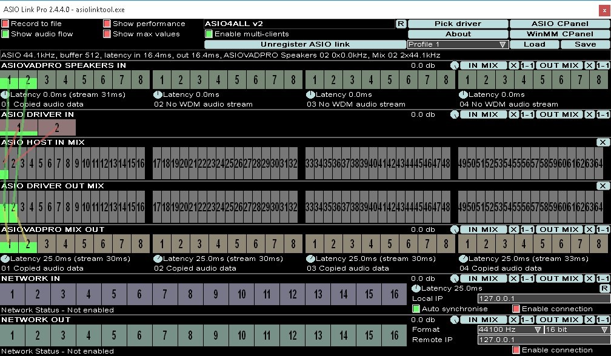  
_The ASIO Link Pro User Interface (UI)_

## Versions

This documentation is specific to the **ASIO Link Pro** edition and the screen shots and information in this documentation are specifically for the ASIO Link Pro version.

We have 3 editions available that all share ASIO Link Technology:

### ASIO Link

The documentation presented here shows the WDM device name as "ASIOVADPRO" but the ASIO Link uses the "ASIOVAD" WDM device name. Also, the ASIO Link Pro Tool is named "ASIO Link Tool" and the ASIO driver name is "ASIO Link".

### ASIO Link

Pro The documentation presented here is specifically for this version.

### ASIO Link Max

The documentation presented here shows the WDM device name as "ASIOVADPRO" but the ASIO Link Max uses the "ASIOVADMAX" WDM device name. Also, the ASIO Link Pro Tool is named "ASIO Link Max Tool" and the ASIO driver name is "ASIO Link Max".

# Installation

## Download and Run Installer

Firstly download the latest installer exe file from the links available on our Home Page and run it.

_All official O Deus Audio software is always signed by John Shield the original_

_developer of ASIO Link_

## Number of WDM Devices

On the welcome page you will have an option to install 16 stereo WDM devices, if you do not select this, 4 surround 7.1 channel devices will be installed.

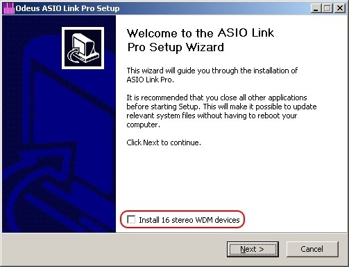  
_Install 4 surround or 16 stereo ASIOVADPRO devices_

## Install ASIO Link Pro

The installer will show you an End User License Agreement (EULA) which you will need to agree to in order to install ASIO Link Pro.

Further options allow choice of installation folders if required.

_WARNING - The uninstaller has an option to delete all settings, only check this if you are not upgrading as it will erase your product key in the registry!!_

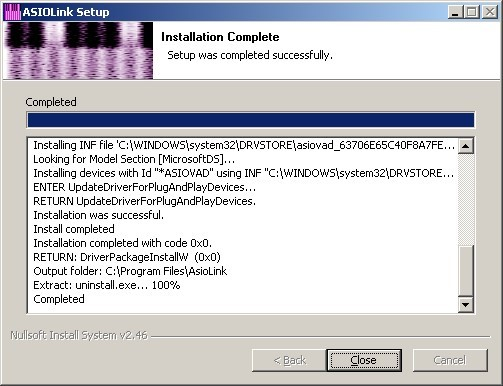

Install has successfully completed

# Setup ASIO Link Pro

## Run ASIO Link Pro Tool

After installation, the installer will usually launch [The ASIO Link Pro Tool](). It is worth clicking the START ASIO button to do a simple test that ASIO Link Pro has installed properly. After that you can run ASIO Link Pro in your favourite host program. 

## Choose ASIO Link Pro in Host ASIO Settings

After installing, you can launch your DAW or ASIO host application. The demonstration is with Ableton Live 8 but DAWs are fairly similar around ASIO configuration.

First, select ASIO as the driver type and "ASIO Link Pro" as the audio driver device in audio preferences

When the Link first runs for this host program

- If you have only one ASIO driver installed it will be automatically selected by ASIO Link Pro

- If you have multiple ASIO drivers you will see a small pop up drop down list (see below) allowing you to pick the driver

- If you do not have an ASIO driver then the ASIO Link Pro will run with the "ASIO Link Pro Null Driver" which is a silent driver used for networking only. If you see this, we recommend _ASIO4ALL_. A quick web search will find this driver and instructions on how to use it.

Tip, you can pick a new driver any time with the "Pick driver" button in the ASIO Link Pro UI.

  
_Select ASIO Link Pro in your host app and select the ASIO driver_

Next, click the new green (or purple) icon in the system tray, if the GUI doesn't automatically pop up.

  
_Tray Icon_

Now, in the ASIO Link Pro GUI, look at the sample rate because you need this information in the next step.

_It is best to run with minimal ASIO latency, 10ms or less is ideal!_

## Setup the ASIOVADPRO Devices

_Unless you are using windows XP, Everything except setting the speaker configuration can be done automatically in windows vista and later OS_

### Windows Multimedia Control Panel

To access this panel, right click on the windows speaker tray icon and click Playback devices or Recording devices.

  
Windows speaker tray icon

The Playback tab contains the ASIOVADPRO Speakers 01-04 and the Recording tab contains the ASIOVADPRO Mix 01-04.

_You can also access this control panel with the   button in ASIO Link Pro_

#### Default Device

To get windows to output and receive all audio through the ASIO Link Pro you need to set the ASIOVADPRO Speakers 01 and ASIOVADPRO Mix 01 as the default windows devices _**(AUTOMATIC IN VISTA, 7, 8 and 10).**_

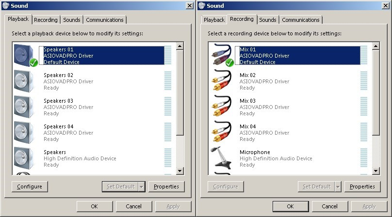  
_ASIOVADPRO Speakers and Mix audio devices_

#### Default Format

The next step is to right click and go into properties of each device and make sure the sample rate is the same as the ASIO sample rate you are using _**(AUTOMATIC IN VISTA, 7, 8 and 10).**_

To be sure of the ASIO sample rate get the sample rate you can look at the ASIO Link Pro UI help bar.

  
_ASIO Link Pro UI Settings and Help bar sections_

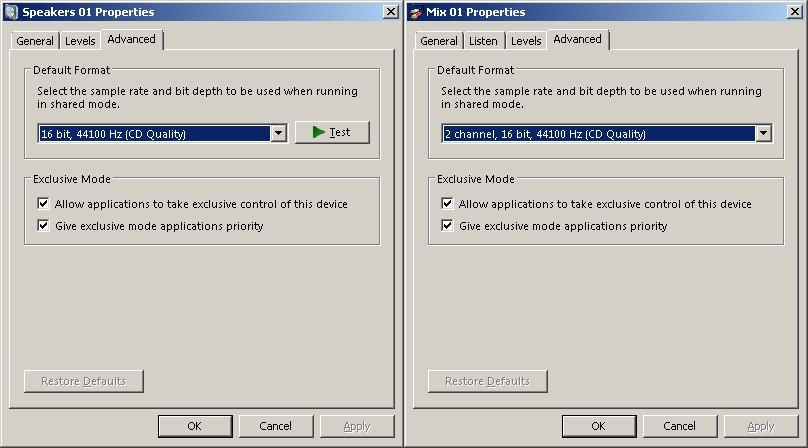  
_ASIOVADPRO Default Format properties_

You only need to check that the Default Format is the same as the ASIO Link Pro is running at. You can set the bits to any value but the 24 bit setting is usually more than adequate.

#### Speaker Configuration

Importantly, you need to tell windows to use the right speaker configuration. Right click on and ASIOVADPRO Speakers playback device and select "Configure Speakers" and you will see the following screen where you can select an appropriate configuration for your needs.

By default, the 7.1 channel configuration is selected.

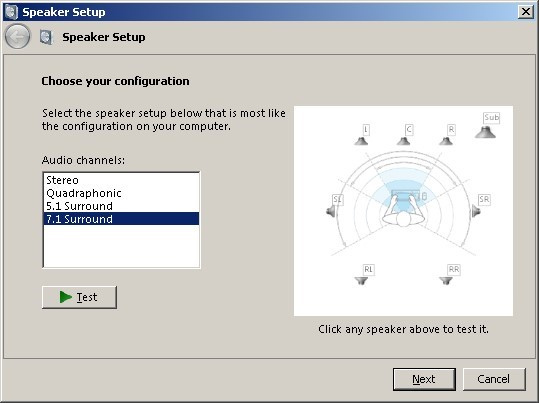  
_Configure ASIOVADPRO Speakers Setup_

# Using ASIO Link Pro

Using the ASIO Link Pro can seem daunting at first but after a while you can easily send audio to friends, loopback audio to other drivers, send audio from DAW – DAW.

_'Anything is possible with ASIO Link Pro'_

## ASIO Link Pro User Interface

The UI consists of two parts

1. The settings and help bar section (top part)
2. The channel racks (lower, larger part)

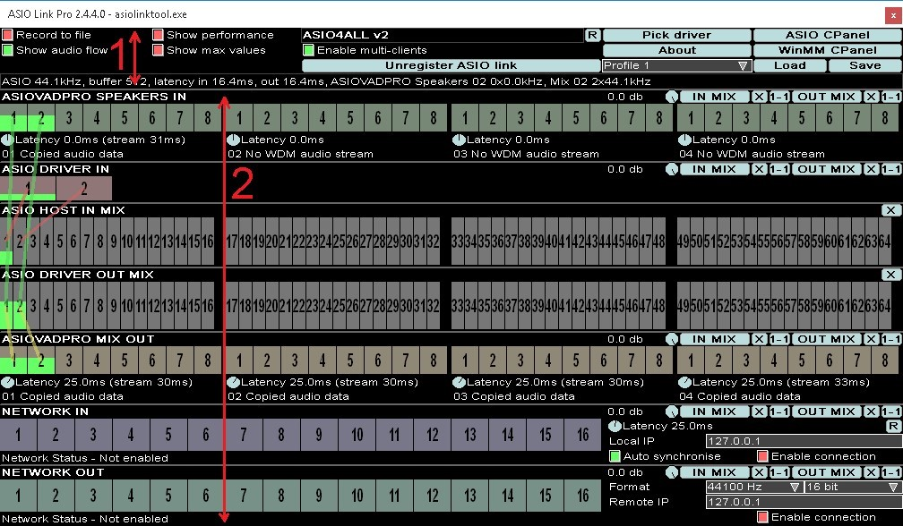  
_ASIO Link Pro UI sections 1 + 2_

## Settings and Help Bar

There are many settings and buttons available in the top part of the ASIO Link Pro UI. They are described in [Top Settings]() in detail.

Just below those is the help bar. When you "mouse over" a control the help bar will give a brief summary of what that control does. Below, it is giving a help tip on the help bar itself.

  
Settings and Help Bar

## Channel Racks and Channel Connections

In the UI section 2 you can see seven sections, each containing a horizontal row of channels. They are categorised into 3 types

### Mix Racks

There are 2 mix racks

- ASIO HOST IN MIX 
- ASIO DRIVER OUT MIX

### Input Racks

There are 3 input racks

- ASIOVADPRO SPEAKERS IN 
- ASIO DRIVER IN 
- NETWORK IN

### Output Racks

There are 2 output racks

- ASIOVADPRO MIX OUT 
- NETWORK OUT

All Input racks and Output racks have an **IN MIX** button and **OUT MIX** button which allows you to control the routings and volume of each channel to the ASIO HOST IN MIX and ASIO DRIVER OUT MIX. They also have a volume control.

The ASIO HOST IN MIX and ASIO DRIVER OUT MIX are known collectively as the MIX racks.

These are the main audio bus racks for ASIO Link Pro. Audio can be mixed both to and from both of these racks. They are both input and output racks, hence the term MIX RACK.

### Channel Connections

Depending on the **Show audio flow** setting (see [Top Settings]()) you can see either some lines or all lines connecting channels on racks. These are called channel connections and can be created by drag-dropping channels as described [below]().

## MIX RACKS

### ASIO HOST IN MIX

  

This rack is the PRE-MIX for your ASIO host programs ASIO input channels. All audio mixed into ASIO HOST IN MIX will appear in your ASIO host.

The **X** button clears all routings.

### ASIO DRIVER OUT MIX

  

This rack is the PRE-MIX for your ASIO driver output. This is where the audio processing has been finished and everything has been mixed in ready to send to the ASIO driver or multi-client server (see [Multi-client Mode]()).

All audio sent here, including your ASIO host program output, which is always mixed in, is sent to the ASIO driver or multi-client server.

The **X** button clears all routings.

## INPUT RACKS

### ASIOVADPRO SPEAKERS IN

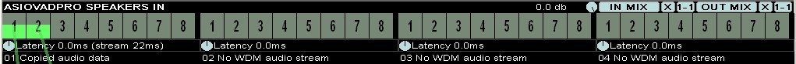  

WDM meets ASIO with ASIOVADPRO SPEAKERS IN. Any audio played to the ASIOVADPRO Speakers 01 – 04 shall appear on this rack as an input to ASIO HOST IN MIX and/or ASIO DRIVER OUT MIX. As shown above, the channels are connected to the ASIO HOST IN MIX and are being processed by the HOST as ASIO inputs.

Each ASIOVADPRO device has WDM specific controls

- Latency The latency wheel enables adjusting the WDM stream latency. It is fine to leave this at 0.0ms. It also displays the current stream latency.  
  

- Status Below the latency wheel there is a text box displaying the ASIOVADPRO device status for each device.  

If the device is unavailable, or there is an error, channels will appear red with an X over the channel number.

By default, when you first start/select ASIO Link Pro in a new host program, the routings 1-1 and 2-2 shall be enabled by default to the ASIO DRIVER OUT MIX.

### ASIO DRIVER IN

  

These are the actual real ASIO driver inputs like microphone and line in etc.

If you have an input plugged into your soundcard then you can send it to ASIO HOST IN MIX and/or ASIO DRIVER OUT MIX.

By default, when you first start/select ASIO Link Pro in a new host program, the routings 1-1 and 2-2 shall be enabled by default to the ASIO HOST IN MIX.

### NETWORK IN

Receive up to 16 channels of audio over the network from another machine that is running another instance of the ASIO Link Pro driver (see [Networking]()).

Notice this rack has some networking specific controls

- **Latency** which allows you to move the stream back from the incoming stream to leave enough latency to avoid drop outs. It is up to the user to set this value right so no distortion can be heard. The latency on the stream is to left in the square brackets and network jitter on the right in the square brackets. The network jitter value will give you a rough idea of what latency should be selected, it shows the maximum variance in received packet delay.  
  

-  **R** Resets the network latency to the value in the latency wheel

- **Local IP** is the IP address and port of the current machine running ASIO Link Pro. An example is **192.168.1.101:5060**

- **Auto synchronise** keeps the incoming stream in sync with the host program by adaptively adjusting the incoming sample rate so the streaming does not get out of synchronisation.

- **Enable connection** when checked, enables the connection if there are any channels connected to ASIO HOST IN MIX and/or ASIO DRIVER OUT MIX

## OUTPUT RACKS

### ASIOVADPRO MIX OUT

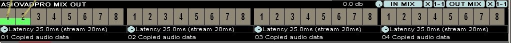  

ASIO meets WDM with ASIOVADPRO MIX OUT. Stream DAW audio over any application that can record WDM, MME, WASAPI or any other WDM based audio stream.

The audio output here is recordable by any normal windows audio application (e.g. sound recorder). If any mappings/connections are enabled, the audio on either ASIO HOST IN MIX and/or ASIO DRIVER OUT MIX will be sent to the ASIOVADPRO Mix device(s).

Each ASIOVADPRO device has WDM specific controls

- **Latency** The latency wheel enables adjusting the WDM stream latency. It is fine to leave this at 25.0ms. It also displays the current stream latency  
  

- **Status** Below the latency wheel there is a text box displaying the ASIOVADPRO device status for each device  
  

If the device is unavailable, or there is an error, channels will appear red with an X over the channel number.

By default, when you first start/select ASIO Link Pro in a new host program, the routings 1-1 and 2-2 shall be enabled by default from the ASIO DRIVER OUT MIX.

_Since most windows applications can only open recording devices in stereo, you can down mix surround sound to stereo by adjusting the mappings appropriately._

### NETWORK OUT

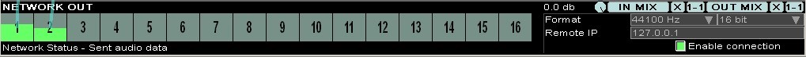  

NETWORK OUT can send audio over the network to another machine that is running another instance of the ASIO Link Pro driver (see [Networking]()).

Notice this rack has some networking specific controls

- **Format** sets the wave audio format to be sent over the network. You can set the sample rate and bit depth. It is best to set both sender and receiver machines to the same sample rate and ASIO buffer size and set the same format in this control. This ensures minimal re sampling needs to take place making the sound quality the best it can be.

- **Remote IP** is the host IP address and port of the machine you wish to send audio to, an example address is **127.0.0.1**

- **Enable connection** when checked, enables the connection if there are any channels connected to ASIO HOST IN MIX and/or ASIO DRIVER OUT MIX

## Connecting Inputs and Outputs

The ASIO Link Pro UI allows two ways to connect channels from audio inputs to audio outputs.

### Method 1 – Drag Drop Channels

If you click and hold the mouse over a channel, then drag the mouse, channels you can connect to become highlighted. All you need to do is drop the channel onto a highlighted channel and a connection is made.

  

  
  
  

  

  
Dragging channel 1 from ASIOVADPRO SPEAKERS IN to ASIO HOST IN MIX channel 1 connects the audio input to the MIX RACK. EASY!!! 

|||
|:--|:--|
| |Dragging channel 1 from ASIOVADPRO SPEAKERS IN to ASIO HOST IN MIX channel 1 connects the audio input to the MIX RACK. EASY!!! |

_Drag-Drop Channels_

TIP - If you mouse-over a channel connection it will become selected and will be displayed with a solid colour if your mouse is over either channel it is connected to. If you now click and release the left mouse button, the connection(s) will be deleted.

_BE CAREFUL NOT TO ACCIDENTALLY DELETE CONNECTIONS!_

### Method 2 – Mapping Buttons (IN MAP X 1-1 or OUT MAP X 1-1)

IN and OUT racks each have **IN MIX**, **X** and 1-1 buttons and also **OUT MIX**, **X** and **1-1** buttons.

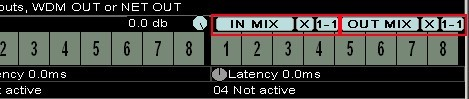  
_IN MIX, X, 1-1 and OUT MIX, X, 1-1 buttons_

### Quick Mapping

The **X** buttons clear all connections to the IN MIX (left) or OUT MIX (right).

The **1-1** buttons set up 1 - 1, 2 - 2, 3 - 3, 4 – 4, and so on, connections to the ASIO HOST IN MIX (left) or the ASIO DRIVER OUT MIX (right).

### The Mapping Window

If you click on **IN MIX** or **OUT MIX** you will bring up the _Mapping Window._

The mapping window allows exact configuration of audio routing from an audio input or output to either the ASIO HOST IN MIX or ASIO DRIVER OUT MIX racks.

In the below image, the mapping window matrix has 4 x 8 channels (from ASIOVADPRO SPEAKERS IN) going down and 8 channels (from ASIO HOST IN MIX) going across.

|||
|:--|:--|
| |In the Mapping window you can assign channels to ASIO HOST IN MIX or ASIO DRIVER OUT MIX.  In the left the routing is to ASIO HOST IN MIX and this window is available for all INPUT and OUTPUT racks.  NOTE – If you subsequently "drag-drop channels" or use "quick mapping" then the volume information will be set to the default of 0dB. It is your choice to use either "drag- dropping", "quick-mapping" or the "mapping window". |

_Mapping window_

It is normal to map channels 1 – 1, 2 – 2, 3 – 3 etc. This is the standard way to set up for the input to be sent to the output. The volume of each routing is adjustable between minus infinity dB (no volume) and 6.02dB. The default value is 0dB.

It is possible to mix multiple channels into single channels and vice versa for down mixing or up mixing channels or converting mono to stereo etc.

## Top Settings

  

### Profiles

**Profile 1 - 8** – This allows you to select a profile slot which stores routing settings. If you save or load a routing profile, the profile slot will take on the name of the file.

**Load** – Loads routing settings from disk to the current selected profile slot

**Save** – Saves the current routing settings to disk and to the current selected profile slot

### Options

**Record to file** – You can send up to 8 channels of audio out to a FLAC file by enabling this (see [Recording to FLAC file]())

**Enable multi-clients** – This allows you to run more than one instance of ASIO Link Pro for multi-client usage (see [Multi-client Mode]())

**Show audio flow** – You can see all rack connections when this is enabled. It makes it easier to see where audio is going but can get cluttered when many routings are active. If not enabled, you can only see the audio connections if you have the mouse over rack the connection is connected to.

**Show performance** – This allows you to see performance metrics. It shows the total time in microseconds taken for audio processing, the host application time and ASIO Link Pro times.

  

**Show max values** – Shows the maximum values over time for each performance display value.

### Buttons

**R** – Request an ASIO driver reset from the host application

**Pick driver** – Picks another ASIO driver to host (requires host restart or driver reload)

**ASIO CPanel** – Opens the hosted drivers ASIO control panel

**WinMM CPanel** – Opens the Windows multimedia control panel

**About** – Opens an about box showing copyright information

**Enter product key** – Pops up a dialog to enter your product key or purchase ASIO Link Pro ([Enter a Product Key])

**Unregister ASIO Link** – Remove the license to ASIO Link Pro from this machine ([Transfer Your License])

## Recording to FLAC file

The ASIO Link Pro can record the first 8 ASIO output channels to a FLAC file!

When you enable this a dialog shall pop up to pick a folder and once selected a file will be created with a name in the following format "asiolink-2014-12- 22_20-06-59.flac". The timestamp is the date-time recording started.

FLAC files can take up a lot of disk space. Especially 8 channel ones.

|||
|:--|:--|
| |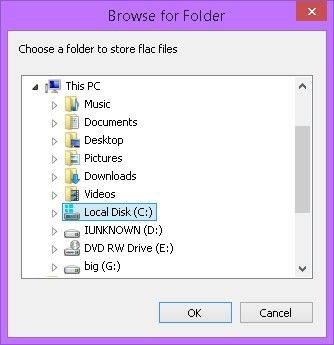|

Once a folder is selected, every time ASIO Link Pro starts, a new FLAC file is created. 

## Running Multiple Instances

See below regarding multi-client support but if you run a second instance of ASIO Link Pro - without enabling multi-client mode in the first instance - you will not have access to the WDM audio as that is already used by the first instance.

However, if you have more than one ASIO soundcard, you can use this to route audio using loop networking from one application to another and use two ASIO soundcards at once!

So if you start say, ASIO Link Pro with driver one normally and disable multi clients, you can then load up another host program and connect to a different ASIO driver. This will allow you to now send audio via the networking from the second instance to the first instance or vice versa.

## Multi-client Mode

The ASIO Link Pro can run in multi-client server mode allowing more than one application to share one ASIO driver. In order to do this you should run a "server" ASIO Link Pro instance and enable the Enable multi-clients check box.

  
_Enabling multi -client Mode_

Now, when you run an application that uses ASIO Link Pro it will use the inbuilt _ASIO Link Multiclient_ ASIO driver.

Using the _ASIO Link Multiclient_ you can send audio from more than one application to your ASIO Drivers sound output or the ASIO inputs of the server application.

You can run up to **25** instances of ASIO Link Pro in anything from standalone VSTs to DAWs.

To capture output to the ASIO inputs of your server application, enable the **Route to ASIO IN** check box in the client application.

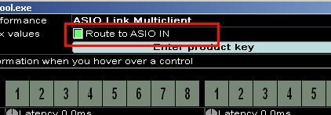  
_Routing multi-client output to ASIO Inputs of the multi-client server host application_

In multi-client mode you can still capture ASIOVADPRO SPEAKERS IN and ASIO DRIVER IN and you can also send audio to the ASIOVADPRO MIX OUT rack. One thing to note is that all the audio is going to the server instance so you need to be careful not to overload the ASIOVADPRO MIX OUT!

_AND, REMEMBER, YOU ALWAYS HAVE ACCESS TO NETWORKING!_  
_NETWORKING CAN ROUTE AUDIO ANYWHERE!_

## Networking

### Network IP address and port format

When entering the Local or Remote IP addresses for NETWORK IN and NETWORK OUT respectively, you can append a port to it with a colon. If you don't it will default to port 5050. An example address is the loopback address **127.0.0.1:5050**

### Network port forwarding and obtaining your IP address

To obtain your IP address, run a command prompt (search for cmd.exe) and type "ipconfig.exe" and press enter and you will see something like this:

  
_"ipconfig.exe" output_

IP address of your machine is not necessarily this on the internet, but for routing over the LAN, this is the address you want. To connect on the internet, often you have to enable traffic on port 5050 (or whatever port you select) with your ISP and with your firewall. You also have to explicitly set the IP address in the adapter settings (right click the network icon in the system tray to get to Local Area Connection Properties)

|||
|:--|:--|
| | |

_Network adapter settings/IPv4 settings_

Now to get your actual real IP address and to check that your port is open, do a google for online port checker and use it to

- Find your "real" internet address 
- Check whether access to the port is enabled (default is 5050)

After this it should allow others to connect to your Link driver. You can send and receive audio from your own IP address and you can do some rather cool things with networking!

See the examples in [Send DAW ASIO output to another DAW ASIO input and Receive audio into your host program from the network or LAN]().

### Additional NETWORK IN and NETWORK OUT Racks

You can enable a second NETWORK IN and NETWORK OUT rack if you enable the **Enable second NETWORK IN/OUT** check box in the [ASIO Link Pro Tool](). You can now send/receive audio from two other machines running ASIO Link Pro!

_Do not underestimate the power of networking!_

## Audio Loopback via the Optional LOOPER Racks

### Loopback racks

There are two racks that can be enabled by enabling the **Enable LOOPER loopback racks** check box in the [ASIO Link Pro Tool]. Once enabled the UI shall add two extra racks and they are described below

### LOOPER OUT

  

You can send audio to this rack to and it will be looped back through the LOOPER IN rack

### LOOPER IN

  

Audio sent to the LOOPER OUT rack will be available on this rack. There will be one audio buffer of latency on audio sent via the LOOPER OUT and LOOPER IN mechanism.

You can also send audio to LOOPER OUT and receive audio from LOOPER IN in [Multi-client Mode]. Note, when in this mode be careful not send audio to the LOOPER OUT that is already being sent to LOOPER OUT in the main server instance of ASIO Link Pro.

# Register ASIO Link Pro

## Enter a Product Key

  
_The "Enter product key" button_

When you click the **Enter product key** button you will get the below dialog pop up to enter your product key.

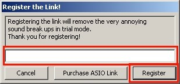  
_"Register the Link!" dialog_

In order to stop the annoying break-ups in sound you must purchase register the software. If you click the **Purchase ASIO Link** button you will be taken to the ASIO Link Pro page.

Here you can click the PayPal  button and you will receive a product key via email to enter in the "_Register the Link!_" dialog. Once you have a key, thank you and click **Register** to register the software.

_**You must be connected to the internet to register**_

## Transfer Your License

  
The "Unregister ASIO Link" button

Once registered, the product key button disappears and a new button becomes available and, if you wish to transfer your license to another machine, then all you need to do is click the **Unregister ASIO Link** button which will remove the license to ASIO Link Pro from this machine.

A dialog stating "You have successfully unregistered the ASIO Link Pro" should be displayed and the current ASIO Link Pro will be reverted to trial mode and you will then be able to install the ASIO Link Pro on another machine.

_**You must be connected to the internet to unregister**_

# The ASIO Link Pro Tool

This is both a configuration tool and a simple ASIO host application to allow configuring and testing the ASIO Link Pro. It can be very helpful to find and diagnose problems as you are in control of all the ASIO settings.

It can also clear all your default settings for host applications. This is like starting with a fresh install if you wish to start anew.

## Using the ASIO Link Pro Tool

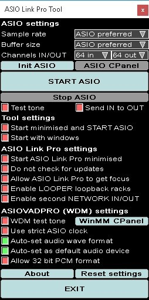  
_ASIO Link Pro Tool UI_

## ASIO Link Pro Tool Functions

### ASIO Settings

**Sample rate** – The ASIO sample rate to set. 'ASIO preferred'.is the default value and it uses the ASIO driver's default sample rate.

**Buffer size** – The ASIO buffer size to try to set in the driver. If low latency is desirable (lower size means lower latency) then try to set this as low as you can but if set too low, audio can distort. 'ASIO Preferred' is the default value and will use the ASIO driver's preferred buffer size.

**Channels IN/OUT** – Choose the number of input and output channels.

**Init ASIO** – Initialises, but does not start, the ASIO Link Pro driver.

**START ASIO** – Starts the ASIO Link Pro driver's audio processing and you can use the test tone to test your ASIO driver.

**Stop ASIO** – This stops the ASIO Link Pro driver.

**ASIO CPanel** – Launches the ASIO driver's control panel.

**Test tone** – Plays a 440Hz test tone to all enabled ASIO output channels.

**Send IN to OUT** – ASIO Link Pro Tool will route audio from ASIO input to the ASIO output. This option is still included but you can route audio in any way you wish in the ASIO Link Pro driver.

### Tool Settings

**Start minimised and START ASIO** – When enabled, the ASIO Link Pro Tool will start minimised to the system tray and automatically start the ASIO Link Pro. This can be useful if you wish to start ASIO Link Pro with windows.

**Start with windows** – When enabled, the ASIO Link Pro Tool will start with windows. Usually you would also enable the Start minimised and START ASIO option too to automatically start ASIO.

### ASIO Link Settings

**Start ASIO Link Pro minimised** – Start the ASIO Link Pro driver minimised to the system tray so the UI does not pop up till the tray icon is clicked.

**Do not check for updates** – ASIO Link Pro will no longer prompt you if you an update is available

**Allow ASIO Link Pro to get focus** – Allows the ASIO Link Pro to become the activated/focused window. The reason this is not enabled by default is that the ASIO Link Pro can take focus away from host applications or DAWs that auto- close the ASIO driver! When this happens, ASIO Link Pro gets "closed" by the host. Be careful if you enable this and read the FAQ below.

**Enable LOOPER loopback racks** – ASIO Link Pro will show two additional racks named LOOPER IN and LOOPER OUT to allow sending audio back to for use as an input.

**Enable second NETWORK IN/OUT** – ASIO Link Pro will now show two additional networking racks named NETWORK IN 2 and NETWORK OUT 2 to allow sending/receiving audio from another machine.

### ASIOVADPRO (WDM) settings

**WDM test tone** – Plays a stereo 880Hz test tone to the first ASIOVADPRO speakers.

**WinMM CPanel** – Launches the windows multimedia control panel.

**Use strict ASIO clock** – The ASIOVADPRO WDM driver normally uses smoothing to average out the ASIO clock time and its own DPC clock time. When strict ASIO clock is enabled ASIOVADPRO uses only the ASIO clock.

**Auto-set audio wave format** – The ASIOVADPRO sample rate and bit format will be automatically set when ASIO Link Pro is in use (not available in Windows XP).

**Auto-set as default audio device** – ASIOVADPRO will be automatically set as the default audio playback and recording devices when in ASIO Link Pro is in use (not available in Windows XP).

**Allow 32 bit PCM format** – ASIOVADPRO will use 32 bit wave format if the ASIO driver is using 32bit wave format. This setting requires Auto-set ASIOVADPRO wave format to be enabled (not available in Windows XP).

### Miscellaneous

**About** – Shows an "About" dialog box.

**Reset settings** – Clears all saved settings for ASIO Link Pro and ASIO Link Pro Tool.

**Exit** – Exits the ASIO Link Pro Tool.

# FAQ

## I can't hear anything

Follow the below steps:

1. Firstly, you must ensure that the ASIOVADPRO device is set up as the default windows audio device to capture all windows sounds (or set it as the output device for your favourite media player if you don't want to capture all windows sounds).

2. Next, you need to start an ASIO host application such as Ableton Live, Reason, FL, Reaper or Cubase but there are countless other ASIO applications.

3. Setup the ASIO Link Pro as the host programs ASIO device and, if it is the first time you have run it, pick the target ASIO driver you wish the ASIO Link Pro to output to.

4. Check the channels with the "Map" button in the "WDM Audio to ASIO OUT" section and you should see green in the V-meters when sound is played through ASIOVADPRO speakers.

5. The status should read "_Copied Audio Data_" and you should hear sound.

## I still can't hear anything

Follow the additional steps

1. If the status says "_No WDM audio stream_" it means nothing is playing to the ASIOVADPRO speaker out, play something in your favourite media player with output to the ASIOVADPRO speakers.

2. If the status says "_Sample rate mismatch_" it means you need to set the ASIOVADPRO windows device sample rate to the sample rate of the ASIO driver.

3. Make sure you have enabled ASIO channels you can actually hear in the appropriate matrix.

## I use ASIO4ALL

If you do use ASIO4ALL be sure not to enable the ASIOVADPRO Driver for the output/input device as this will not work (ASIO Link Pro mixes ASIOVADPRO audio into ASIO therefore it cannot be the selected device for ASIO4ALL).

  

## DAW specific

When using DAWs with ASIO Link there can be an issue with settings that offer to "unload" your ASIO driver when the application becomes inactive or loses focus.

It is best not to enable these features as ASIO Link Pro gives you access to all windows audio anyway!

If you enable these options be aware that the ASIO Link Pro driver may be shut down and restarted often making it hard to use the UI. It will also _cause problems running as a multi-client server_ as the driver will shut down causing clients to "disconnect".

### FL Studio

In FL Studio the setting is the **Auto Close** ASIO driver option (it is not enabled by default). Try not to enable it.

### Reaper

In Reaper the setting is **Close audio device when stopped and application is inactive**. Try not to enable it.

### I use Reason

In Reason the setting is **Play in background**. Try to keep it enabled as you want the driver to stay active even when focus is taken away from Reason.

### I use Wavelab or SoundForge

Wavelab and SoundForge both start and stop the ASIO driver so it is not wise to use it as a multi-client server at all. Always check the latest version as we do not check every version of these tools.

## I get a Failed IOCTL status from ASIOVADPRO

Make sure you fully uninstall a previous version before installing a new one. Try a complete uninstall and reinstall and it should then be fine. 

## What is this latency thing?

### ASIOVADPRO SPEAKERS / MIX Latency Adjustment

In the case of the ASIOVADPRO SPEAKERS IN rack, ASIOVADPRO MIX OUT rack, the latency is the time between the audio being written to, and the audio being read from the stream.

Windows writes audio into the ASIOVADPRO SPEAKERS and ASIO Link Pro reads audio behind it and the latency is the time delay. In the case of ASIOVADPRO MIX, windows is reading audio just after ASIO Link Pro writes audio and the latency is the time delay.

Usually you do not need to adjust this but you can reduce or add latency if required.

### NETWORK IN Latency Adjustment

The latency adjust in the NETWORK IN rack allows you to add latency to the network stream to stop drop outs. It is really dependent on the quality of the network connection whether this can be reduced to nearer 0. The range is the same as the stored buffer size which is 250ms of audio. In short, if it distorts, add some latency.

If you enable "Auto synchronise" the audio stream will use "adaptive resampling" to keep the incoming audio stream clock and local ASIO clock in time.

The value displayed in the latency box is a best estimate of the total latency from sender to receiver.

## I get distortion when mixing multiple channels

Make sure, when mixing multiple input channels into only a few channels, you reduce the volume of the multiple channels using the IN MIX or OUT MIX buttons. Hold the left mouse button and move the mouse up or down on the green circle volume control to adjust the volume. Try to make sure no red levels are visible in the level display. 

## WDM is running but status is "Not Active" with ASIO4ALL

Sometimes ASIO4ALL can have trouble getting the card if it was the default device before ASIO4ALL starts. The best way to work around this is to disable the card in playback devices before using the link. It doesn't always happen so you can just try a few times disabling certain inputs and outputs in ASIO4ALL.

## I see red channels with X

This means that the ASIO driver is not doing any audio processing at all. If this happens first try to reset the ASIO Link Pro driver (R button).

You can also try to restart the host application and possibly the computer and if that does not solve this issue then [contact us]().

  

# Sample Configurations

## Mix WDM playback into host application input

By enabling connections from ASIOVADPRO SPEAKERS IN to ASIO HOST IN MIX you can bring WDM audio into your host applications ASIO input channels.

You can pull audio from any windows audio source that is using WASAPI, MME or DirectSound.

You can quickly achieve this by clicking the "**1-1**" button shown below.

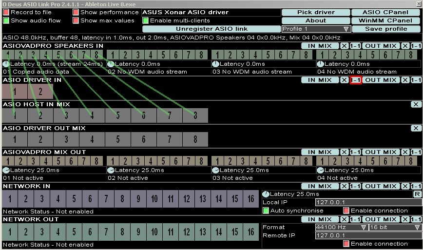  
_Send WDM playback to ASIO input_

### Uses

- Bring WDM WASAPI, MME or DirectSound audio into your DAW or ASIO application 
- Record windows WDM application audio into your ASIO host

## Send ASIO output to WDM recording devices

By enabling connections from ASIO DRIVER OUT MIX to ASIOVADPRO MIX OUT you can send your ASIO output to the ASIOVADPRO WDM recording devices.

You can push audio to any windows audio application that is using WASAPI, MME or DirectSound.

To use the output simply select the ASIOVADPRO MIX 01-04 (or 01-16) in your screen casting or recording software.

You can quickly achieve this by clicking the "**1-1**" button shown below.

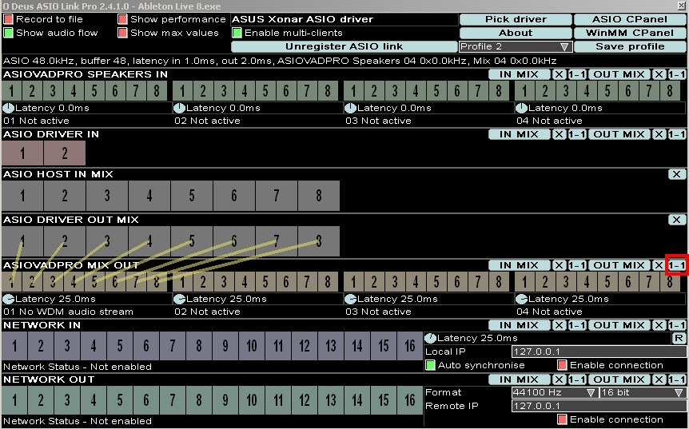  
_Send ASIO output to WDM recording devices_

### Uses

- Send ASIO audio to any WASAPI, MME or DirectSound application 
- Capture DAW audio into screen casting applications

## Send DAW ASIO output to another DAW ASIO input

To achieve this you need to use multi-client mode.

First, start the server DAW that will receive the audio input from another DAW. Below I have started Ableton Live and selected the ASIO Link Pro ASIO driver and I made sure that "**Enable multi-clients**" is enabled. Also, enable all the ASIO input and output channels you need.

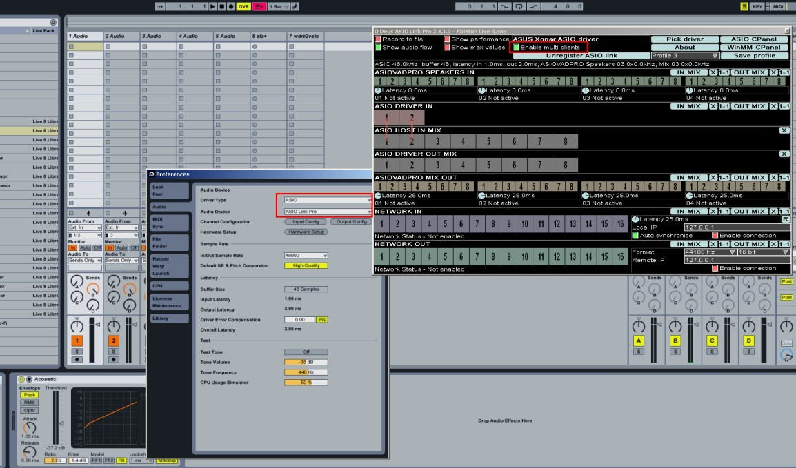  
_Start the server DAW_

Next, start the DAW that will send audio to Ableton Live. I have started FL Studio and made sure I enabled the "**Route to ASIO in**" option to send audio to Ableton Live ASIO inputs. Note I have selected channels 3+4 for output so that audio output from FL Studio appears on Ableton Live ASIO input channels 3 + 4.

  
_Start the DAW to send audio from_

### Uses

- Send ASIO audio output from one application to another applications ASIO inputs

## Send audio over IP on the network or LAN

By enabling connections from ASIO DRIVER OUT MIX to NETWORK OUT you can send audio over IP.

You can quickly achieve this by clicking the "**1-1**" button.

Next, enter the Remote IP address of the target machine that is running ASIO Link Pro with NETWORK IN enabled so it can receive the audio.

NOTE: You need to check the "**Enable connection**" check box to start sending audio.

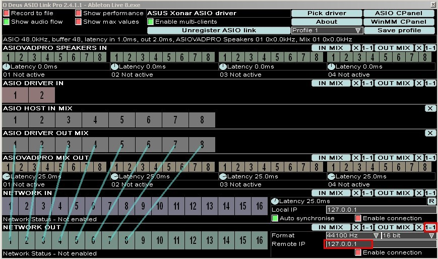  
_Send audio over IP_

### Uses

- Send audio to another machine on the network running ASIO Link Pro 
- Set up full-duplex audio send and receive to share ideas with another musician in real time 
- Use loopback IP (127.0.0.1) to send audio to the same machine 
- Combine with [Multi-client Mode]() to receive audio from more than one machine

## Receive audio into your host program from the network or LAN

By enabling connections from NETWORK IN to ASIO HOST IN MIX you can receive audio over IP.

You can quickly achieve this by clicking the "**1-1**" button and entering the IP address of the local machine running ASIO Link Pro so it can listen for incoming connections.

NOTE: You need to check the "**Enable connection**" check box to start sending audio.

  
_Receive audio over IP_

### Uses

- Receive audio from another machine 
- Set up full-duplex audio send and receive audio to share ideas with another musician in real time 
- It is possible to use the loopback address (127.0.0.1) to receive audio sent from the same machine 
- Combine with Multi-client Mode to receive audio from more than one machine

# Contact O Deus Audio

## Contact Page

Go to our [Contact Page]() and look for our contact details.

# Thank You

## Aleksey Vaneev

A special thank you goes out to Aleksey Vaneev for his r8brain sample rate conversion code which is used for adaptive resampling.

## Steinberg Media GmbH

Thank you for the ASIO and VST technology that has become standard on windows platforms for pro-audio. ASIO Link Technology would not be possible without ASIO.

# Copyright

## O Deus Audio

ASIO Link Technology and its associated products and documentation are the copyright work of John Shield/O Deus Audio.

ASIO Link Technology uses ASIO technology by Steinberg.

## Steinberg Media GmbH

  

ASIO Technology by Steinberg. ASIO is a trademark of Steinberg Media Technologies GmbH.