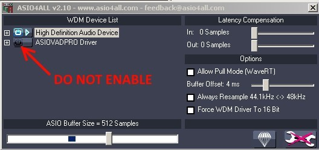

# FAQ

## 我什么都听不到

**I can't hear anything**

请按照以下步骤操作:

1. 首先，您必须确保 ASIOVADPRO device 已被设置为 Windows 的默认音频设备，以便捕获所有系统声音（如果您不想捕获所有系统声音，也可以将其设为常用媒体播放器的输出设备）。

2. 接下来，您需要启动一个 ASIO 主机应用程序，例如 Ableton Live、Reason、FL Studio、Reaper 或 Cubase，等等。

3. 将 ASIO Link Pro 设置为主机程序的 ASIO 设备；如果是首次运行，请选择您希望 ASIO Link Pro 输出的目标 ASIO 驱动程序。

4. 在“WDM Audio to ASIO OUT”部分，使用“Map”按钮检查各通道，当通过 ASIOVADPRO speaker 播放声音时，V 型表应显示绿色。

5. 状态应显示“_Copied Audio Data_”，并且您应该能够听到声音。

## 我仍然听不到任何声音

**I still can't hear anything**

请按照以下附加步骤操作

1. 如果状态显示“_无 WDM 音频流（No WDM audio stream）_”，则表示没有任何音频正在输出到 ASIOVADPRO speaker，请在您常用的媒体播放器中播放一段音频，并确保输出设备为 ASIOVADPRO speakers。

2. 如果状态显示“_采样率不匹配（Sample rate mismatch）_”，则需要将 ASIOVADPRO Windows 设备的采样率设置为与 ASIO 驱动程序相同的采样率。

3. 请确保在相应的矩阵中已启用您实际能够听到的 ASIO 通道。

## 使用 ASIO4ALL

**I use ASIO4ALL**

在 ASIO4ALL 中，请务必不要为输出/输入设备启用 ASIOVADPRO 驱动程序，因为这将无法正常工作（ASIO Link Pro 会将 ASIOVADPRO 的音频混入 ASIO 中，因此它不能被选为 ASIO4ALL 的目标设备）。

  

## DAW 特点

**DAW specific**

在使用支持 ASIO Link 的 DAW 时，可能会遇到一种情况：当应用程序处于非活动状态或失去焦点（focus）时，某些设置会尝试“卸载（unload）”您的 ASIO 驱动程序。  

建议不要启用这些功能，因为 ASIO Link Pro 本身已能为您提供对 Windows 音频的完全访问权限！  

如果您启用了这些选项，请注意，ASIO Link Pro 驱动程序可能会频繁被关闭并重新启动，从而导致 UI 使用不便。此外，这还会 _在作为多客户端服务器（multi-client server）运行时引发问题_，因为驱动程序的关闭会导致客户端“断开连接（disconnect）”。

### FL Studio

在 FL Studio 中，相关设置是 **Auto Close（自动关闭）** 的 ASIO 驱动选项（默认情况下未启用）。请尽量不要启用该选项。

### Reaper

在 Reaper 中，设置为“Close audio device when stopped and application is inactive（停止且应用程序处于非活动状态时关闭音频设备）”。请尽量不要启用此选项。

### I use Reason

在 Reason 中，设置为“Play in background（在后台播放）”。请尽量保持该选项启用，以便在您将焦点移出 Reason 时，驱动程序仍能持续运行。

### I use Wavelab or SoundForge

Wavelab 和 SoundForge 都会自行启动和停止 ASIO 驱动程序，因此根本不建议将其用作多客户端服务器。请务必检查最新版本，因为我们不会对这些工具的每个版本都进行逐一验证。

## Failed IOCTL status

**I get a Failed IOCTL status from ASIOVADPRO**

**我从 ASIOVADPRO 获得了“IOCTL 失败”的状态。**

请确保在安装新版本之前，已彻底卸载旧版本。尝试执行完全卸载后再重新安装，问题应该就能解决。

## 延迟相关

**What is this latency thing?**

### ASIOVADPRO SPEAKERS / MIX Latency Adjustment（调整）

对于 ASIOVADPRO SPEAKERS IN 机架和 ASIOVADPRO MIX OUT 机架而言，延迟是指音频从被写入流到被读取之间的时延。

Windows 将音频写入 ASIOVADPRO SPEAKERS，而 ASIO Link Pro 则在其后读取音频，此时的延迟即为这一时间差。对于 ASIOVADPRO MIX 而言，Windows 在 ASIO Link Pro 写入音频之后随即读取，其延迟同样为这一时间差。

通常情况下，您无需调整此项设置，但如有需要，也可适当增加或减少延迟。

### NETWORK IN Latency Adjustment

NETWORK IN 机架中的延迟调节功能允许您为网络音频流添加延迟，以避免音频断续。能否将延迟降至接近零，很大程度上取决于网络连接的质量。该调节范围与存储缓冲区大小一致，即250毫秒的音频时长。简而言之，如果出现失真，就适当增加一些延迟。

启用“Auto synchronise（自动同步）”后，音频流将采用“adaptive resampling（自适应重采样）”技术，使输入音频流的时钟与本地 ASIO 时钟保持同步。

延迟框中显示的数值是发送端到接收端总延迟的最佳估算值。

## 在混音多个声道时会出现失真现象

**I get distortion when mixing multiple channels**

请确保在将多个输入声道混合为少数几个声道时，使用“IN MIX”或“OUT MIX”按钮降低各声道的音量。按住鼠标左键，在绿色圆圈状的音量控制区域上下拖动以调节音量。同时，请尽量保证电平显示（level display）中不出现红色峰值（red levels）。

## WDM 正在运行，但状态显示为“未激活”，且使用的是 ASIO4ALL

**WDM is running but status is "Not Active" with ASIO4ALL**

有时，如果在 ASIO4ALL 启动前该声卡曾是默认设备，ASIO4ALL 可能会难以正确识别该声卡。解决这一问题的最佳方法是在启用该连接之前，先在播放设备中禁用该声卡。这种情况并非每次都会发生，因此您可以尝试多次在 ASIO4ALL 中禁用某些输入和输出端口。

## 通道红色显示为 X

**I see red channels with X**

这意味着 ASIO 驱动程序完全没有进行任何音频处理。如果出现这种情况，首先尝试重置 ASIO Link Pro 驱动程序（按 R 键）。

您还可以尝试重启宿主应用程序，必要时也重启计算机。

  
