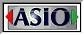

# ASIO Link Technology

## What is it?

借助 WDM 驱动程序并模拟真实声卡，ASIO Link 技术使您能够通过 ASIO 驱动程序收听或录制 Windows 音频。

您可以将 Windows 音频作为输入信号接入 ASIO 主机应用程序或 DAW，也可以将其作为 ASIO 输出进行监听，从而绕过主机应用程序。

此外，您还可以将 ASIO 输出路由至 ASIOVADPRO 混音录制设备，以供 WDM 应用程序进行录制，或用于流媒体应用（如直播、OBS、语音聊天软件、Skype 等）。

ASIO Link 技术还具备通过网络将音频传输至另一台运行 ASIO Link 技术产品的计算机的功能。这一特性支持双方互为发送端与接收端，实现全双工的实时音乐创意共享！

ASIO Link 技术内置多客户端支持，允许您在多个应用程序中使用同一套 ASIO 驱动程序。

  
_The ASIO Link Pro User Interface (UI)_

## 版本说明

本手册仅适用于 **ASIO Link Pro** 版本，其中的屏幕截图及各项信息亦专为 ASIO Link Pro 版本而设计。

我们提供三种版本，均采用 ASIO Link 技术：

|版本名称|WDM device name|Tool name|ASIO driver name|
|:--|:--|:--|--|
|ASIO Link     |ASIOVAD    |ASIO Link Tool    |ASIO Link     |
|ASIO Link Pro |ASIOVADPRO |ASIO Link Pro Tool|ASIO Link Pro |
|ASIO Link Max |ASIOVADMAX |ASIO Link Max Tool|ASIO Link Max |

## Thank You

- Aleksey Vaneev  
A special thank you goes out to Aleksey Vaneev for his r8brain sample rate conversion code which is used for adaptive resampling.

- Steinberg Media GmbH  
Thank you for the ASIO and VST technology that has become standard on windows platforms for pro-audio. ASIO Link Technology would not be possible without ASIO.

## Copyright

- O Deus Audio  
  ASIO Link Technology and its associated products and documentation are the copyright work of John Shield/O Deus Audio.  
  
  ASIO Link Technology uses ASIO technology by Steinberg.

- Steinberg Media GmbH

    

  ASIO Technology by Steinberg. ASIO is a trademark of Steinberg Media Technologies GmbH.