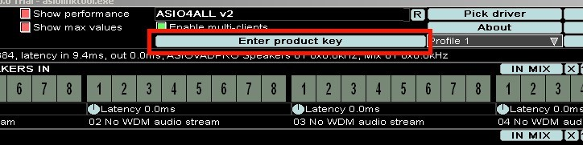
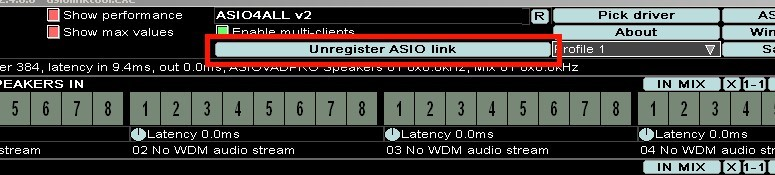

# Register ASIO Link Pro

## Enter a Product Key

  
_The "Enter product key" button_

When you click the **Enter product key** button you will get the below dialog pop up to enter your product key.

  
_"Register the Link!" dialog_

In order to stop the annoying break-ups in sound you must purchase register the software. If you click the **Purchase ASIO Link** button you will be taken to the ASIO Link Pro page.

Here you can click the PayPal  button and you will receive a product key via email to enter in the "_Register the Link!_" dialog. Once you have a key, thank you and click **Register** to register the software.

_**You must be connected to the internet to register**_

## Transfer Your License

  
The "Unregister ASIO Link" button

Once registered, the product key button disappears and a new button becomes available and, if you wish to transfer your license to another machine, then all you need to do is click the **Unregister ASIO Link** button which will remove the license to ASIO Link Pro from this machine.

A dialog stating "You have successfully unregistered the ASIO Link Pro" should be displayed and the current ASIO Link Pro will be reverted to trial mode and you will then be able to install the ASIO Link Pro on another machine.

_**You must be connected to the internet to unregister**_
