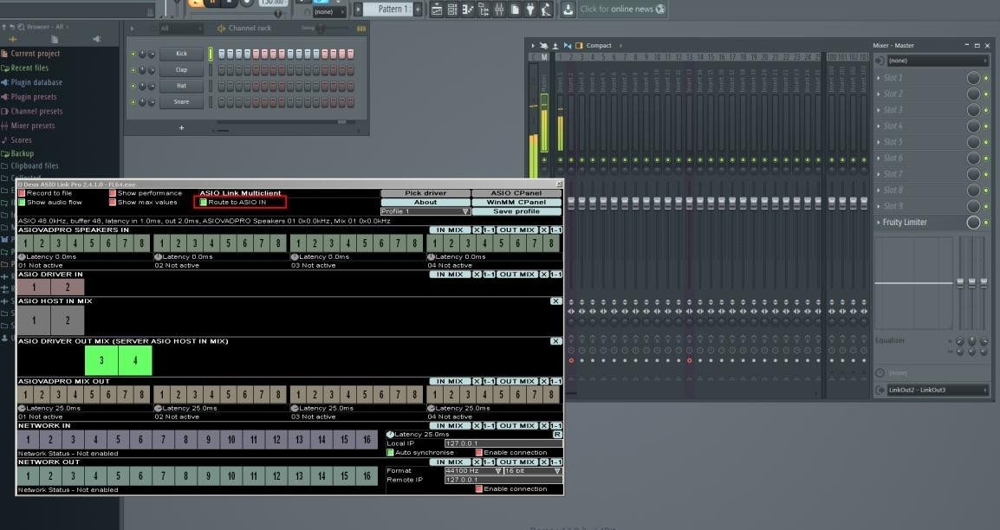
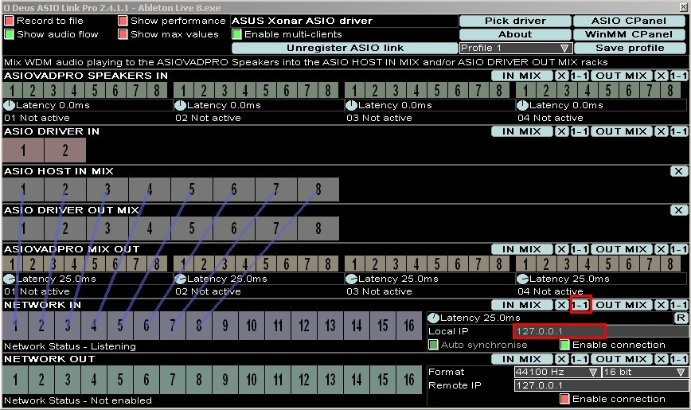

# Sample Configurations

## Mix WDM playback into host application input

**将 WDM 播放混入主机应用程序的输入**

通过启用从 ASIOVADPRO SPEAKERS IN 到 ASIO HOST IN MIX 的连接，您可以将 WDM 音频引入主机应用程序的 ASIO 输入通道。

您可以从任何使用 WASAPI、MME 或 DirectSound 的 Windows 音频源中获取音频。

只需点击下方所示的“**1-1**”按钮，即可快速实现这一操作。

  
_Send WDM playback to ASIO input_

### 用途（Uses）

- 将 WDM WASAPI、MME 或 DirectSound 音频引入您的 DAW 或 ASIO 应用程序  

- 将 Windows WDM 应用程序的音频录制到您的 ASIO 主机中

## Send ASIO output to WDM recording devices

**将 ASIO 输出发送至 WDM 录音设备**

通过启用从 ASIO DRIVER OUT MIX 到 ASIOVADPRO MIX OUT 的连接，您可以将 ASIO 输出传输至 ASIOVADPRO 的 WDM 录音设备。

您还可以将音频推送到任何使用 WASAPI、MME 或 DirectSound 的 Windows 音频应用程序。

要使用该输出，只需在您的屏幕录制或直播软件中选择 ASIOVADPRO MIX 01–04（或 01–16）即可。

您可以通过点击下方所示的“**1-1**”按钮快速完成此操作。

  
_Send ASIO output to WDM recording devices_

### 用途（Uses）

- 将 ASIO 音频发送至任何 WASAPI、MME 或 DirectSound 应用程序  

- 将 DAW 音频捕获至屏幕共享应用程序

## Send DAW ASIO output to another DAW ASIO input

**将 DAW 的 ASIO 输出发送至另一台 DAW 的 ASIO 输入**

要实现这一目标，您需要启用多客户端模式（multi-client mode）。

首先，启动作为接收端的主 DAW（server DAW），并使其能够接收来自另一台 DAW 的音频输入。以下以 Ableton Live 为例，我已选择 ASIO Link Pro ASIO 驱动程序，并确保已启用“Enable multi-clients（启用多客户端）”选项。同时，请确保所需的所有 ASIO 输入和输出通道均已启用。

  
_Start the server DAW_

接下来，启动将音频发送至 Ableton Live 的 DAW。我已打开 FL Studio，并确保启用了“**Route to ASIO in（路由至 ASIO）**”选项，以便将音频输出至 Ableton Live 的 ASIO 输入通道。请注意，我已将输出通道设置为 3 和 4，这样 FL Studio 的音频输出就会出现在 Ableton Live 的 ASIO 输入通道 3 和 4 上。

  
_Start the DAW to send audio from_

### 用途（Uses）

- 将 ASIO 音频输出从一个应用程序发送到另一个应用程序的 ASIO 输入端口
## Send audio over IP on the network or LAN

By enabling connections from ASIO DRIVER OUT MIX to NETWORK OUT you can send audio over IP.

You can quickly achieve this by clicking the "**1-1**" button.

Next, enter the Remote IP address of the target machine that is running ASIO Link Pro with NETWORK IN enabled so it can receive the audio.

NOTE: You need to check the "**Enable connection**" check box to start sending audio.

**通过网络或局域网发送音频**

通过启用从 ASIO DRIVER OUT MIX 到 NETWORK OUT 的连接，您可以实现音频的 IP 传输。

只需单击“**1-1**”按钮即可快速完成此操作。

接下来，请输入目标计算机的远程 IP（Remote IP）地址，该计算机已运行 ASIO Link Pro 并启用了网络输入（NETWORK IN）功能，以便接收音频。

注意：您需要勾选“Enable connection（启用连接）”复选框，才能开始发送音频。

  
_Send audio over IP_

### 用途（Uses）

- 将音频发送到网络中另一台运行 ASIO Link Pro 的设备  

- 配置全双工音频收发，与另一位音乐人实时交流创意  

- 使用环回 IP 地址（127.0.0.1）将音频发送至本机  

- 结合“多客户端模式（Multi-client Mode）”，从多台设备接收音频

## Receive audio into your host program from the network or LAN

**通过网络或局域网将音频输入到您的宿主程序中**

通过启用从“NETWORK IN”到“ASIO HOST IN MIX”的连接，您可以实现基于 IP 的音频接收。

您只需点击“**1-1**”按钮，并输入运行 ASIO Link Pro 的本地计算机的 IP 地址，即可快速完成设置，使该计算机能够监听传入的连接。

注意：您需要勾选“Enable connection（启用连接）”复选框，才能开始发送音频。

  
_Receive audio over IP_

### 用途（Uses）

- 从另一台设备接收音频  

- 配置全双工音频收发，与另一位音乐人实时分享创意  

- 可使用环回地址（127.0.0.1）接收来自本机的音频  

- 结合多客户端模式，可同时接收来自多台设备的音频