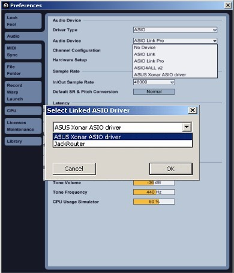

# Setup ASIO Link Pro

## Run ASIO Link Pro Tool

After installation, the installer will usually launch [The ASIO Link Pro Tool](The_ASIO_Link_Pro_Tool.md). It is worth clicking the START ASIO button to do a simple test that ASIO Link Pro has installed properly. After that you can run ASIO Link Pro in your favourite host program. 

## Choose ASIO Link Pro in Host ASIO Settings

After installing, you can launch your DAW or ASIO host application. The demonstration is with Ableton Live 8 but DAWs are fairly similar around ASIO configuration.

First, select ASIO as the driver type and "ASIO Link Pro" as the audio driver device in audio preferences

When the Link first runs for this host program

- If you have only one ASIO driver installed it will be automatically selected by ASIO Link Pro

- If you have multiple ASIO drivers you will see a small pop up drop down list (see below) allowing you to pick the driver

- If you do not have an ASIO driver then the ASIO Link Pro will run with the "ASIO Link Pro Null Driver" which is a silent driver used for networking only. If you see this, we recommend _ASIO4ALL_. A quick web search will find this driver and instructions on how to use it.

Tip, you can pick a new driver any time with the "Pick driver" button in the ASIO Link Pro UI.

  
_Select ASIO Link Pro in your host app and select the ASIO driver_

Next, click the new green (or purple) icon in the system tray, if the GUI doesn't automatically pop up.

  
_Tray Icon_

Now, in the ASIO Link Pro GUI, look at the sample rate because you need this information in the next step.

_It is best to run with minimal ASIO latency, 10ms or less is ideal!_

## Setup the ASIOVADPRO Devices

_Unless you are using windows XP, Everything except setting the speaker configuration can be done automatically in windows vista and later OS_

### Windows Multimedia Control Panel

To access this panel, right click on the windows speaker tray icon and click Playback devices or Recording devices.

  
Windows speaker tray icon

The Playback tab contains the ASIOVADPRO Speakers 01-04 and the Recording tab contains the ASIOVADPRO Mix 01-04.

_You can also access this control panel with the   button in ASIO Link Pro_

#### Default Device

To get windows to output and receive all audio through the ASIO Link Pro you need to set the ASIOVADPRO Speakers 01 and ASIOVADPRO Mix 01 as the default windows devices _**(AUTOMATIC IN VISTA, 7, 8 and 10).**_

  
_ASIOVADPRO Speakers and Mix audio devices_

#### Default Format

The next step is to right click and go into properties of each device and make sure the sample rate is the same as the ASIO sample rate you are using _**(AUTOMATIC IN VISTA, 7, 8 and 10).**_

To be sure of the ASIO sample rate get the sample rate you can look at the ASIO Link Pro UI help bar.

  
_ASIO Link Pro UI Settings and Help bar sections_

  
_ASIOVADPRO Default Format properties_

You only need to check that the Default Format is the same as the ASIO Link Pro is running at. You can set the bits to any value but the 24 bit setting is usually more than adequate.

#### Speaker Configuration

Importantly, you need to tell windows to use the right speaker configuration. Right click on and ASIOVADPRO Speakers playback device and select "Configure Speakers" and you will see the following screen where you can select an appropriate configuration for your needs.

By default, the 7.1 channel configuration is selected.

  
_Configure ASIOVADPRO Speakers Setup_
