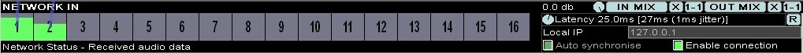
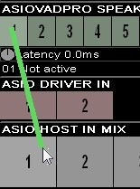
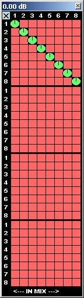
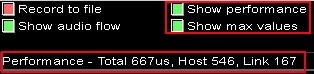
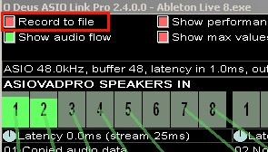
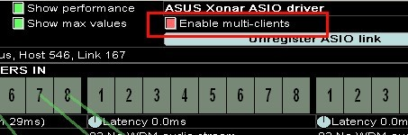
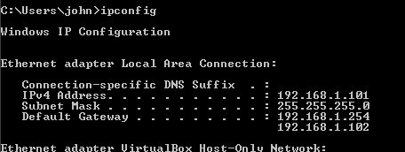
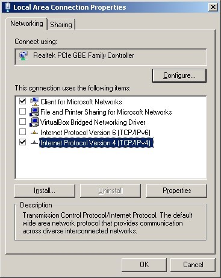
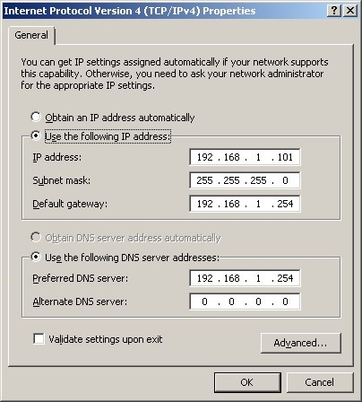

# 使用 ASIO Link Pro

轻松地将音频发送给朋友、将音频回送（loopback）到其他声卡驱动，以及在 DAW 之间进行音频传输。

_'Anything is possible with ASIO Link Pro'_

## 用户界面（UI）

**ASIO Link Pro User Interface**

该界面由两部分组成：

1. 设置（settings）与帮助栏（help bar）区域（位于顶部）  

2. 通道机架（channel racks）区域（位于下方、占据较大空间）

  
_ASIO Link Pro UI sections 1 + 2_

## 设置（settings）与帮助栏（help bar）

**Settings and Help Bar**

ASIO Link Pro 界面的顶部区域提供了许多设置和按钮，其详细说明请参阅[顶部设置（Top Settings）](#top-settings)。

紧挨其下的便是帮助栏（Help Bar）。当您将鼠标悬停在某个控件上时，帮助栏会显示该控件功能的简要说明。下方则是在帮助栏本身上显示的帮助提示。

  
Settings and Help Bar

## 通道机架（Racks）与通道连接

**Channel Racks and Channel Connections**

在界面的第 2 部分，您可以看到七个区域，每个区域都包含一排水平排列的通道（channels）。这些通道被划分为 3 种类型。

### Mix Racks

有 2 个混音（mix）机架

- ASIO HOST IN MIX 
- ASIO DRIVER OUT MIX

### Input Racks

有 3 个输入（input）机架

- ASIOVADPRO SPEAKERS IN 
- ASIO DRIVER IN 
- NETWORK IN

### Output Racks

有 2 个输出（output）机架

- ASIOVADPRO MIX OUT 
- NETWORK OUT

所有输入机架（Input racks）和输出机架（Output racks）均配备“**IN MIX**”按钮和“**OUT MIX**”按钮，用于控制各通道信号在 ASIO 主机输入混音（ASIO HOST IN MIX）与 ASIO 驱动程序输出混音（ASIO DRIVER OUT MIX）之间的路由及音量（volume），并且还设有音量调节旋钮。

ASIO 主机输入混音（ASIO HOST IN MIX）与 ASIO 驱动程序输出混音（ASIO DRIVER OUT MIX）统称为“混音机架（MIX racks）”。

二者是 ASIO Link Pro 的主要音频总线机架。音频既可从这两个机架进行混音输入，也可从中进行混音输出。它们同时兼具输入与输出功能，因此被称为“混音机架”。

### 通道连接（Channel Connections）

Depending on the **Show audio flow** setting (see [Top Settings]()) you can see either some lines or all lines connecting channels on racks. These are called channel connections and can be created by drag-dropping channels as described [below]().

根据“显示音频流（Show audio flow）”设置（参见[顶部设置（Top Settings）](#top-settings)），您可以看到连接机架上各通道的若干条线，或全部线条。这些称为通道连接（Channel Connections），可通过如下所述的[拖放通道操作（drag-dropping channels）](#方法一-拖放通道)来创建。

## MIX RACKS

### ASIO HOST IN MIX

  

该机架是您 ASIO 主机（host）程序的预混音（PRE-MIX）输入通道。所有混入 ASIO 主机输入混音（ASIO HOST IN MIX）的音频都将显示在您的 ASIO 主机中。

点击 **X** 按钮可清除所有路由设置。

### ASIO DRIVER OUT MIX

  

此混音轨是您的 ASIO 驱动程序输出的预混音（PRE-MIX）。在这里，音频处理已经完成，所有信号均已混合完毕，随时准备发送至 ASIO 驱动程序或多客户端服务器（multi-client server）（参见[多客户端模式（Multi-client Mode）](#multi-client-mode)）。

所有发送至此的音频，包括您的 ASIO 主机程序输出（该输出始终被混音），都会被发送至 ASIO 驱动程序或多客户端服务器。

点击 **X** 按钮可清除所有路由设置。

## INPUT RACKS

### ASIOVADPRO SPEAKERS IN

  

WDM 与 ASIO 在 ASIOVADPRO SPEAKERS IN 相连接。任何播放至 ASIOVADPRO SPEAKERS 01–04 的音频信号，都将作为输入出现在该机架上，供 ASIO 主机输入混音（ASIO HOST IN MIX）和/或 ASIO 驱动输出混音（ASIO DRIVER OUT MIX）使用。如上所示，这些声道已连接至 ASIO 主机输入混音（ASIO HOST IN MIX），并由主机作为 ASIO 输入进行处理。

每个 ASIOVADPRO 设备（device）均有 WDM 专用控制选项：

- **延迟（Latency）**：延迟旋钮可用于调节 WDM 流的延迟。通常可将其保持在 0.0 毫秒；同时，该旋钮还会显示当前的流延迟值。  
  

- **状态（Status）**：在延迟轮下方，有一个文本框，用于显示每个设备的 ASIOVADPRO 设备状态。  

如果设备不可用或出现错误，通道（channels）将显示为红色，并在通道编号上方标有叉号（X）。

默认情况下，当您首次在新的宿主（host）程序中启动或选择 ASIO Link Pro 时，路由 1-1 和 2-2 将默认启用并连接到 ASIO 驱动输出混音（ASIO DRIVER OUT MIX）。

### ASIO DRIVER IN

  

这些是真正的 ASIO 驱动程序输入，例如麦克风、线路输入等。

如果您的声卡上已插入某个输入设备，那么您可以将其路由至 ASIO 主机输入混音（ASIO HOST IN MIX）和/或 ASIO 驱动程序输出混音（ASIO DRIVER OUT MIX）。

默认情况下，当您在新的宿主（host）软件中首次启动或选择 ASIO Link Pro 时，路由 1-1 和 2-2 将自动启用，并指向 ASIO 主机输入混音（ASIO HOST IN MIX）。

### NETWORK IN

Receive up to 16 channels of audio over the network from another machine that is running another instance of the ASIO Link Pro driver (see [Networking]()).

Notice this rack has some networking specific controls

- **Latency** which allows you to move the stream back from the incoming stream to leave enough latency to avoid drop outs. It is up to the user to set this value right so no distortion can be heard. The latency on the stream is to left in the square brackets and network jitter on the right in the square brackets. The network jitter value will give you a rough idea of what latency should be selected, it shows the maximum variance in received packet delay.  
  

-  **R** Resets the network latency to the value in the latency wheel

- **Local IP** is the IP address and port of the current machine running ASIO Link Pro. An example is **192.168.1.101:5060**

- **Auto synchronise** keeps the incoming stream in sync with the host program by adaptively adjusting the incoming sample rate so the streaming does not get out of synchronisation.

- **Enable connection** when checked, enables the connection if there are any channels connected to ASIO HOST IN MIX and/or ASIO DRIVER OUT MIX

## OUTPUT RACKS

### ASIOVADPRO MIX OUT

  

ASIO 通过 ASIOVADPRO MIX OUT 实现与 WDM 相连接。通过任何能够录制 WDM、MME、WASAPI 或其他基于 WDM 的音频流的应用程序，传输 DAW 音频。

此处的音频输出可被任何常规 Windows 音频应用程序（例如录音机）捕获。如果已启用相关映射或连接，则 ASIO HOST IN MIX 和/或 ASIO DRIVER OUT MIX 中的音频都将被发送至 ASIOVADPRO 混音（Mix）设备。

每个 ASIOVADPRO 设备均配备专属于 WDM 的控制选项

- **延迟（Latency）** 延迟轮盘可用于调整 WDM 流的延迟。将其保持在25.0毫秒即可。它还会显示当前的流延迟（stream latency）  
  

- **状态（Status）** 在延迟轮下方有一个文本框，用于显示每个设备的 ASIOVADPRO 设备状态  
  

If the device is unavailable, or there is an error, channels will appear red with an X over the channel number.

By default, when you first start/select ASIO Link Pro in a new host program, the routings 1-1 and 2-2 shall be enabled by default from the ASIO DRIVER OUT MIX.

_Since most windows applications can only open recording devices in stereo, you can down mix surround sound to stereo by adjusting the mappings appropriately._

如果设备不可用或出现错误，通道将显示为红色，并在通道编号上标有叉号（X）。

默认情况下，当您首次在新的宿主（host）程序中启动或选择 ASIO Link Pro 时，ASIO 驱动输出混音（ASIO DRIVER OUT MIX）中的路由 1-1 和 2-2 将被默认启用。

_由于大多数 Windows 应用程序只能以立体声模式打开录音设备，因此您可以通过适当调整映射设置，将环绕声降混为立体声。_

### NETWORK OUT

  

NETWORK OUT can send audio over the network to another machine that is running another instance of the ASIO Link Pro driver (see [Networking]()).

Notice this rack has some networking specific controls

- **Format** sets the wave audio format to be sent over the network. You can set the sample rate and bit depth. It is best to set both sender and receiver machines to the same sample rate and ASIO buffer size and set the same format in this control. This ensures minimal re sampling needs to take place making the sound quality the best it can be.

- **Remote IP** is the host IP address and port of the machine you wish to send audio to, an example address is **127.0.0.1**

- **Enable connection** when checked, enables the connection if there are any channels connected to ASIO HOST IN MIX and/or ASIO DRIVER OUT MIX

## 连接输入与输出

**Connecting Inputs and Outputs**

ASIO Link Pro 的用户界面支持两种将音频输入（inputs）通道连接至音频输出（outputs）通道的方式。

### 方法一 拖放通道

**Method 1 – Drag Drop Channels**

如果在某个通道（channel）上按住鼠标并拖动，可连接的通道将会高亮显示。您只需将该通道拖放到高亮的通道上，即可建立连接。

  

  
  
  

  

  
将 ASIOVADPRO SPEAKERS IN 的通道 1 拖至 ASIO HOST IN MIX 的通道 1，即可将音频输入（audio input）连接到 MIX RACK。很简单！！！

_Drag-Drop Channels_

> [!TIP]
> 提示：将鼠标悬停在某条通道连接（connection）上时，该连接会被选中；当鼠标位于其任一相连的通道（channel）上时，该连接将以实色（solid colour）显示。此时单击并松开鼠标左键，即可删除该（些）连接。

_请务必小心，以免误删连接！_

### 方法二 按钮映射

**Method 2 – Mapping Buttons (IN MAP X 1-1 or OUT MAP X 1-1)**

IN 和 OUT 机架各配备 6 个按钮： **IN MIX**、**X** 和 **1-1** 按钮，以及 **OUT MIX**、**X** 和 **1-1** 按钮。

  
_IN MIX, X, 1-1 and OUT MIX, X, 1-1 buttons_

#### 快速映射（Quick Mapping）

**X** 按钮用于清除与 IN MIX（左侧）或 OUT MIX（右侧）的所有连接。

**1-1** 按钮用于建立 1-1、2-2、3-3、4-4 等对应的连接，分别指向 ASIO HOST IN MIX（左侧）或 ASIO DRIVER OUT MIX（右侧）。

#### 映射窗口（The Mapping Window）

点击 **IN MIX** 或 **OUT MIX **，将会打开_映射窗口（Mapping Window）_。

映射窗口（Mapping Window）允许您精确配置音频信号的路由，将其从某个音频输入或输出端口路由至 ASIO HOST IN MIX 或 ASIO DRIVER OUT MIX 机架。

在下图中，映射窗口的矩阵显示：纵向有 4 行 8 列的通道（来自 ASIOVADPRO SPEAKERS IN），横向则有 8 个通道（来自 ASIO HOST IN MIX）。

  

  
  
  

  

  

    
在“映射窗口（Mapping Window）”中，您可以将通道（channels）分配至 ASIO 主机输入混音（ASIO HOST IN MIX）或 ASIO 驱动程序输出混音（ASIO DRIVER OUT MIX）。

    
左侧的路由指向 ASIO 主机输入混音（ASIO HOST IN MIX），该窗口适用于所有输入和输出机架（INPUT and OUTPUT racks）。

    
注意：如果您随后使用“拖放通道（drag-drop channels）”或“快速映射（quick-mapping）”，音量值将被重置为默认的 0dB。您可以选择使用“拖放”、“快速映射”或“映射窗口”。

  

_Mapping window_

常见的做法，将通道（channels）1 映射到 1、通道 2 映射到 2、通道 3 映射到 3，以此类推。这也是将输入信号路由至输出的标准设置方式。每个路由的音量可在负无穷dB（无音量）至 6.02dB 之间调节，缺省值为0dB。

此外，还可以实现多路（multiple）通道混音至单路（single）通道，或反之，用于下混（down mixing）、上混（up mixing），以及将单声道转换为立体声等操作。

## Top Settings

  

### 配置文件（Profiles）

**配置文件 1–8（Profile 1 - 8）**： 允许您选择一个用于存储路由设置的配置文件槽（（profile slot））。如果您保存或加载某个路由配置文件，该配置文件槽将采用相应文件的名称。

**加载（Load）**： 将磁盘中的路由设置加载到当前选定的配置文件槽中。

**保存（Save）**： 将当前的路由设置同时保存到磁盘和当前选定的配置文件槽中。

### 选项（Options）

**录制到文件（Record to file）**：启用此功能后，您可以将最多 8 个声道（channels）的音频输出至 FLAC 文件（参见[录制到FLAC文件（Recording to FLAC file）](#录制到-flac-文件)）。

**启用多客户端（Enable multi-clients）**：此选项允许您运行多个 ASIO Link Pro 实例，以实现多客户端使用（参见[多客户端模式（Multi-client Mode）](#多客户端模式multi-client-mode)）。

**显示音频流向（Show audio flow）**：启用后，您可以查看所有机架连接。这有助于更直观地了解音频的传输路径，但当存在大量路由时可能会显得杂乱。如果未启用此功能，则只有当鼠标悬停在某个机架及其所连接的端口上时，才能看到相应的音频连接。

**显示性能信息（Show performance）**：此选项可让您查看各项性能指标，包括音频处理所耗费的总时间（单位：微秒）、宿主应用程序的耗时以及 ASIO Link Pro 的耗时。

  

**显示最大值（Show max values）**：显示每个性能指标随时间变化的最大值。

### 按钮（Buttons）

**R**：从主机（host）应用程序请求重置 ASIO 驱动程序（ASIO driver）

**选择驱动程序（Pick driver）**：为主机（host）选择其他 ASIO 驱动程序（需要重启主机或重新加载驱动程序）

**ASIO 控制面板（ASIO CPanel）**：打开所托管驱动程序的 ASIO 控制面板

**WinMM 控制面板（WinMM CPanel）**：打开 Windows 多媒体控制面板

**关于（About）**：打开显示版权信息的关于窗口

## 录制到 FLAC 文件

**Recording to FLAC file**

ASIO Link Pro 可以将前 8 条 ASIO 输出通道录制为 FLAC 文件！

启用此功能后，将弹出一个对话框用于选择文件夹；选定后，系统会按照以下格式生成一个文件名：“asiolink-2014-12-22_20-06-59.flac”。其中的时间戳表示录音开始的日期与时间。

FLAC 文件可能会占用大量磁盘空间，尤其是 8 声道的文件。

|||
|:--|:--|
| ||

选定文件夹后，每次启动 ASIO Link Pro 时，都会生成一个新的 FLAC 文件。

## 运行多个实例

**Running Multiple Instances**

关于多客户端支持，请参见下文；但如果您在未启用第一个实例的多客户端模式的情况下启动 ASIO Link Pro 的第二个实例，则将无法访问 WDM 音频，因为该音频已被第一个实例占用。

不过，如果您拥有不止一块 ASIO 声卡，就可以通过环形网络（loop networking）将音频从一个应用程序路由到另一个应用程序，从而同时使用两块 ASIO 声卡！

因此，如果你先以常规方式启动 ASIO Link Pro 并使用第一个驱动程序，同时禁用多客户端功能，那么你就可以再加载另一个宿主软件，并连接到另一个 ASIO 驱动程序。这样一来，你便可以通过网络将音频从第二个实例发送到第一个实例，或者反之亦然。

## 多客户端模式（Multi-client Mode）

ASIO Link Pro 支持多客户端服务器（multi-client server）模式，允许多个应用程序共享同一个 ASIO 驱动程序。为此，您需要运行一个“服务器（server）”版的 ASIO Link Pro 实例，并勾选“启用多客户端（Enable multi-clients）”复选框。

  
_Enabling multi-client Mode_

现在，当您运行使用 ASIO Link Pro 的应用程序时，它将使用内置（inbuilt）的 _ASIO Link Multiclient_ ASIO 驱动程序。

借助 _ASIO Link Multiclient_，您可以将来自多个应用程序的音频发送至您的 ASIO 驱动程序的声卡输出，或发送至服务器（server）应用程序的 ASIO 输入端口。

最多可以同时运行 **25 个** ASIO Link Pro 实例，独立 VST 插件或 DAW 中。

要将输出捕获到服务器应用程序的 ASIO 输入端口，请在客户端应用程序中启用 **“路由至 ASIO IN（Route to ASIO IN）”** 复选框。

  
_Routing multi-client output to ASIO Inputs of the multi-client server host application_

In multi-client mode you can still capture ASIOVADPRO SPEAKERS IN and ASIO DRIVER IN and you can also send audio to the ASIOVADPRO MIX OUT rack. One thing to note is that all the audio is going to the server instance so you need to be careful not to overload the ASIOVADPRO MIX OUT!

在多客户端模式（multi-client mode）下，您仍然可以同时捕获 ASIOVADPRO SPEAKERS IN 和ASIO DRIVER IN，并且还可以将音频发送至 ASIOVADPRO MIX OUT 机架。需要注意的是，所有音频都会路由到服务器实例（server instance），因此请务必避免使 ASIOVADPRO MIX OUT 过载！

_AND, REMEMBER, YOU ALWAYS HAVE ACCESS TO NETWORKING!_  
_NETWORKING CAN ROUTE AUDIO ANYWHERE!_

## Networking

### Network IP address and port format

When entering the Local or Remote IP addresses for NETWORK IN and NETWORK OUT respectively, you can append a port to it with a colon. If you don't it will default to port 5050. An example address is the loopback address **127.0.0.1:5050**

### Network port forwarding and obtaining your IP address

To obtain your IP address, run a command prompt (search for cmd.exe) and type "ipconfig.exe" and press enter and you will see something like this:

  
_"ipconfig.exe" output_

IP address of your machine is not necessarily this on the internet, but for routing over the LAN, this is the address you want. To connect on the internet, often you have to enable traffic on port 5050 (or whatever port you select) with your ISP and with your firewall. You also have to explicitly set the IP address in the adapter settings (right click the network icon in the system tray to get to Local Area Connection Properties)

|||
|:--|:--|
| | |

_Network adapter settings/IPv4 settings_

Now to get your actual real IP address and to check that your port is open, do a google for online port checker and use it to

- Find your "real" internet address 
- Check whether access to the port is enabled (default is 5050)

After this it should allow others to connect to your Link driver. You can send and receive audio from your own IP address and you can do some rather cool things with networking!

See the examples in [Send DAW ASIO output to another DAW ASIO input and Receive audio into your host program from the network or LAN]().

### Additional NETWORK IN and NETWORK OUT Racks

You can enable a second NETWORK IN and NETWORK OUT rack if you enable the **Enable second NETWORK IN/OUT** check box in the [ASIO Link Pro Tool](). You can now send/receive audio from two other machines running ASIO Link Pro!

_Do not underestimate the power of networking!_

## LOOPER Racks

**Audio Loopback via the Optional LOOPER Racks**

**通过可选的 LOOPER 机架 实现音频环回**

### Loopback racks

有两个机架可通过在 [ASIO Link Pro Tool](./The_ASIO_Link_Pro_Tool.md) 中勾选“**启用 LOOPER 环回机架（Enable LOOPER loopback racks）**”复选框来启用。启用后，用户界面将新增两个额外的机架，其说明如下：

### LOOPER OUT

  

您可以将音频发送到此机架，它将通过 LOOPER IN 机架进行回环。

### LOOPER IN

  

通过 LOOPER OUT 机架发送的音频将在此机架中可用。经由 LOOPER OUT 和 LOOPER IN 机制传输的音频将存在一个音频缓冲延迟（audio buffer of latency）。

您还可以在[多客户端模式(Multi-client Mode)](#多客户端模式multi-client-mode)下将音频发送至 LOOPER OUT，并从 LOOPER IN 接收音频。请注意，在此模式下，请勿将音频再次发送至 LOOPER OUT，以免与 ASIO Link Pro 主服务器实例中已发送至 LOOPER OUT 的音频发生冲突。